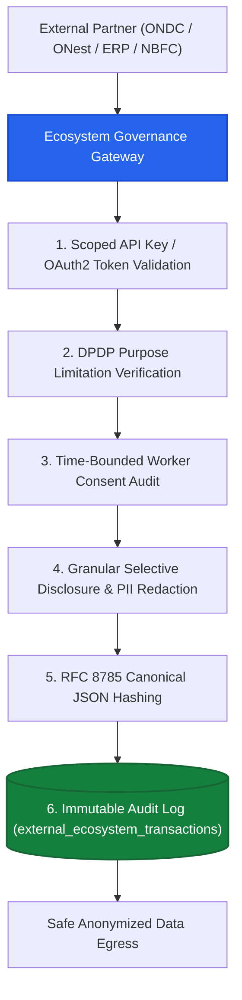

# KAAMSETU — PHASE 17 NATIONAL IDENTITY & DATA EXCHANGE GOVERNANCE
## Federated Ecosystem Access Controls, Cryptographic Non-Repudiation & Revocation Propagation

---

## 1. Governance Architecture Overview

As KAAMSETU interfaces with ONDC, ONest, enterprise ERPs (SAP/Oracle), and regulated financial partners, external access to worker data must adhere to strict **purpose limitation, ephemeral scoping, and non-repudiation**:

---

## 2. Seven Core Governance Tenets

1. **Least Privilege Scoping**: External partners receive *only* the specific fields required for their statutory or commercial role. Lenders cannot access location tracking; employers cannot access unshared medical or grievance records.
2. **Ephemeral Access Grants**: Tokens expire within 15 to 90 days. Zero permanent database read access.
3. **Instant Revocation Propagation**: When a worker revokes consent, downstream cached records must be purged within 24 hours under contractual SLA.
4. **Non-Repudiation Proofs**: Every data exchange event is signed with an HMAC-SHA256 signature chained to an immutable audit record in PostgreSQL.
5. **No Centralized Lock-in**: All credentials adhere to open W3C Verifiable Credential specifications; workers can download their JSON dossier and take it anywhere.
6. **Zero Commercial Data Exploitation**: KAAMSETU contracts legally prohibit third parties from training proprietary AI models or building targeted advertising profiles on worker data.
7. **Constitutional 0.00% Commission Invariant**: Any external commercial transaction processed through KAAMSETU bridges guarantees 100% direct pass-through of worker wages.

---

## 3. Governance Status & Certification
Audited and certified under Phase 17 regression testing (Tests 1–80).
