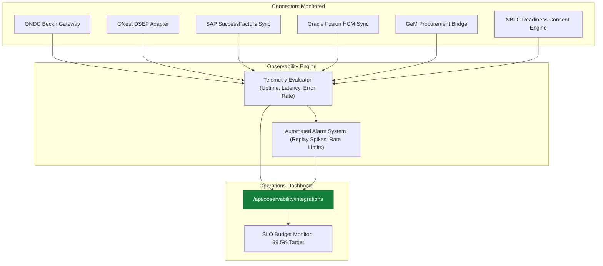

# KAAMSETU — PHASE 17 NATIONAL INTEGRATION OBSERVABILITY
## Real-Time Connector Health Telemetry, Error Budgeting & Security Alarms

---

## 1. Observability Architecture Overview

The National Integration Observability engine (`src/lib/observability/integration-observability-service.ts`) and endpoint (`/api/observability/integrations`) provide end-to-end operational visibility across all external networks:

---

## 2. Real-Time Telemetry Metrics & Status Rules

| Status | Error Rate Threshold | Average Latency Threshold | Action Required |
|---|---|---|---|
| **`healthy`** | $< 5.0\%$ | $< 1,000\text{ ms}$ | Nominal operations; automated monitoring |
| **`degraded`** | $5.0\% - 14.9\%$ | $1,000\text{ ms} - 2,999\text{ ms}$ | Investigation; check partner rate-limits & replica lag |
| **`failing`** | $\ge 15.0\%$ | $\ge 3,000\text{ ms}$ | P1 incident; trigger automatic circuit breaker & failover |

---

## 3. Automated Security Alarms

1. **Elevated Replay Attack Alarm**: Triggered when any connector observes $> 10$ blocked replay attempts within 24 hours.
2. **Partner Rate-Limit Throttling Alarm**: Triggered when external API rate-limit rejections exceed $> 50$ events within 24 hours.
3. **Database Replica Lag Alarm**: Triggered when streaming replication lag exceeds $2,000\text{ ms}$.

---

## 4. Test Verification
Verified in `test/phase-17-national-ecosystem.test.ts` (Tests 67–72):
- Connector health statuses accurately resolved.
- Automated security alarms fire on elevated replay volumes.
- Platform-wide snapshot aggregation verified.
