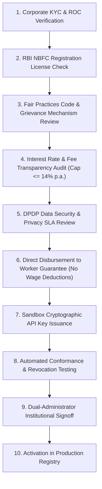

# KAAMSETU — PHASE 17 NBFC PARTNERSHIP & REGULATORY REVIEW
## RBI Compliance Framework, Partner Due Diligence & Digital Lending Guidelines

---

## 1. Regulatory Role & Status of KAAMSETU

Under the **Reserve Bank of India (RBI) Digital Lending Guidelines (2022)**:
- **Regulated Entities (REs)**: Commercial banks and Non-Banking Financial Companies (NBFCs) licensed by the RBI to lend money.
- **Lending Service Providers (LSPs)**: Agents of REs who carry out customer acquisition, underwriting, or collections.

### Crucial Distinction:
KAAMSETU is **NOT an LSP or Loan Originator**. KAAMSETU is a **worker-directed digital identity infrastructure**. The sharing of financial readiness data occurs exclusively at the unilateral instruction of the worker under the **Digital Personal Data Protection (DPDP) Act, 2023**, acting as a consent-backed data provider.

---

## 2. 10-Step Partner Due Diligence Workflow

Before any bank or NBFC is granted API access to receive consented worker profiles:

---

## 3. Mandatory Statutory Pledges
All partner financial institutions must execute a legally binding covenant:
1. **Zero Platform Commission**: The lender shall never offer or pay lead-referral fees, commissions, or kickbacks to KAAMSETU.
2. **No Wage Seizure**: The lender shall never seek to garnish, deduct, or withhold worker wages passing through KAAMSETU escrow accounts.
3. **Immediate Revocation Compliance**: Upon receipt of a worker's consent revocation event, the lender must cease processing and purge cached readiness data within 24 hours.

---

## 4. Audit & Verification
Verified in `test/phase-17-national-ecosystem.test.ts`:
- **Test 73:** Consent lifecycle auditing in `worker_financial_consents`.
- **Test 74 & 75:** Unilateral revocation terminates partner access immediately.
