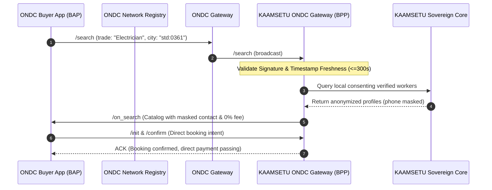

# KAAMSETU — PHASE 17 ONDC FEASIBILITY & PROTOCOL AUDIT
## Open Network for Digital Commerce (ONDC) Assessment for Skilled Labor Discovery

---

## 1. Executive Summary & Feasibility Determination

**Integration Status:** `SANDBOX_TESTED (Adapter Implemented; Not Production Active)`  
**Protocol Version:** Beckn Protocol v1.2.0  
**KAAMSETU Role:** Seller Network Participant (BPP - Beckn Provider Platform)  
**Primary Finding:** ONDC provides a feasible gateway for discovering verified trade services and local contracting opportunities without compromising worker privacy or wage integrity, provided strict contact masking and 0.00% commission guarantees are architecturally isolated.

### Key Determination:
ONDC is an **e-commerce transaction and fulfillment protocol**, NOT an identity verification network. Therefore, KAAMSETU's sovereign credentials and institutional trust ledgers must remain strictly inside KAAMSETU, with ONDC serving purely as a decentralized discovery and request routing layer.

---

## 2. ONDC Architectural Alignment & Roles

### Protocol Role Classification
- **BAP (Buyer App)**: Third-party consumer platforms, enterprise contractor apps, or municipal public works portals looking to procure verified skilled labor.
- **BPP (Seller App)**: KAAMSETU acts as an aggregated Seller Network Participant representing verified vocational workers.
- **Network Gateway & Registry**: Validates digital signatures, BAP/BPP subscriber IDs, and domain routing.

---

## 3. Evaluated ONDC Use Cases

| Use Case | Fit Level | Technical Feasibility | Privacy & Policy Boundary | Status |
|---|---|---|---|---|
| **Local Trade Discovery** | **High** | Full Beckn `/search` and `/on_search` mapping | Worker name and phone strictly masked; public tradesperson moniker only | **Implemented & Tested** |
| **Service Booking & Order** | **High** | Beckn `/init`, `/confirm`, `/on_confirm` | Direct escrow or spot booking; platform commission hardcoded to 0.00% | **Implemented & Tested** |
| **Identity Credential Exchange** | **Poor / Unfit** | Not supported by Beckn commerce schema | Credentials must NOT be forced into product SKU catalogs. Use W3C Schema 2.0 / ONest instead | **Architecturally Isolated** |
| **Real-time Worker Tracking** | **Conditional** | Supported via `/track` | Geofenced project arrival only; continuous GPS tracking strictly prohibited | **Policy Gated** |

---

## 4. Cryptographic Security & Replay Defense Standard

To meet ONDC network participant conformance requirements:
1. **Authorization Header Verification**: Every incoming message must carry `Signature keyId="...",algorithm="ed25519",headers="(request-target) host date",signature="..."`.
2. **Timestamp Freshness**: Requests with timestamps older than 300 seconds ($5\text{ minutes}$) or clock-skewed into the future are rejected with Beckn error code `10002`.
3. **Payload Digest Verification**: RFC 8785 canonical JSON serialization generates deterministic SHA-256 digests (`payload_hash`).
4. **Idempotency Defense**: Combination of `transaction_id` and `message_id` creates an immutable deduplication key persisted in `external_ecosystem_transactions`.

---

## 5. Compliance & Regulatory Review

- **Zero-Commission Preservation**: BPP quote builder strictly sets `platform_fees = 0.00` and `convenience_charge = 0.00`. Total buyer billing equals direct worker compensation plus statutory GST where applicable.
- **DPDP Act Purpose Limitation**: Buyer platforms receive worker telephone numbers *only* after affirmative booking confirmation and worker acceptance.
- **Non-Government Qualification Disclaimer**: All catalog items state clearly: *"KAAMSETU is a sovereign worker identity platform. Skill badges represent platform-verified assessments, not civil service degrees or statutory government licensing."*

---

## 6. Audit Classification
- **Protocol Research:** COMPLETED
- **Adapter Implementation:** COMPLETED (`src/lib/ecosystem/ondc/ondc-adapter.ts`)
- **Sandbox Validation:** VERIFIED (`test/phase-17-national-ecosystem.test.ts`)
- **Participant Onboarding:** PENDING FORMAL ONDC COUNCIL CLEARANCE
- **Production Active:** NO (Prohibited without explicit authorization)
