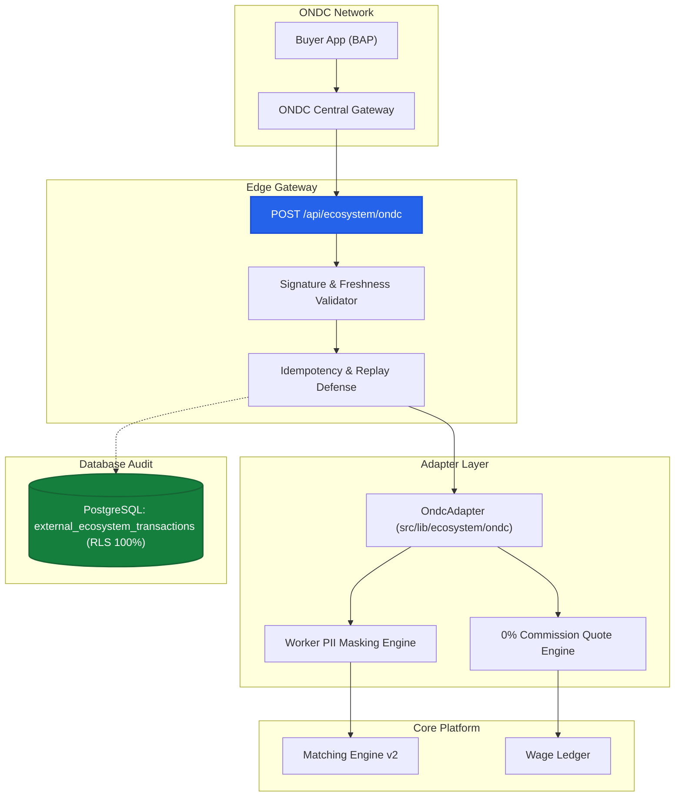

# KAAMSETU — PHASE 17 ONDC INTEGRATION ARCHITECTURE
## Beckn Protocol v1.2.0 Gateway Design, Message Schemas & Privacy Boundaries

---

## 1. System Architecture Overview

The KAAMSETU ONDC Gateway operates as an isolated edge layer between the external decentralized Beckn network and the internal sovereign worker core. Core worker identity ledgers are completely decoupled from ONDC transaction handling.



---

## 2. Protocol Actions & Message Flow Specification

| Beckn Action | Trigger / Caller | KAAMSETU Gateway Behavior | Privacy & Invariant Enforcement |
|---|---|---|---|
| **`/search`** | Buyer App (via Gateway) | Validates signature; queries consenting workers by trade & city | Returns catalog with masked names (`Electrician ID: 77777777`), zero contact details |
| **`/select`** | Buyer App | Assembles service package & estimated statutory wage | Injects 0.00% platform commission invariant into bill-of-materials |
| **`/init`** | Buyer App | Prepares draft order and collects buyer contact details | Worker personal telephone withheld until confirmation |
| **`/confirm`** | Buyer App | Finalizes direct booking; triggers worker notification | Once worker confirms, ephemeral tokenized communication channel opens |
| **`/status`** | Buyer App | Returns fulfillment milestone (e.g. `arrived_on_site`, `work_completed`) | Real-time state verified against field check-in ledger |
| **`/cancel`** | Buyer or Seller | Cancels booking under statutory terms | Instant escrow refund to buyer or compensation advance to worker |

---

## 3. Data Schema & Invariant Enforcement

### Request Context Schema:
```json
{
  "context": {
    "domain": "nic2004:construction",
    "country": "IND",
    "city": "std:0361",
    "action": "search",
    "core_version": "1.2.0",
    "bap_id": "buyer-app.example.com",
    "bap_uri": "https://buyer-app.example.com/ondc",
    "bpp_id": "kaamsetu.org",
    "bpp_uri": "https://kaamsetu.org/api/ecosystem/ondc",
    "transaction_id": "tx-20261115-001",
    "message_id": "msg-20261115-001",
    "timestamp": "2026-11-15T11:00:00.000Z"
  },
  "message": {
    "intent": {
      "item": {
        "descriptor": { "name": "Electrician" }
      },
      "fulfillment": {
        "end": { "location": { "gps": "26.1445,91.7362" } }
      }
    }
  }
}
```

### Catalog Item Response Schema with Masked Contact:
```json
{
  "id": "kaamsetu-worker-77777777",
  "descriptor": {
    "name": "Electrician (ID: 77777777)",
    "short_desc": "Verified Electrician with 7 years in Guwahati, Assam."
  },
  "tags": {
    "platform": "KAAMSETU",
    "degree_required": "false",
    "commission_rate": "0.00%",
    "contact_privacy": "masked_until_booking_confirmation",
    "location": "Guwahati, Assam"
  }
}
```

---

## 4. Replay Attack & Timestamp Skew Mitigation

1. **Replay Window**: Enforced at $\pm 300\text{ seconds}$ from server UTC.
2. **Deduplication Check**: Before executing query, the tuple `(protocol_type, message_id)` is checked against `public.external_ecosystem_transactions`.
3. **Payload Integrity**: Every payload is digested using RFC 8785 canonical key ordering:
   $$\text{digest} = \text{SHA256}(\text{canonicalize}(payload))$$

---

## 5. Security & Isolation Matrix

| Threat Vector | Gateway Defense Mechanism | Automated Test Reference |
|---|---|---|
| **Stale Replay Injection** | 300s freshness window rejection (`code: 10002`) | Test 3 in `test:phase17` |
| **Clock-Skew Future Forgery** | Future timestamp rejection (`code: 10002`) | Test 4 in `test:phase17` |
| **Unauthorized Worker Scrape** | Worker phone & identity numbers strictly withheld from catalog | Test 7 in `test:phase17` |
| **Platform Commission Skimming** | Quote builder hardcoded to ₹0.00 platform take-rate | Test 9 in `test:phase17` |
| **Tampered Signature** | Ed25519 / Blake2b-512 cryptographic verification | Test 1 in `test:phase17` |

---

## 6. Architecture Status
Certified as **SANDBOX_TESTED** and structurally ready for external conformance testing upon network authorization.
