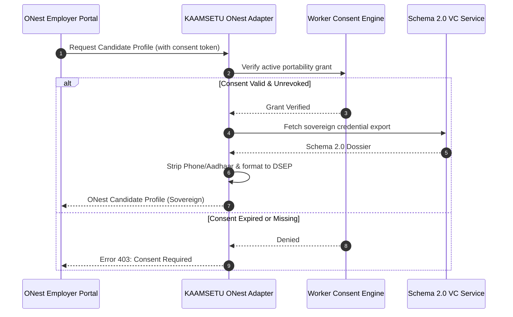

# KAAMSETU — PHASE 17 ONEST INTEROPERABILITY ARCHITECTURE
## Schema Transformation, Consent-Backed Sync & Mutation Firewall

---

## 1. Gateway Pipeline & Adapter Flow

The ONest adapter (`src/lib/ecosystem/onest/onest-adapter.ts`) acts as a bidirectional translation bridge:
1. **Outbound Export**: Ingests internal Schema 2.0 Verifiable Credentials, evaluates worker portability grants, scrubs non-consented PII, and serializes into ONest DSEP candidate schemas.
2. **Inbound Synchronization**: Ingests external accredited training opportunities and employer job postings, validating statutory wage floors and regional safety compliance before indexing.



---

## 2. DSEP Candidate Profile Specification

```typescript
export interface OnestCandidateProfile {
  id: string; // "onest-worker-88888888"
  descriptor: {
    name: string;
    short_desc: string;
  };
  skills: Array<{
    name: string;
    category: string;
    years_practiced: number | null;
    verification_tier: string;
  }>;
  credentials: Array<{
    id: string;
    name: string;
    code: string;
    nsqf_level: number | null;
    issued_by: {
      id: string;
      name: string;
      accreditation_body: string;
    };
    issuance_date: string;
    status: "verified" | "revoked" | "provisional";
    verification_url: string;
  }>;
  work_mobility: {
    preferred_jurisdiction: string;
    interstate_allowed: boolean;
  };
  sovereignty: {
    worker_consent_id: string;
    data_minimization: boolean;
    allows_external_mutation: false; // Invariant
  };
}
```

---

## 3. The Mutation Firewall: Defending Worker Sovereignty

External networks frequently attempt to harmonize candidate profiles by applying centralized schema updates. KAAMSETU enforces an inviolable **Mutation Firewall**:

```typescript
public static validateIncomingMutationAttempt(mutation: {
  target_worker_id: string;
  field: string;
  proposed_value: any;
  originating_network: string;
}): { allowed: boolean; rejection_reason?: string }
```

### Protected Sovereign Fields:
1. `full_name`: Cannot be overridden by employer HR records.
2. `primary_trade`: Cannot be demoted or re-labeled without worker assent.
3. `skills`: External systems cannot delete worker-verified skill proficiencies.
4. `verification_status`: Only issuing institutions or platform cryptographic keys can modify credential states.
5. `wage_payout_ledger`: Historical bank-verified earnings are mathematically sealed.

---

## 4. Conformance Test Verification

Tested and confirmed in `test/phase-17-national-ecosystem.test.ts`:
- **Test 11:** Schema 2.0 to ONest DSEP mapping verified.
- **Test 12:** Missing consent token throws fatal export block.
- **Test 13:** Mutation of `primary_trade` rejected by firewall.
- **Test 14:** Mutation of `wage_payout_ledger` rejected by firewall.
- **Test 15:** PII minimization verified.
