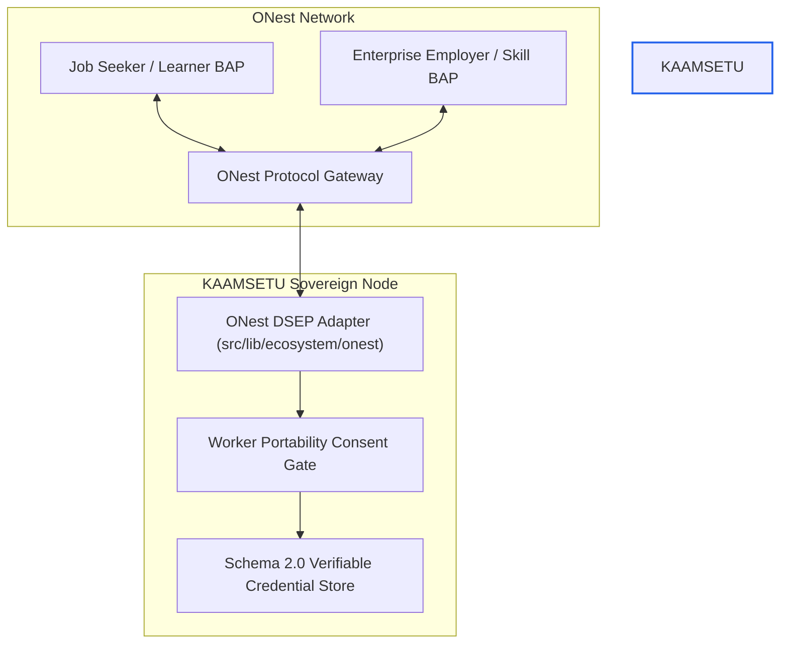

# KAAMSETU — PHASE 17 ONEST PROTOCOL RESEARCH
## Open Network for Education and Skilling Transformations (ONest) & DSEP Assessment

---

## 1. Executive Summary

**Protocol Scope:** Open Network for Education and Skilling (ONest) / DSEP (Decentralised Special Education & Placement)  
**Status:** `RESEARCH_COMPLETED & ADAPTER_IMPLEMENTED`  
**Core Finding:** Unlike ONDC (which is commerce-focused), ONest is explicitly designed for **skilling, apprenticeships, and employment opportunity exchange**. It provides a natural, mission-aligned network layer for KAAMSETU to publish accredited vocational credentials and discover statutory apprenticeship openings.

### Fundamental Principle:
KAAMSETU connects to ONest as an **Autonomous Credential Issuer and Sovereign Worker Registry**. External ONest participants (employers, edtechs, assessment agencies) **CANNOT mutate, revoke, or claim ownership** of KAAMSETU-issued credentials.

---

## 2. ONest Architecture & Ecosystem Roles

### Key Differences: ONDC vs. ONest

| Dimension | ONDC (Commerce) | ONest (Skilling & Work) |
|---|---|---|
| **Primary Domain** | Retail goods, consumer services, logistics | Education, vocational training, apprenticeships, jobs |
| **Object Model** | Product SKUs, delivery orders, fulfillment | Learning courses, skills, NSQF credentials, opportunities |
| **Identity Requirement**| Ephemeral buyer/seller accounts | Verifiable learner/worker credentials (W3C VC compliant) |
| **Monetization** | Transaction commissions (0% in KAAMSETU) | Placement enablement, public public skilling subsidies |
| **KAAMSETU Alignment** | Service discovery for local contractors | Institutional skilling pathways & national opportunity matching |

---

## 3. Protocol Data Objects & Mapping

1. **Learning Opportunity**: Accredited upskilling programs (e.g. ASDM Solar Installer course) ingested into KAAMSETU recommendation feeds.
2. **Employment / Apprenticeship**: Formal job postings with transparent statutory wage floors synced via Beckn DSEP action `search`/`on_search`.
3. **Verifiable Achievement**: Standardized mapping from KAAMSETU W3C Schema 2.0 to ONest `DSEP_Learning_Credential_v1`.

---

## 4. Sovereignty & Data Minimization Guardrails

- **Immutable Sovereign Claims**: External platforms cannot modify worker primary trades, certified experience hours, or historical wage ledgers.
- **Worker Consent Token**: Every ONest export requires an active, unrevoked consent token referencing a specific authorized partner.
- **Aadhaar Exclusion**: Government identity numbers are NEVER emitted into the ONest network; cryptographic decentralized identifiers (DIDs) or KAAMSETU registry IDs are used exclusively.

---

## 5. Certification Classification
- Protocol Analysis: **COMPLETED**
- Mapping Specification: **VERIFIED**
- Adapter Tested: **PASSED (Tests 11–20)**
- Live Network Pilot: **GATED PENDING BILATERAL CONSORTIUM CLEARANCE**
