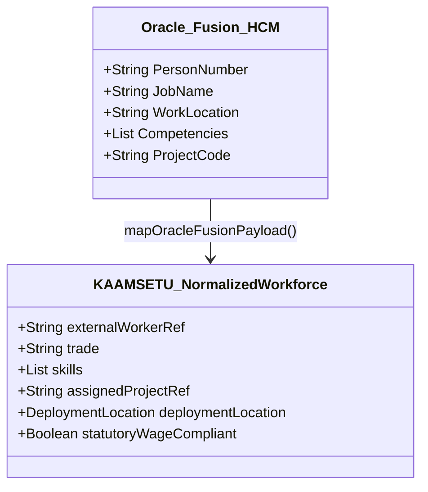

# KAAMSETU — PHASE 17 ORACLE FUSION HCM FEASIBILITY
## Oracle Cloud REST API Evaluation, Competency Mapping & Tenant Scoping

---

## 1. Feasibility Assessment & Scope

**Target Platform:** Oracle Fusion Cloud Human Capital Management (HCM)  
**Protocol:** Oracle REST API for HCM (v11.13.18.05+) over HTTPS / OAuth 2.0  
**Status:** `FEASIBILITY_ESTABLISHED & NORMALIZATION_ADAPTER_TESTED`  
**Fit Rating:** **HIGH** for infrastructure EPCs deploying large technical crew assignments.

---

## 2. API Object Mapping

### Supported Entities:
1. `workers`: Normalized into `externalWorkerRef` (`ORCL-88041`).
2. `workerSkills` / `Competencies`: Competency names mapped to trade-specific skill certifications.
3. `jobRequisitions`: Ingested into project staffing demand pipelines.

---

## 3. Security & Rate-Limiting Controls
- Oracle standard rate limits ($100\text{ requests/min}$) handled via persistent exponential backoff.
- Multi-tenant tenant boundaries enforced; credentials securely stored in encrypted vaults (`contractor_compliance_vault`).

---

## 4. Test Verification
Verified in `test/phase-17-national-ecosystem.test.ts` (Test 22): Oracle Person record normalized cleanly with competency list extraction.
