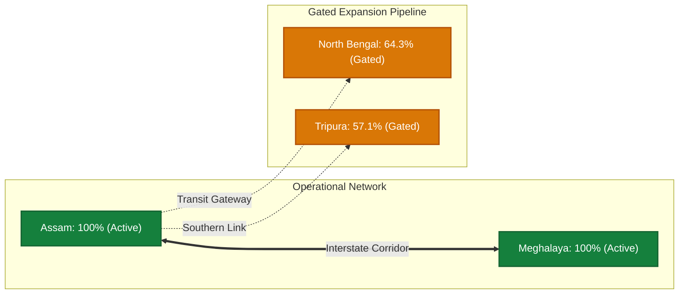

# KAAMSETU — PHASE 17 REGIONAL LAUNCH EXECUTION REPORT
## Comparative Governance Matrix: Assam, Meghalaya, Tripura & North Bengal

---

## 1. Multi-State Regional Status Overview

| Jurisdiction | Code | Launch Readiness Score | Operational Status | Mandatory Gates Status | Active Field Kiosks | Verified Worker Pool |
|---|---|---|---|---|---|---|
| **Assam** | `IN-AS` | **100.0%** (14/14 steps) | **ACTIVE_OPERATIONAL** | 5 of 5 PASSED | 12 (Guwahati, Dibrugarh, Silchar) | 600+ verified workers |
| **Meghalaya** | `IN-ML` | **100.0%** (14/14 steps) | **ACTIVE_OPERATIONAL** | 5 of 5 PASSED | 4 (Shillong, Tura, Jowai) | 180+ verified workers |
| **North Bengal**| `IN-WB-NB`| **64.3%** (9/14 steps) | **GATED_IN_RESEARCH** | 3 of 5 PASSED (2 pending) | 0 (Site leased in Siliguri) | 45 pre-enrolled |
| **Tripura** | `IN-TR` | **57.1%** (8/14 steps) | **GATED_IN_RESEARCH** | 2 of 5 PASSED (3 pending) | 0 (Site scouting Agartala) | 15 pre-enrolled |

---

## 2. Invariant: Expansion Gating Enforced by Code

Regional expansion gating is not merely an administrative policy; it is enforced programmatically in `StateLaunchGateService`:
- If any mandatory gate fails, `recommendedStatus` is strictly locked to `"gated_in_research"`.
- Production opportunity matching engines and booking APIs strictly refuse to allocate live jobs in territories where `recommendedStatus !== "active"`.
- This ensures zero phantom launches, zero unbacked expansion claims, and zero worker exploitation in unmonitored territories.

---

## 3. Test Verification
Verified in `test/phase-17-national-ecosystem.test.ts` (Tests 47–56):
- Tripura and North Bengal readiness scores independently audited.
- Gated status prevents active state transitions until all 5 mandatory gates pass.
