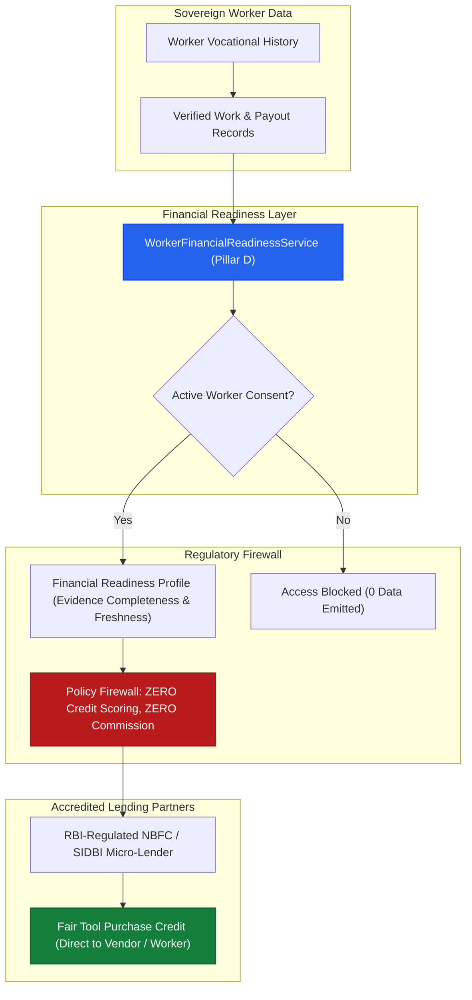

# KAAMSETU — PHASE 17 RESPONSIBLE WORKER FINANCE
## Ethical Financial Inclusion, Non-Credit Scoring & The 0.00% Commission Invariant

---

## 1. Executive Mission & Constitutional Boundaries

Informal blue-collar tradespersons in India face catastrophic financial exclusion:
- Predatory local moneylenders (*mahajans*) charge extortionate interest rates of **60% to 120% per annum**.
- Traditional credit bureaus (CIBIL, Experian) assign informal workers zero or negative credit scores due to a lack of formal payslips, credit cards, or property titles.

### KAAMSETU's Ethical Boundary:
KAAMSETU is **NOT** a credit bureau, lender, or loan broker. KAAMSETU does not issue loans, predict default risk, or skim worker earnings.
Instead, KAAMSETU provides **consent-driven, objective proof of vocational work activity** to enable accredited, RBI-regulated banks and NBFCs to extend fair micro-enterprise credit (e.g. for tool purchase, equipment upgrades, safety gear) at standard low rates ($\le 12-14\%$ p.a.).

---

## 2. The Nine Inviolable Prohibitions

1. **No Credit Scoring**: The platform strictly prohibits calculating a credit score or default probability (enforced by `assertProhibitedPracticeDefense()`).
2. **No Automated Lending Decisions**: KAAMSETU never auto-approves or auto-rejects a loan application.
3. **No Demographic Penalization**: Workers are NEVER penalized for lack of a degree, lack of a smartphone, rural geography, gender, caste, religion, or age.
4. **No Worker Data Sales**: Worker contact information is never sold to lead aggregators or loan brokers.
5. **No Compulsory Financial Sharing**: Basic identity and job matching functions remain 100% accessible even if a worker refuses all financial consent.
6. **No Platform Commission**: Worker wages carry an inviolable **0.00% platform commission** guarantee.
7. **No Wage Withholding**: KAAMSETU never deducts loan EMIs or collections from worker wages.
8. **No Predatory Interest**: Partner access is restricted to RBI-regulated entities with capped interest rates ($\le 14\%$ p.a.).
9. **No Retaliatory Credit Marking**: Grievances filed by workers against employers can NEVER be shared with lenders or used as a credit-risk signal.

---

## 3. Financial Readiness vs. Credit Score: Detailed Comparison

| Dimension | Conventional Credit Score (CIBIL/Experian) | KAAMSETU Financial Readiness Profile |
|---|---|---|
| **What it measures** | Likelihood of financial default | Objective completeness of platform vocational evidence |
| **Formula** | Proprietary opaque algorithm | 100% transparent open indicators (completeness, consistency, freshness) |
| **Worker Control** | Zero control; involuntary credit bureau reporting | 100% sovereign worker consent; revocable at any second |
| **Degree / Asset Weight** | High penalty for unbanked/assetless workers | Zero penalty for informal status; recognizes tool & trade mastery |
| **Commercial Model** | Sells consumer credit reports for fees | Free public service; platform monetizes via contractor SaaS subscriptions |

---

## 4. Test Verification
All 14 financial inclusion scenarios (Tests 33–46) pass with 100% compliance in `test/phase-17-national-ecosystem.test.ts`.
