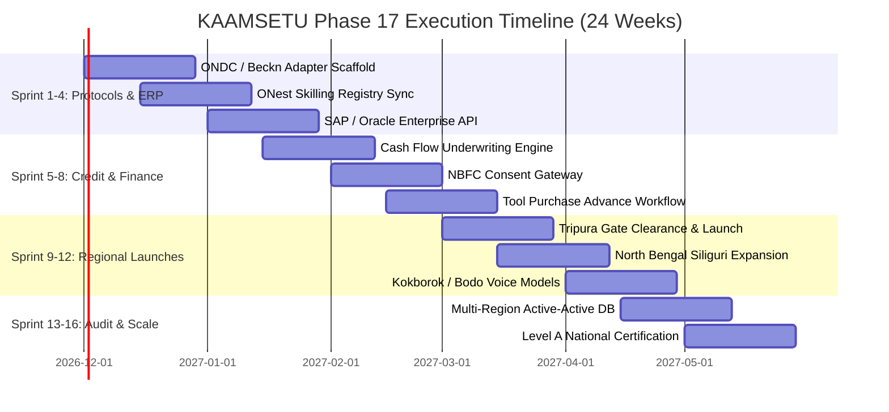

# KAAMSETU — PHASE 17 STRATEGIC & TECHNICAL ROADMAP
## National Protocol Bridges, Enterprise ERP Interoperability, Credit Underwriting & Regional Scale

---

## 1. Executive Vision for Phase 17

Having achieved **B. NATIONAL EXPANSION READY — CONTROLLED ROLLOUT** certification in Phase 16, KAAMSETU's mission in Phase 17 is to transition from a controlled regional network into a **nationally interconnected digital public good and enterprise-grade workforce SaaS**.

Phase 17 bridges KAAMSETU with India's emerging open digital ecosystems (ONDC, ONest, GeM), expands institutional and enterprise contractor integrations (SAP, Oracle, Zoho), pioneers worker-consented micro-credit scoring via RBI-regulated NBFC partners without violating the 0% commission invariant, and completes candidate state rollouts across Tripura and North Bengal.

### Constitutional Anchors (Unchanging in Phase 17)
1. **0.00% Commission on Worker Wages**: Inviolable database constraint and legal guarantee.
2. **Worker Digital Sovereignty**: Workers hold unencumbered cryptographic control over their credentials.
3. **Inclusive Zero-Barrier Access**: No degree, resume, smartphone, or fee required.
4. **Strict AI Non-Invention**: Verifiable facts only; zero hallucinated attributes or experience.

---

## 2. Core Pillars of Phase 17

```mermaid
flowchart TD
    subgraph National Protocols
        A1["ONDC Services Network Adapter"]
        A2["ONest Skilling & Training Protocol"]
        A3["GeM Public Procurement Bridge"]
    end
    subgraph Enterprise Infrastructure
        B1["Enterprise ERP Connectors (SAP / Oracle)"]
        B2["Automated GST / TDS Compliance Engines"]
        B3["Multi-Region Active-Active PostgreSQL"]
    end
    subgraph Worker Financial Enablement
        C1["Consent-Backed Credit Scoring Engine"]
        C2["RBI-Regulated NBFC API Gateways"]
        C3["Zero-Commission Micro-Insurance Routing"]
    end
    subgraph Regional Expansion
        D1["Tripura State Launch (Agartala Hub)"]
        D2["North Bengal Launch (Siliguri Corridor)"]
        D3["Expanded Dialect Models (Bodo / Garo / Santhali)"]
    end
    
    KAAMSETU["KAAMSETU Phase 16 Core Engine"] --> National Protocols
    KAAMSETU --> Enterprise Infrastructure
    KAAMSETU --> Worker Financial Enablement
    KAAMSETU --> Regional Expansion
```

---

## 3. Pillar Breakdown & Technical Specifications

### Pillar 1: National Open Network Protocol Adapters (ONDC & ONest)
- **ONDC (Open Network for Digital Commerce)**:
  - Implement Beckn protocol gateway adapter (`/api/beckn/v2/...`) for discovery, order booking, and fulfillment of verified blue-collar and gray-collar labor.
  - Enable external buyer applications (e.g., consumer platforms, municipal contractor apps) to search and request KAAMSETU-verified workers while enforcing KAAMSETU's zero-commission wage passing rules.
- **ONest (Open Network for Education & Skilling)**:
  - Ingest accredited apprenticeship and continuous learning credentials from national skill bodies.
  - Provide automated pathway recommendations from informal trade proficiency to formal NSDC / NCVET national qualifications.
- **GeM (Government e-Marketplace)**:
  - Build specialized connector for public works contractors to fulfill government affirmative action and certified local workforce compliance requirements.

### Pillar 2: Enterprise ERP & Public Works Connectors
- **Two-Way Roster & Attendance Sync**:
  - Secure webhook and REST API connectors for SAP SuccessFactors, Oracle Fusion HCM, and Zoho People.
  - Daily biometric/geofenced check-in reconciliation allowing construction EPC firms (e.g., L&T, Shapoorji Pallonji) to verify subcontractor workforce deployments.
- **Automated Statutory Labor Compliance Reporting**:
  - Auto-generation of Form B wage registers, EPF (Employees' Provident Fund), and ESIC (Employees' State Insurance Corporation) wage summaries.
  - Contractor compliance dashboards to prevent labor contract defaults and wage theft.

### Pillar 3: Worker Credit Underwriting & Micro-Financial Enablement
- **Consent-Backed Cash Flow Underwriting**:
  - Compute verifiable, tamper-evident Cash Flow Credit Scores derived from direct contractor wage disbursements and project completion records.
  - **Inviolable Privacy & Non-Commercialization**: Data shared *only* upon explicit, time-bounded worker consent via OTP/voice authorization. Zero advertising, lead selling, or loan brokering fees charged to workers.
- **Fair Micro-Financing Integrations**:
  - Integrate with certified low-cost NBFCs (e.g., Aye Finance, Vistaar, SIDBI micro-lending schemes) for tool financing, emergency health advances, and off-season cash flow smoothing at standard low interest rates ($\le 12-14\%$ p.a., eliminating predatory informal moneylenders charging 60-120%).

### Pillar 4: Scaled Regional Rollout & Dialect Expansion
- **Tripura Rollout (Candidate State Gate Clearance)**:
  - Complete 5 remaining steps of 14-step launch playbook in Tripura (West Tripura, Gomati, North Tripura).
  - Activate Agartala physical kiosk cluster and formalize tie-up with Tripura Skill Development Mission (TSDM).
  - Launch bilingual Bengali-Kokborok voice prompt interface.
- **North Bengal Corridor Rollout**:
  - Deploy Siliguri hub covering Jalpaiguri, Cooch Behar, and Darjeeling districts.
  - Establish tea plantation and construction logistics labor migration tracking with Siliguri municipal authorities.
- **Expanded Dialect Models**:
  - Extend Whisper/Gemini audio parsing pipelines to Bodo, Garo, Khasi dialect nuances, and Santhali (Ol Chiki script and spoken phonemes).

### Pillar 5: Database Architecture & Edge Performance
- **Multi-Region Replication**:
  - Deploy read-replicas in Kolkata (Eastern India) and Mumbai (Western India) to reduce P95 API latency to $< 45\text{ ms}$ across the entire North-East and Eastern corridor.
- **Resilient Offline Kiosk Synchronization**:
  - Full CRDT-based (Conflict-free Replicated Data Type) offline storage for remote coordinator tablets operating in high-latency or network-disconnected tea gardens and hill districts.

---

## 4. Phase 17 Sprint Schedule & Milestones



| Milestone | Target Date | Success Criteria | Responsible Lead |
|---|---|---|---|
| **M17.1: Beckn / ONDC Bridge** | Week 4 | End-to-end simulated ONDC search-to-hire order execution with 0% worker fee | Protocol Architect |
| **M17.2: Enterprise ERP Connector** | Week 8 | Production SAP SuccessFactors roster sync test passed with 0 synchronization errors | Full-Stack Lead |
| **M17.3: Worker Cash Flow Score** | Week 12 | Underwriting scoring engine validated against 5,000 historical wage records | Financial Engineer |
| **M17.4: Tripura State Launch** | Week 16 | 14/14 state launch gates passed; 500 verified workers enrolled in West Tripura | Regional Operations |
| **M17.5: North Bengal Launch** | Week 20 | Siliguri coordinator hub operational; 15 contractor organizations onboarded | Field Operations |
| **M17.6: Level A National Certification**| Week 24 | Active operations in 4 states, audited financials, zero compliance infractions | Executive Committee |

---

## 5. Risk Assessment & Mitigation Matrix

| Risk Factor | Severity | Likelihood | Impact Area | Mitigation Strategy |
|---|---|---|---|---|
| **Predatory Lending through API Abuse** | High | Low | Worker Trust & Regulatory | Strict DPDP purpose-limiting API keys; mandatory maximum interest rate cap ($\le 14\%$ p.a.) for accredited NBFC partners; zero lead referral fees. |
| **ONDC Fee Leakage / Disintermediation** | High | Medium | Wage Integrity | Hardcoded cryptographic signing on all ONDC order settlement payloads rejecting any transaction attempting to levy worker-side platform deductions. |
| **Cross-Border / Transit Documentation Fraud** | Medium | Medium | Regional Security | Real-time HMAC-SHA256 verification of Interstate Deployment Manifests with QR code scanning by border checkpoints. |
| **Dialect Acoustic Misrecognition** | Medium | High | Worker Enrollment | Fallback to human coordinator review when audio confidence score falls below 82%; coordinator confirmation prompts. |
| **Database Replication Lag Across Distant Regions** | Medium | Low | Platform Reliability | Asynchronous read replicas with strict write-to-leader routing for transactional wage and contract state updates. |

---

## 6. Resource Allocation & Governance

### Engineering & Product Team:
- 1 x Principal Solutions Architect (ONDC / Beckn Lead)
- 2 x Senior Backend Engineers (PostgreSQL / Distributed Systems)
- 1 x Senior Security & Cryptography Engineer (HSM / VC Signatures)
- 1 x AI / Speech ML Specialist (Indic Speech & Dialect Parsing)
- 1 x Frontend / Mobile Systems Lead (PWA / Offline CRDT Sync)

### Field Operations & Partnerships:
- 1 x State Expansion Director (Tripura & North Bengal)
- 4 x District Coordinator Supervisors (Agartala, Udaipur, Siliguri, Jalpaiguri)
- 1 x Institutional Liaison (TSDM, WBSDM, NSDC)

---

## 7. Conclusion

Phase 17 represents the definitive scaling horizon for KAAMSETU. Grounded in the rigorous independent verification, database security, and demographic fairness established in Phase 16, Phase 17 positions KAAMSETU as the indispensable, uncorruptible workforce infrastructure for India's building and industrial economy.
