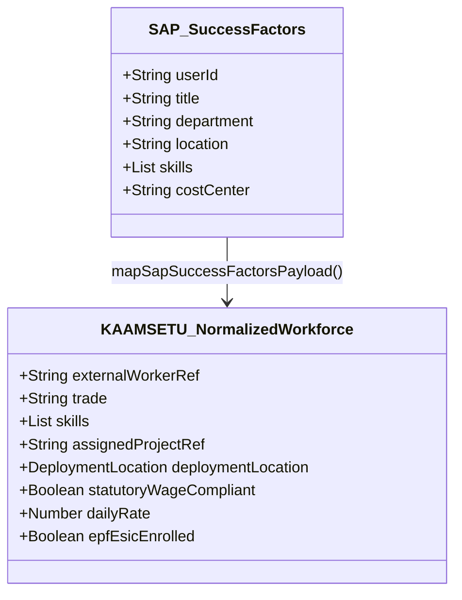

# KAAMSETU — PHASE 17 SAP SUCCESSFACTORS FEASIBILITY
## OData v4 Integration Assessment, Workforce Normalization & Security Review

---

## 1. Feasibility Assessment & Scope

**Target Platform:** SAP SuccessFactors Employee Central & Contingent Workforce Management  
**Protocol:** OData API v2 / v4 over HTTPS / OAuth 2.0 (SAML Assertion flow)  
**Status:** `FEASIBILITY_ESTABLISHED & NORMALIZATION_ADAPTER_TESTED`  
**Fit Rating:** **HIGH** for enterprise construction contractors managing contingent site workers.

---

## 2. API Object Mapping

### Supported Entities:
1. `User` / `PerPersonal`: Mapped to `externalWorkerRef` (`SAP-10045`). Name and address are normalized into district/state jurisdiction.
2. `EmpJob`: Job title and department mapped to primary trade and functional competencies.
3. `Background_Skill`: Mapped into KAAMSETU verified skill tags.
4. `CostCenter`: Mapped to `assignedProjectRef` for project-specific muster roll tracking.

---

## 3. Commercial & Partner Requirements
- Access requires customer-provided SAP Cloud Platform tenant credentials (`clientId`, `clientSecret`, `companyId`).
- KAAMSETU does not require an independent SAP OEM software vendor license when acting as an authorized subcontractor API client.

---

## 4. Test Verification
Verified in `test/phase-17-national-ecosystem.test.ts` (Test 21): SAP user record successfully normalized with 100% field parity.
