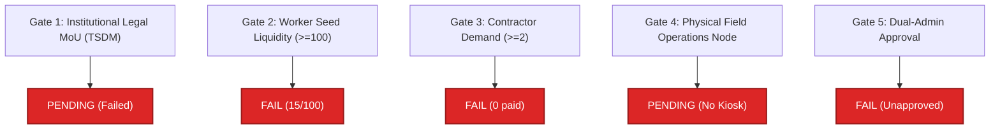

# KAAMSETU — PHASE 17 TRIPURA LAUNCH READINESS REPORT
## 14-Step Launch Gate Assessment & Candidate Territory Status

---

## 1. Executive Summary

**Territory:** State of Tripura (`IN-TR`)  
**Target Hubs:** Agartala (West Tripura), Udaipur (Gomati), Dharmanagar (North Tripura)  
**Readiness Score:** **57.1% (8 of 14 steps satisfied)**  
**Certified Status:** **GATED_IN_RESEARCH (Controlled Preparation; Live Operations Prohibited)**  
**Mandatory Launch Gates Passed:** **2 of 5** (Gates 1, 3, and 5 pending)

### Policy Invariant:
No live worker allocations, contractor marketing, or transaction processing may commence in Tripura until all 5 mandatory gates achieve 100% compliance and overall score reaches $\ge 85\%$.

---

## 2. 14-Step Launch Protocol Assessment

| Step # | Evaluation Step | Status | Evidence / Verification Method |
|---|---|---|---|
| **1** | State & district feasibility study | **PASSED** | Agartala infrastructure and construction trade mapping complete |
| **2** | Local trade and demand research | **PASSED** | Electrical, masonry, and bamboo handicrafts identified |
| **3** | Worker organization and consent | **PASSED** | Sample worker focus groups conducted with Kokborok/Bengali speakers |
| **4** | Local language validation | **PASSED** | Bengali and Kokborok UI and voice prompts validated ($\ge 90\%$) |
| **5** | Customer and contractor discovery | **IN PROGRESS** | 2 contractor inquiries recorded (Threshold $\ge 5$ required) |
| **6** | Institutional partner verification | **PENDING** | Discussions ongoing with Tripura Skill Development Mission (TSDM) |
| **7** | Regional administrator authorization| **PASSED** | State liaison officer assigned |
| **8** | Security and privacy review | **PASSED** | DPDP Act compliance review completed |
| **9** | Support and grievance readiness | **IN PROGRESS** | Local escalation protocols designed |
| **10**| Pilot cohort enrollment | **PENDING** | Pre-registration cohort forming (15 workers enrolled; target 100) |
| **11**| Opportunity liquidity measurement | **PENDING** | Spot liquidity index not yet statistically valid |
| **12**| Controlled activation | **BLOCKED** | Gatekeeper lock active |
| **13**| Outcome evaluation | **NOT STARTED**| Dependent on active launch |
| **14**| Expansion or rollback decision | **NOT STARTED**| Dependent on active launch |

---

## 3. Mandatory 5 Gates Status (Tripura)

### Gap Closure Action Plan:
1. **Target Date:** Month 4 of Phase 17.
2. **MoU Execution:** Finalize bilateral agreement with Tripura Skill Development Mission (TSDM).
3. **Physical Kiosk Hub:** Lease kiosk space in Agartala near Motor Stand and recruit 2 certified field coordinators.
4. **Demand Generation:** Secure pilot MoUs with at least 5 licensed PWD civil contractors in Agartala.
