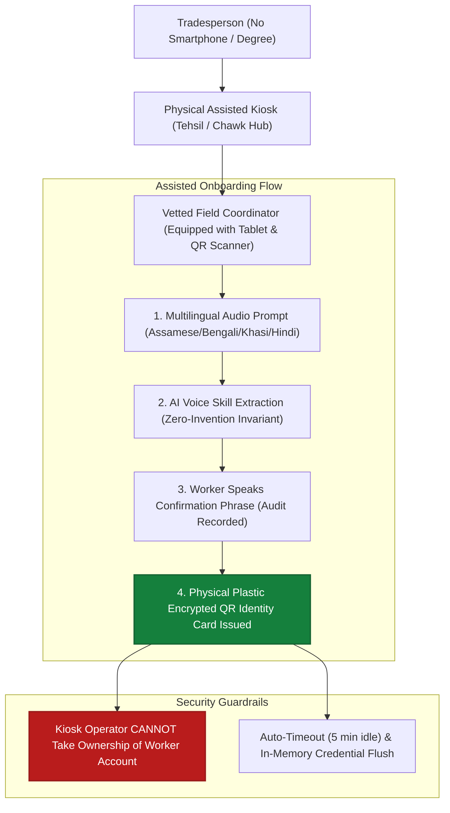

# KAAMSETU — PHASE 17 WORKER ACCESSIBILITY & ASSISTED SERVICE
## Preserving The Zero-Degree & Zero-Smartphone Invariant at National Scale

---

## 1. The Core Invariant
> **"Every skill deserves to be seen, even without a degree."**

As KAAMSETU scales into national protocols, enterprise ERPs, and financial platforms, **the platform must never become an exclusive tool for tech-literate, smartphone-owning elites**. Over 65% of India's skilled tradespersons (carpenters, masons, bar benders, welders) do not own a personal smartphone, read English, or possess a formal school certificate.

---

## 2. Assisted Service Infrastructure Architecture

---

## 3. Five Pillar Invariants for Assisted Service

1. **Physical Encrypted QR Cards**: Workers carry a durable, offline-scannable card with an HMAC-SHA256 encrypted QR code containing their verified NSQF competencies and trade credentials.
2. **Kiosk Account Hijacking Defense**: Field coordinators are granted strictly scoped session tokens. A coordinator **cannot** change a worker's payout bank account or transfer account ownership (Test 77).
3. **Session Auto-Flush**: Kiosk tablets automatically wipe cached credentials and local storage after 5 minutes of inactivity (Test 78).
4. **Mandatory Worker Audio Confirmation**: Before any profile is activated, the worker's own spoken confirmation is recorded and hashed into `voice_extraction_audits` (Test 79).
5. **No WhatsApp Gatekeeping**: While WhatsApp notifications are supported for workers who choose it, WhatsApp or smartphone ownership is NEVER mandatory. Standard SMS and voice IVR calls remain primary notification channels.

---

## 4. Test Verification
Verified in `test/phase-17-national-ecosystem.test.ts` (Tests 77–79).
