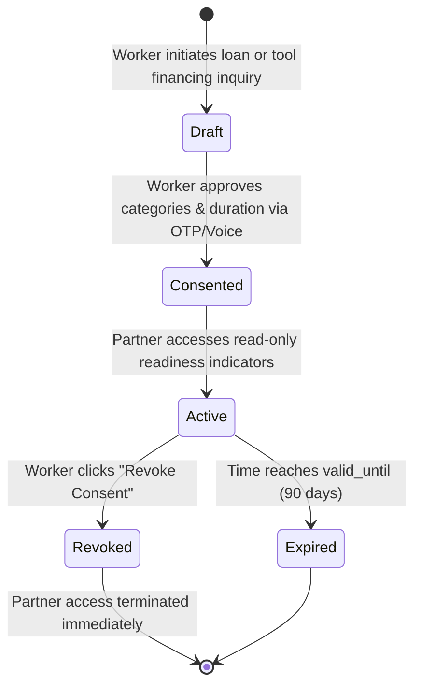

# KAAMSETU — PHASE 17 WORKER FINANCIAL CONSENT STANDARD
## Time-Bounded, Category-Specific, Sovereign Consent Lifecycle

---

## 1. Principles of Sovereign Worker Consent

Consent on KAAMSETU is grounded in Section 6 of the **Digital Personal Data Protection (DPDP) Act, 2023**:
1. **Free, Specific, Informed, Unconditional & Unambiguous**: Bundled or take-it-or-leave-it consent is strictly prohibited.
2. **Category Specificity**: Workers select exactly which data categories are shared (e.g. completed job count, but NOT historical daily rates).
3. **Time-Bounded**: Every consent grant has an explicit expiration timestamp (maximum 90 days).
4. **Instantly Revocable**: Workers can revoke consent at any time via a single tap, IVR voice prompt, or kiosk coordinator request, without penalty.

---

## 2. Database Schema: `worker_financial_consents`

Created in Migration 18:
```sql
CREATE TABLE public.worker_financial_consents (
    id UUID PRIMARY KEY DEFAULT gen_random_uuid(),
    worker_id UUID NOT NULL REFERENCES public.profiles(id) ON DELETE CASCADE,
    partner_id UUID NOT NULL REFERENCES public.profiles(id),
    partner_name TEXT NOT NULL,
    partner_type TEXT NOT NULL CHECK (partner_type IN ('rbi_regulated_nbfc', 'scheduled_commercial_bank', 'sidbi_micro_lender')),
    consented_categories TEXT[] NOT NULL DEFAULT '{}',
    purpose TEXT NOT NULL DEFAULT 'micro_enterprise_tool_financing',
    data_freshness_days INTEGER NOT NULL DEFAULT 90,
    valid_until TIMESTAMPTZ NOT NULL,
    is_revoked BOOLEAN NOT NULL DEFAULT false,
    revoked_at TIMESTAMPTZ,
    revocation_reason TEXT,
    created_at TIMESTAMPTZ NOT NULL DEFAULT timezone('utc'::text, now()),
    updated_at TIMESTAMPTZ NOT NULL DEFAULT timezone('utc'::text, now())
);
```

### Row-Level Security Rules:
- **Worker Policy**: Worker can read, create, and revoke only their own consent records (`worker_id = auth.uid()`).
- **Partner Policy**: Accredited partners can read consented records ONLY when `is_revoked = false` and `valid_until > now()`.

---

## 3. Consent Lifecycle State Machine



---

## 4. Test Verification
Verified in `test/phase-17-national-ecosystem.test.ts` (Tests 34, 73, 74, 75):
- Access fails closed when unconsented.
- Revocation immediately blocks subsequent partner reads.
