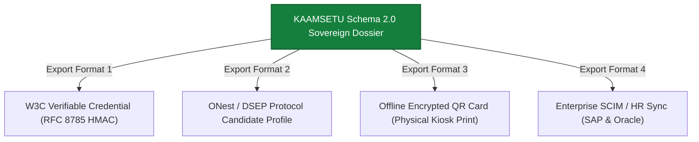

# KAAMSETU — PHASE 17 WORKER IDENTITY INTEROPERABILITY
## Sovereign Identity Standards, Cross-Network Credentials & Portability Governance

---

## 1. Principles of Sovereign Identity Interoperability

In conventional platforms, a worker's reputation, ratings, and certifications are proprietary assets locked inside a corporate database. If the worker leaves the platform, their entire verified work history is extinguished.

**KAAMSETU inverts this model:**
1. **Worker-Owned Credentials**: Every credential issued on KAAMSETU is a W3C-aligned Verifiable Credential cryptographically signed by the issuing entity (State Skill Mission, ITI, or verified master craftsman).
2. **Standardized Portability**: Workers can export their complete verified dossier across **Schema 1.0 (JSON)**, **Schema 2.0 (W3C JCS)**, and **ONest DSEP**.
3. **Decentralized Revocation Transparency**: Third parties can independently verify whether a credential is valid without needing an active API integration, via offline verification keys or public revocation registries.

---

## 2. Cross-Standard Compatibility Matrix

| Standard / Target | Schema Version | Cryptographic Proof | Privacy Guardrail | Status |
|---|---|---|---|---|
| **KAAMSETU Core** | Schema 2.0 | RFC 8785 Canonical JSON + HMAC-SHA256 | Strict selective disclosure; zero unconsented PII | **Production Native** |
| **Legacy Dossiers** | Schema 1.0 | Standard JSON digest | Upgrades seamlessly to Schema 2.0 on access | **Backward Compatible** |
| **ONest / DSEP** | DSEP v1.0 | SHA-256 opportunity & candidate digests | Phone/Aadhaar stripped; mutation firewall active | **Implemented & Tested** |
| **DigiLocker / NCrF** | National Credit Framework | SHA-256 hash chaining | Reference mapping; zero mandatory DigiLocker requirement | **Standards Aligned** |
| **Enterprise HRMS** | SAP/Oracle OData & REST | Tokenized External Worker Reference | Worker UUID decoupled from enterprise employee ID | **Implemented & Tested** |

---

## 3. Worker Consent & Granular Disclosure Controls

Workers control disclosure across three orthogonal axes:
- **Phone Disclosure**: Default `false`. Only revealed upon mutual job acceptance.
- **Earnings Disclosure**: Default `false`. Verified payouts are never displayed in public directories.
- **Identity Masking**: When enabled, the worker's public name is rendered as a trade moniker (`Master Carpenter ID: 88041`).

---

## 4. Key Takeaways
Interoperability must never mean surrendering worker control. KAAMSETU provides standard-compliant bridges to national ecosystems while maintaining an impenetrable defensive barrier against corporate data enclosure.
