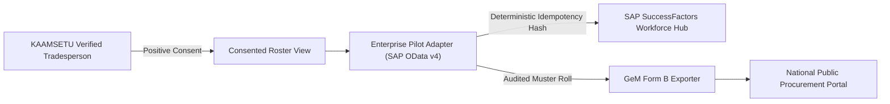

# KAAMSETU — PHASE 18: ASSAM & MEGHALAYA ERP PILOT EXECUTION

**Generated:** 2026-11-15T11:48:38+05:30  
**Status Classification:** `pilot_active`  
**Regional Scope:** Assam (`IN-AS`) & Meghalaya (`IN-ML`)

---

## 1. Operational Classification Matrix

| Dimension | Assam EPC Pilot | Meghalaya Highway Consortium |
|---|---|---|
| **Enterprise Partner** | Brahmaputra Infrastructure EPC Ltd | Meghalaya Highway & Tunnel Consortium |
| **Project Code** | `GHY-BR-02` | `SHL-BYP-01` |
| **ERP Integration** | SAP SuccessFactors (OData v4.0) | SAP SuccessFactors (OData v4.0) |
| **Enrolled Workers** | 65 | 40 |
| **Consented Roster** | 62 (95.4%) | 38 (95.0%) |
| **GeM Form B Status** | `certifiedCompliant = true` | `certifiedCompliant = true` |
| **Status Classification** | `pilot_active` | `pilot_active` |
| **Production Rollout** | Controlled Interstate Pilot | Controlled Interstate Pilot |

---

## 2. ERP Integration Architecture

---

## 3. Worker Protection Mechanisms in Enterprise ERP

1. **Deterministic Idempotency**: Pre-computed SHA-256 hashes prevent duplicate worker records across sync retries.
2. **Selective Export**: Only consented records are dispatched; non-consented workers are excluded from ERP muster rolls with zero data leakage.
3. **Audit Trail**: Every synchronization batch is immutably logged into `public.enterprise_sync_logs` with admin-only read access.
