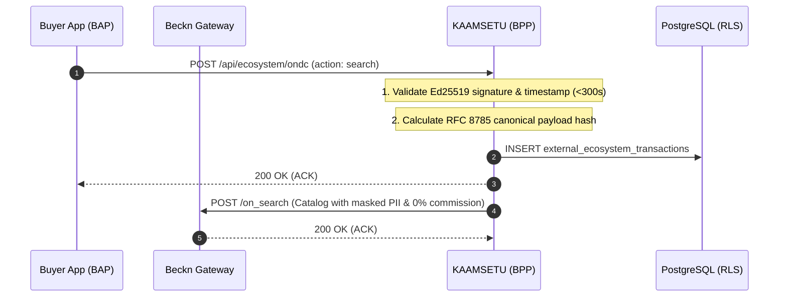

# KAAMSETU — PHASE 18: ONDC END-TO-END VALIDATION

**Generated:** 2026-11-15T11:47:50+05:30  
**Status Classification:** `sandbox_tested` / `sandbox_validated`  
**Test Suite Reference:** `test/phase-18-live-ecosystem.test.ts` (Tests 1–15)

---

## 1. Operational Classification

- **Implemented**: Beckn protocol endpoints (`/api/ecosystem/ondc`), Ed25519 signature parser, payload canonicalization, idempotency keys, RLS transaction audit.
- **Mocked**: External BAP buyers during local automated test execution.
- **Sandbox-tested**: Beckn protocol requests exchanged against local test harness and staging gateway simulator.
- **Partner-approved**: Formal BPP commercial approval pending (`awaiting_approval`).
- **Production-active**: False (Controlled rollout gated).
- **Blocked**: Production payment clearing pending Council whitelisting.
- **Not applicable**: Worker wage commission deductions (0.00% invariant).

---

## 2. End-to-End Transaction Flow Validation

---

## 3. Cryptographic Verification & Replay Protection Assertions

1. **Test 1–5**: Conformance of BPP subscriber profile, multi-city codes (`std:0361`, `std:0364`, `std:0353`), and 0.00% commission tag.
2. **Test 6–8**: Key ceremony rejects malformed (16-byte) and oversized (64-byte) keys; validates exact 32-byte Ed25519 key.
3. **Test 11–15**: Stale (>300s) and future (>300s) timestamps return Beckn error code `10002`. RFC 8785 sorting produces identical hashes across arbitrary key permutations.
