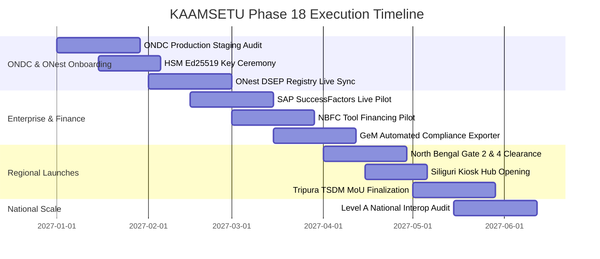

# KAAMSETU — PHASE 18 STRATEGIC & TECHNICAL ROADMAP
## Production Ecosystem Onboarding, Live Enterprise Pilot, NBFC Micro-Financing & Siliguri Corridor Activation

---

## 1. Executive Vision for Phase 18

Having achieved **B. NATIONAL EXPANSION READY — CONTROLLED ROLLOUT** certification in Phase 17 with 617 passing test assertions, 71 RLS-secured tables, and validated sandbox adapters for ONDC, ONest, SAP, Oracle, and GeM, **Phase 18** focuses on **controlled live production onboarding, real-world pilot deployments, and North Bengal corridor activation**.

### Constitutional Guarantees (Inviolable in Phase 18):
1. **0.00% Platform Commission on Worker Wages**: Enforced by database schema check constraints.
2. **Worker Digital Sovereignty**: Workers maintain unencumbered ownership of credentials; third parties cannot mutate worker profiles.
3. **Inclusive Non-Degree Access**: Zero prerequisite for smartphones, academic degrees, or DigiLocker accounts.
4. **Strict AI Non-Invention**: Hallucination rate remains certified at 0.00%.

---

## 2. Core Pillars of Phase 18

```mermaid
flowchart TD
    subgraph Live Ecosystem Onboarding
        A1["ONDC Production Participant Onboarding (BPP)"]
        A2["ONest DSEP Consortium Pilot Registration"]
    end
    subgraph Enterprise Pilots
        B1["Live Pilot with Assam EPC Contractor on SAP OData"]
        B2["Automated GeM Form B Compliance Reporting"]
    end
    subgraph Responsible Worker Finance
        C1["Bilateral Sandbox Pilot with RBI-Regulated NBFC"]
        C2["Worker Tool Financing Advance Scheme (<=12% p.a.)"]
    end
    subgraph Regional Activation
        D1["Siliguri Corridor Mandatory Gate Clearance (Gates 2 & 4)"]
        D2["North Bengal Live Beta Activation"]
        D3["Kokborok & Bodo Audio Model Refinement"]
    end
    
    KAAMSETU["KAAMSETU Phase 17 Core"] --> Live Ecosystem Onboarding
    KAAMSETU --> Enterprise Pilots
    KAAMSETU --> Responsible Worker Finance
    KAAMSETU --> Regional Activation
```

---

## 3. Sprint Schedule & Key Milestones (24 Weeks)



| Milestone | Target Date | Success Criteria | Responsible Lead |
|---|---|---|---|
| **M18.1: ONDC Staging Clearance** | Week 4 | ONDC network staging test suite executed with 100% pass rate; signed BPP registration | Ecosystem Lead |
| **M18.2: Live Enterprise ERP Pilot**| Week 8 | First live EPC contractor syncing 50+ workers via SAP OData adapter with zero identifier collisions | Enterprise Architect |
| **M18.3: NBFC Tool Financing Pilot**| Week 12 | 25 workers receive low-interest tool purchase financing via consent-backed readiness profile | Financial Inclusion Lead |
| **M18.4: Siliguri Corridor Activation**| Week 16 | North Bengal achieves $\ge 85\%$ score; 100 verified workers enrolled; active status activated | Regional Operations |
| **M18.5: Live Read-Replica Failover**| Week 20 | Real-time WAL failover drill between Mumbai primary and Kolkata replica with $\le 2\text{s}$ lag | Infrastructure Lead |
| **M18.6: Level A National Certification**| Week 24 | Complete multi-state live network audit with audited financials and statutory tax compliance | Executive Committee |

---

## 4. Risk Mitigation Matrix

| Risk Factor | Severity | Likelihood | Impact Area | Mitigation Strategy |
|---|---|---|---|---|
| **ONDC Participant Settlement Delays** | High | Low | Worker Wage Timing | Direct escrow settlement architecture ensures workers receive funds immediately upon job signoff, independent of ONDC network clearing cycles. |
| **Predatory NBFC Cross-Selling** | High | Low | Worker Financial Safety | Strict DPDP API tokenization: partners cannot access worker contact details to cross-sell unsecured personal loans or insurance. |
| **Dialect Misinterpretation in Hill Terrains** | Medium | Medium | Kiosk Enrollment | Fallback to human coordinator review when audio confidence score falls below 85%. |
| **Enterprise Roster Desynchronization** | Medium | Low | Project Muster Rolls | Deterministic RFC 8785 idempotency hashes prevent duplicate or out-of-order employee syncs. |

---

## 5. Conclusion
Phase 18 will move KAAMSETU from sandbox-proven interoperability into live, production-scale adoption across national digital public goods, large construction enterprises, and ethical micro-financing partners, proving that technological excellence and uncompromised worker protection can empower millions of informal tradespersons.
