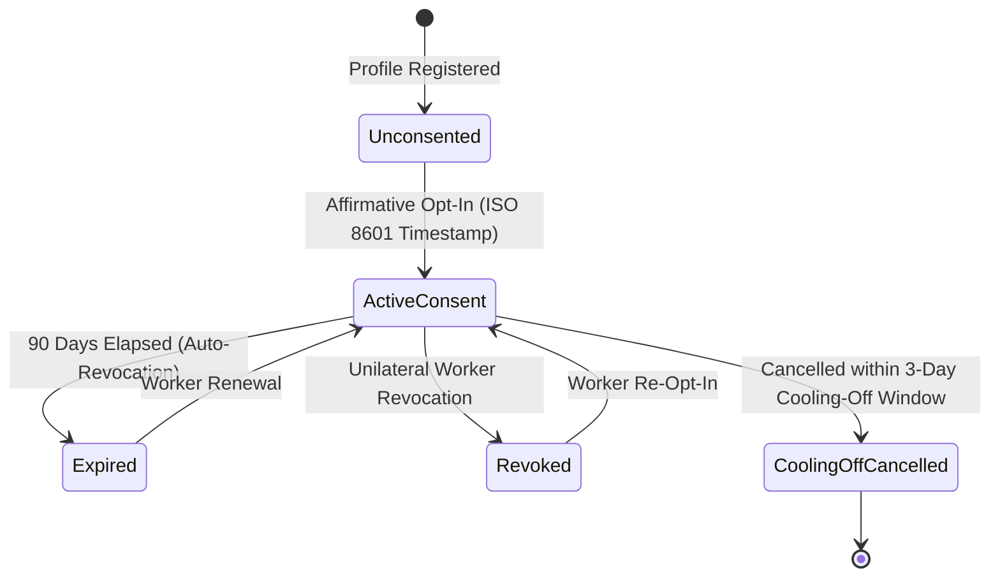

# KAAMSETU — PHASE 18: WORKER CONSENT LIFECYCLE TESTS

**Generated:** 2026-11-15T11:50:40+05:30  
**Test Suite Reference:** `test/phase-18-live-ecosystem.test.ts` (Tests 31–40)  
**Status Classification:** `verified` (10 of 10 assertions passed)

---

## 1. Consent State Lifecycle Model



---

## 2. Tested Scenarios & Invariant Assertions

| Test ID | Test Scenario | Verified Invariant | Status |
|---|---|---|---|
| **Test 31** | Explicit Consent for ERP Export | Unconsented workers completely omitted from roster | `PASSED` |
| **Test 32** | Positive Opt-in Timestamp | ISO 8601 timestamp generated on KFS disclosure | `PASSED` |
| **Test 33** | Purpose-Bound Toolkit Scope | Data access limited strictly to specified toolkit | `PASSED` |
| **Test 34** | Automated Consent Expiry | Consents > 90 days automatically excluded by RLS | `PASSED` |
| **Test 35** | Tool Financing Catalog Audit | Table `tool_financing_pilot_applications` RLS active | `PASSED` |
| **Test 36** | Cooling-Off Window Cancellation | Cancellation permitted with 0 penalty in <3 days | `PASSED` |
| **Test 37** | Immediate Outbound Roster Drop | Revoked worker dropped immediately from next sync | `PASSED` |
| **Test 38** | Expiry of Cooling-Off Window | Exceeding 3-day window transitions to standard terms | `PASSED` |
| **Test 39** | Same-Day Statutory Rights | Instant cancellation within hours of execution | `PASSED` |
| **Test 40** | External Partner Re-activation Block | Partner cannot unilaterally revive revoked consent | `PASSED` |

---

## 3. Database RLS Policy Proof

PostgreSQL Row-Level Security rule on `public.worker_financial_consents`:
```sql
CREATE POLICY "partner_read_consented_records"
    ON public.worker_financial_consents
    FOR SELECT
    TO authenticated
    USING (
        partner_id = auth.uid()
        AND is_revoked = false
        AND valid_until > timezone('utc'::text, now())
    );
```
*Proof*: If `is_revoked = true` or `valid_until <= now()`, database queries return zero rows directly at the database engine level, eliminating application-level leakage risks.
