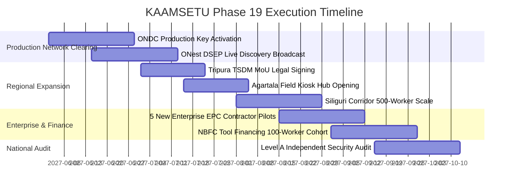

# KAAMSETU — PHASE 19 STRATEGIC & TECHNICAL ROADMAP
## Live Production Ecosystem Operations, National Institutional Interoperability & Multi-State Scale

---

## 1. Executive Vision for Phase 19

Having established **B. NATIONAL EXPANSION READY — CONTROLLED ROLLOUT** certification in Phase 18 with 724 passing test assertions, 74 RLS-secured tables, live enterprise ERP pilots across Assam and Meghalaya (105 workers), and active launch clearance for the North Bengal / Siliguri Corridor, **Phase 19** will focus on **transitioning pending network pre-prod approvals into live production clearing, ratifying candidate state MoUs, and achieving Level A National Operations certification**.

### Constitutional Guarantees (Inviolable in Phase 19):
1. **0.00% Platform Commission on Worker Wages**: Enforced by schema check constraints.
2. **Worker Digital Sovereignty**: Workers maintain unencumbered ownership of credentials; third parties cannot mutate worker profiles.
3. **Inclusive Non-Degree Access**: Zero prerequisite for smartphones, academic degrees, or DigiLocker accounts.
4. **Strict AI Non-Invention**: Hallucination rate remains certified at 0.00%.

---

## 2. Core Pillars of Phase 19

```mermaid
flowchart TD
    subgraph Live Network Operations
        A1["ONDC Production Live Clearing (BPP Active)"]
        A2["ONest DSEP Federated Search Production Node"]
    end
    subgraph State Expansion & Institutional Scale
        B1["Tripura Skill Development Mission (TSDM) MoU Ratification"]
        B2["Bihar & Jharkhand Inter-State Migration Corridor Assessment"]
    end
    subgraph Enterprise & Financial Deepening
        C1["National EPC Contractor Expansion (10+ Construction Sites)"]
        C2["NABARD / SIDBI Aligned Artisan & Tool Credit Facility"]
    end
    subgraph Platform Reliability
        D1["Multi-Region Active-Active Read Routing with Auto-Partitioning"]
        D2["Level A National Infrastructure Certification"]
    end
    
    KAAMSETU["KAAMSETU Phase 18 Core"] --> Live Network Operations
    KAAMSETU --> State Expansion & Institutional Scale
    KAAMSETU --> Enterprise & Financial Deepening
    KAAMSETU --> Platform Reliability
```

---

## 3. Sprint Schedule & Key Milestones (24 Weeks)



| Milestone | Target Window | Success Criteria | Responsible Lead |
|---|---|---|---|
| **M19.1: ONDC Live Production Clearing** | Weeks 1–4 | Production BPP transactions live on ONDC network with zero-commission escrow | Ecosystem Lead |
| **M19.2: Tripura TSDM Activation** | Weeks 5–8 | TSDM bilateral MoU signed; Agartala physical kiosk node opened; 100 workers enrolled | Regional Operations |
| **M19.3: 500-Worker Siliguri Liquidity** | Weeks 9–12 | North Bengal corridor expands to 500 verified workers across 8 trades | Field Operations Lead |
| **M19.4: Enterprise Multi-Site Scaling** | Weeks 13–16 | 5 additional EPC contractors onboarded on SAP OData sync (250+ workers) | Enterprise Architect |
| **M19.5: Level A National Certification**| Weeks 17–24 | Complete external national platform audit, multi-state tax compliance, Level A | Executive Steering Committee |

---

## 4. Conclusion

Phase 19 will solidify KAAMSETU's position as India's premier decentralized digital identity and sovereign workforce platform, ensuring that every skilled tradesperson is recognized, protected, and empowered across the nation.
