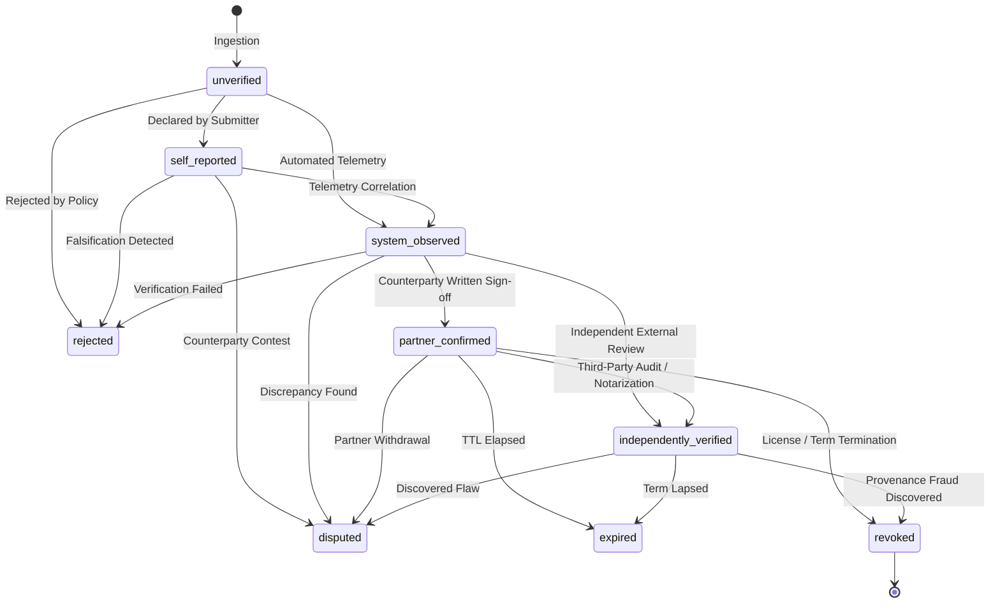

# KAAMSETU — EVIDENCE REGISTRY V2 SPECIFICATION
## Controlled Evidence-Management System, Cryptographic Hashing, Schema V2 & Public Redaction

**Core Principle:** "A hash proves that evidence has not changed since hashing. It does not prove that the underlying claim is true."  
**Repository Table:** `public.evidence_registry_records`  
**Migration:** `20261115000021_evidence_registry_v2_and_attestation.sql`  
**Service Implementation:** `src/lib/governance/evidence-registry-service.ts`

---

### 1. Evidence Registry Architecture & Governing Principles

In Phase 19, the platform introduced a centralized evidence registry to catalog institutional and operational claims. Phase 20 expands this to **Evidence Registry V2**, an immutable, provenance-tracked, and access-governed repository of evidence records.

The system is governed by four strict integrity principles:

1. **Digest Immutability:** An evidence record stores the RFC 8785 canonical JSON SHA-256 digest of the underlying payload. This proves mathematical tamper-detection since the moment of record ingestion.
2. **Provenance Traceability:** Every evidence claim explicitly captures `claim_owner` (the party asserting the claim), `verifier_identity` (the party validating the claim), `verification_method` (the empirical methodology utilized), and `access_classification`.
3. **Strict Progressive Lifecycle:** Evidence cannot jump directly from `unverified` to `independently_verified`. It must progress through observable states.
4. **Public Sanitization & Privacy Preservation:** Public consumers may inspect verified digests and summaries, but confidential artifacts, internal infrastructure paths, and protected personal data (PII) are permanently stripped.

---

### 2. Database Schema (Migration 21)

```sql
-- Migration 21: Evidence Registry V2 Enhancements
ALTER TABLE public.evidence_registry_records
  ADD COLUMN IF NOT EXISTS claim_owner text,
  ADD COLUMN IF NOT EXISTS verifier_identity text,
  ADD COLUMN IF NOT EXISTS verification_method text,
  ADD COLUMN IF NOT EXISTS revocation_reason text,
  ADD COLUMN IF NOT EXISTS access_classification text DEFAULT 'internal'
    CHECK (access_classification IN ('public', 'internal', 'confidential', 'restricted'));

-- Update status check constraint to include 'revoked'
ALTER TABLE public.evidence_registry_records
  DROP CONSTRAINT IF EXISTS evidence_registry_records_status_check;

ALTER TABLE public.evidence_registry_records
  ADD CONSTRAINT evidence_registry_records_status_check
  CHECK (status IN (
    'unverified',
    'self_reported',
    'system_observed',
    'partner_confirmed',
    'independently_verified',
    'expired',
    'disputed',
    'rejected',
    'revoked'
  ));
```

---

### 3. Progressive Evidence Lifecycle State Machine



#### Transition Invariant Defense:
- Direct transitions from `unverified` $\to$ `independently_verified` are rejected by `validateEvidenceStatusTransition()`.
- Records marked as `revoked` cannot transition to `partner_confirmed` or `independently_verified` without full resubmission and fresh audit.

---

### 4. Classification & Redaction Rules

Evidence is categorized into four access tiers:

| Tier | Visibility | Permitted Contents | Forbidden Contents |
| :--- | :--- | :--- | :--- |
| **Public** | Public Verification Portal (`/verify/*`) | Redacted summary, SHA-256 hash, category, status, verifier role, revocation reason | S3 internal URIs, phone numbers, Aadhaar, API keys, contractor commercial rates |
| **Internal** | Authorized Platform Admin | Full JSON payloads, test runner outputs, system correlation IDs | Raw unencrypted biometrics |
| **Confidential** | Enterprise & Auditor Access | Stamped contracts, OData endpoint credentials, bank statements | Worker biometric secrets |
| **Restricted** | Legal & Executive Signatories | Wet-ink legal filings, arbitration records | None |

#### Automated Sanitization Regex Filter
Before any evidence record is persisted or exposed publicly, `buildEvidenceRegistryRecord()` executes strict pattern matching to eliminate leaks:
- Aadhaar numbers: `\b\d{4}[ -]?\d{4}[ -]?\d{4}\b`
- Unmasked Indian mobile numbers: `\b[6-9]\d{9}\b`
- Bearer tokens: `/bearer\s+[a-z0-9_\-\.]+/i`
- Plaintext passwords: `/password/i`

---

### 5. API Endpoints

- `GET /api/governance/evidence-registry`:
  - Query parameters: `category`, `status`, `claimId`.
  - Returns sanitized evidence summaries and status statistics.
- `POST /api/governance/evidence-registry`:
  - Default: Ingests new evidence record with canonical digest computation.
  - Action `update_status`: Progresses status according to the valid state machine.
