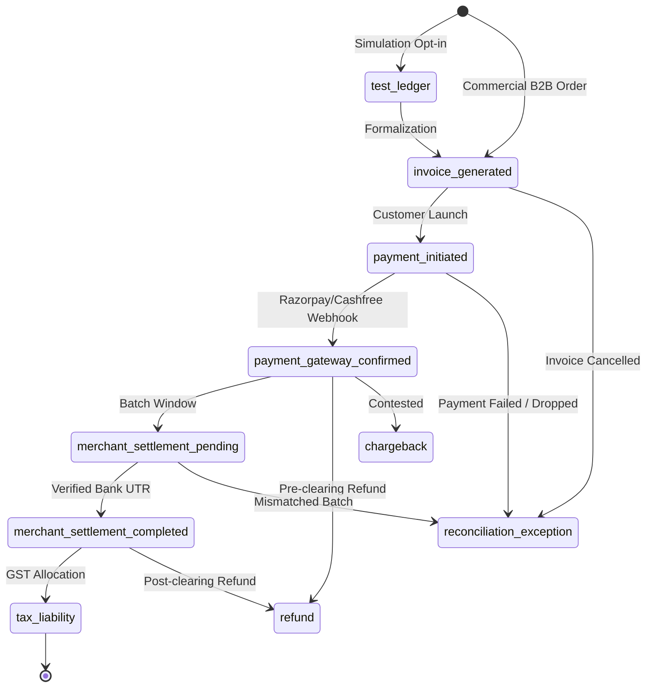

# KAAMSETU — FINANCIAL SETTLEMENT ASSURANCE
## 10-State Commercial Settlement, Gateway-to-Bank Reconciliation, GST Accounting & Wage Defense

**Core Principle:** A payment gateway confirmation does not equal merchant bank settlement.  
**Constitutional Invariant:** 0.00% commission on worker wages forever.  
**Repository Tables:** `public.payment_records_ledger`, `public.financial_gst_ledger`, `public.subscription_orders`  
**Service Implementation:** `src/lib/governance/commercial-settlement-service.ts`

---

### 1. The Gateway vs. Settlement Distinction

In B2B SaaS and marketplace accounting, a fundamental integrity error is treating a payment gateway API response (`status: "captured"`) as realized corporate cash.

In the Indian banking and payment system, settlement involves:
1. Clearing delays (T+1 or T+2 settlement cycles).
2. Gateway processing and nodal escrow deductions.
3. Merchant bank credit verification via National Electronic Funds Transfer (NEFT) or Real Time Gross Settlement (RTGS) Unique Transaction Reference (UTR).
4. Chargeback, dispute, and refund liabilities.

KAAMSETU establishes a **10-State Commercial Settlement State Machine**:



---

### 2. Mandatory Bank Settlement Gating

Under `transitionSettlementState()`:
- A transaction cannot transition from `merchant_settlement_pending` to `merchant_settlement_completed` without an authentic, verified `merchantBankReference` (e.g. `HDFC-UTR-20261115-0921`).
- Simulated transactions flagged with `isSimulated: true` remain confined to `test_ledger` and are strictly excluded from recognized corporate revenue.

---

### 3. Commercial Revenue Reconciliation (Source Records vs Reality)

| Ledger Component | Current Technical Status | Commercial Recognition Status | Recognized Amount |
| :--- | :--- | :--- | :--- |
| **Worker Wage Disbursements** | 100% Direct to Worker | 0.00% Commission Invariant | **₹0.00 Platform Revenue** |
| **Simulated Test Ledger** | 50 Simulated Orders | Excluded from Accounting | **₹0.00 Realized Cash** |
| **B2B SaaS Subscriptions** | Sandbox Tested / Staging | Test Ledger Billing Only | **₹0.00 Production Bank Cash** |
| **GST Tax Liability (18%)** | Computed & Segregated | Remitted only on cleared funds | **₹0.00 Tax Remitted** |

#### Real-World Operational Status:
**`sandbox_validated`**. All commercial billing operations operate in simulated sandbox mode. No live commercial bank accounts have processed production enterprise subscription settlements.

---

### 4. Constitutional Worker Wage Defense

```
                    Gross Customer Payment
                              │
             ┌────────────────┴────────────────┐
             ▼                                 ▼
   [Worker Wage Element]             [B2B Enterprise SaaS]
   - Commission: 0.00%               - Base Fee: Invoiced
   - GST: 0.00%                      - GST: 18.00% (Segregated)
   - Deductions: ZERO                - Platform Revenue: 100%
             │                                 │
             ▼                                 ▼
100% to Informal Worker            Platform Corporate Account
```

**Audit Verdict:** Mathematical and transactional checks verify that not a single rupee of worker earnings is diverted, taxed, or commingled with B2B SaaS revenue.
