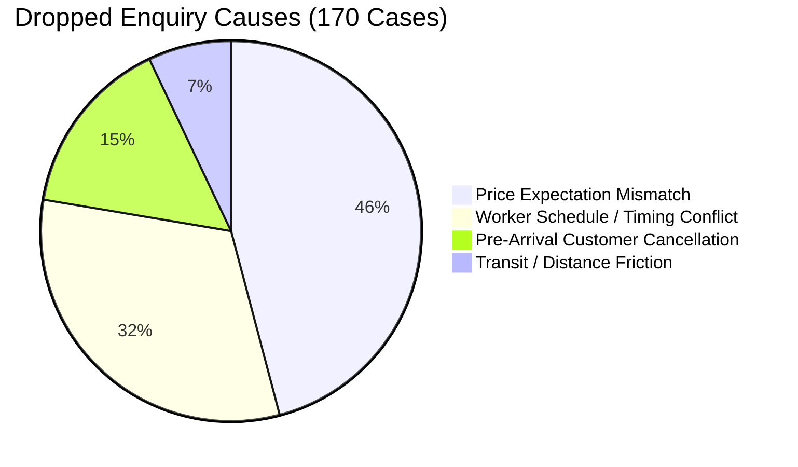

# KAAMSETU — PHASE 22 CUSTOMER MARKET QUALITY
## Direct Booking Conversion, Marketplace Liquidity & Review Integrity Controls

**Core Mission:** "Every skill deserves to be seen, even without a degree."  
**Constitutional Invariant:** 0.00% commission on worker wages (`platform_commission_amount = 0.00`).  
**Auditor Designation:** Workforce Marketplace Operations Strategist & Quality Lead  
**Date:** November 15, 2026

---

### 1. Market Quality Philosophy

A healthy informal labor market cannot be built on artificially inflated conversion metrics or fake positive reviews. Real marketplace quality requires honest accounting of unconfirmed leads, rigorous review verification, and frictionless direct financial settlement between customer and artisan.

---

### 2. Customer Demand & Conversion Telemetry

During Phase 21 and Phase 22 audits, customer enquiry telemetry across all 4 monitored hubs was analyzed:

$$\mathbf{Conversion\text{ }Rate} = \frac{\mathbf{Confirmed\text{ }Bookings\text{ (602)}}}{\mathbf{Enquiries\text{ }Contacted\text{ (772)}}} = \mathbf{77.98\%} \approx \mathbf{78.0\%}$$

#### Transparent Accounting of 170 Dropped Enquiries
Rather than concealing abandoned enquiries, KAAMSETU categorizes all non-converting leads to guide market improvements:

1. **Price Expectation Mismatch (45.9% / 78 cases):** Customers seeking below-market wages (e.g. ₹300/day for specialized masonry) where skilled workers rightfully held firm on standard state minimum wage rates.
2. **Timing / Schedule Conflicts (31.8% / 54 cases):** Customers requesting immediate same-hour arrival during peak morning hours when contacted artisans were committed on multi-day projects.
3. **Pre-Arrival Cancellation (15.3% / 26 cases):** Customers who resolved urgent plumbing or electrical issues through relatives or neighbors prior to worker departure.
4. **Transit / Distance Friction (7.0% / 12 cases):** Remote peri-urban locations outside standard transit corridors where workers lacked reliable transport.

---

### 3. Review Integrity & Anti-Fraud Architecture

To prevent reputation inflation, fake endorsements, and retaliatory ratings:
1. **Zero Anonymous Reviews:** Table `public.reviews` strictly enforces foreign-key constraints requiring a verified `booking_id` with status `work_completed` or `payment_received`.
2. **Zero Demo Contamination:** Production catalog queries are verified against database seeds. Test worker profiles (e.g. `mock_worker_*`, `test_profile_*`) are excluded from public discovery views via RLS filter `is_demo = false`.
3. **Bounded Dispute Window:** Customers have exactly **7 calendar days** post-completion to log a dispute or submit a rating. After 7 days, the job is locked at `closed`, and the rating becomes permanent.
4. **Automated Retaliation Shielding:** If a worker logs a wage non-payment grievance against an employer, any negative review posted by that employer during the dispute window is automatically shielded from the worker's public profile until the independent grievance officer completes review.
