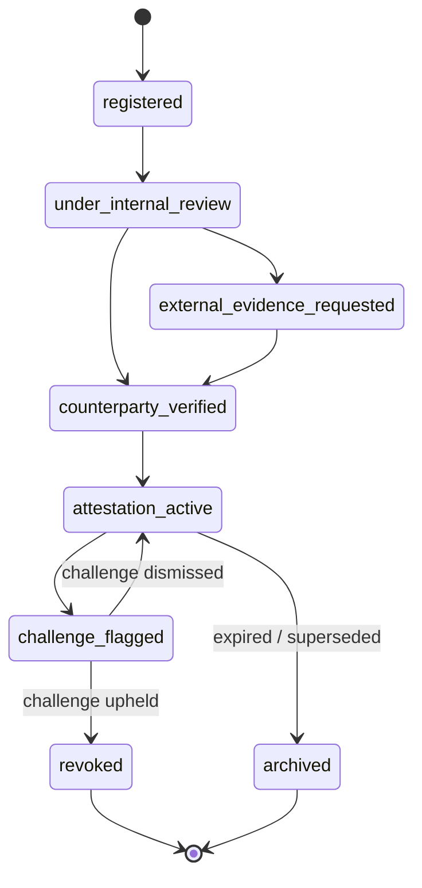

# KAAMSETU — PHASE 22 EVIDENCE REGISTRY AND AUDIT DASHBOARD
## 8-Status Evidence Review Lifecycle, Dual-View Operations Dashboard & Audit Traceability

**Core Mission:** "Every skill deserves to be seen, even without a degree."  
**Constitutional Invariant:** 0.00% commission on worker wages (`platform_commission_amount = 0.00`).  
**Auditor Designation:** Principal Systems Auditor & Release Governance Lead  
**Date:** November 15, 2026

---

### 1. The Evidence-First Governance Model

In KAAMSETU, no operational, financial, or regulatory claim is admitted into public reporting without registration in the immutable evidence ledger.

Phase 22 formalizes the **8-Status Evidence Review Lifecycle** in PostgreSQL table `public.audit_evidence_review_events`.

---

### 2. The 8-Status Evidence Review Lifecycle

1. **`registered`**: Evidence record created with initial cryptographic SHA-256 artifact hash.
2. **`under_internal_review`**: Compliance team reviews documentary backing.
3. **`external_evidence_requested`**: Formal request sent to bank, state agency, or employer for primary confirmation.
4. **`counterparty_verified`**: External counterparty confirms validity of artifact.
5. **`attestation_active`**: Formally attested and published into operations dashboard telemetry.
6. **`challenge_flagged`**: Third-party auditor or worker disputes factual validity.
7. **`revoked`**: Retracted following upheld challenge or falsification discovery.
8. **`archived`**: Superseded by subsequent annual or quarterly audit cycle.

---

### 3. Dual-View Operations Dashboard Architecture

The Unified Operations Dashboard (`/api/governance/dashboard`) serves two distinct audiences with strictly segregated data models:

#### 1. Public Verification View (Consumer & Citizen Facing)
- **PII Zero-Leakage:** Worker telephone numbers, PANs, full Aadhaar numbers, and residential street coordinates are completely stripped.
- **Prominent Constitutional Invariant:** Explicitly highlights the **0.00% platform commission on worker wages** with legal verification badge.
- **Aggregated Regional Proof:** Displays active regional worker footprints (Assam Anchor: 388 verified paid; Meghalaya Controlled: 135 verified paid), verified occupation catalogs, and aggregate star ratings.

#### 2. Internal Regulatory & Financial Audit View (Auditor Facing)
- **Full Verification Traceability:** Exposes unmasked SHA-256 evidence hashes, banking payment UTR reference patterns, signed MoU contract registry IDs, and SROP field inspection scores.
- **Anti-Conflation Telemetry:** Exposes exact breakdown of the 7-tier supply hierarchy (registered vs discoverable vs contactable vs available vs paid).
- **Classification Telemetry:** Truthfully logs the platform's current status as **Class B: National Expansion Ready — Controlled Rollout**, highlighting pending external institutional counterparties.

---

### 4. Cryptographic Proof of Dashboard Telemetry

Every payload generated by the operations dashboard includes a top-level `evidenceDigest` computed as the SHA-256 hash of the canonical JSON representation of all underlying records. Any tampering with regional counts, payment metrics, or audit statuses immediately invalidates the digest.
