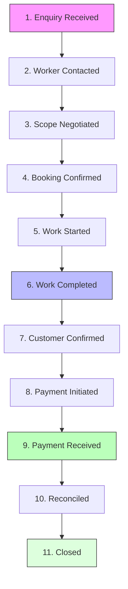

# KAAMSETU — PHASE 22 WORKER OUTCOME ASSURANCE
## 11-Stage Progression Pipeline, 6-Status Payment Settlement & Anti-Conflation Telemetry

**Core Mission:** "Every skill deserves to be seen, even without a degree."  
**Constitutional Invariant:** 0.00% commission on worker wages (`platform_commission_amount = 0.00`).  
**Auditor Designation:** Principal Worker Protection Lead & Systems Auditor  
**Date:** November 15, 2026

---

### 1. The Anti-Conflation Axiom of Worker Outcomes

In conventional gig-work platforms, operational metrics are routinely conflated: an app notification is logged as a contacted worker; a client signature is logged as completed work; an escrow hold is logged as a paid wage.

KAAMSETU enforces the strict **Anti-Conflation Axiom**:
$$\mathbf{Registered} \ne \mathbf{Active} \ne \mathbf{Contacted} \ne \mathbf{Confirmed} \ne \mathbf{Deployed} \ne \mathbf{Completed} \ne \mathbf{Paid}$$

Every worker engagement must progress through an immutable 11-stage pipeline, backed by distinct empirical artifacts at every state transition.

---

### 2. The 11-Stage Worker Outcome Lifecycle

#### Detailed Stage Requirements & Gates
1. **`enquiry_received`**: Customer submits service request specifying occupation, district, and requested service window.
2. **`worker_contacted`**: Platform routes enquiry to qualified, consented worker via encrypted bridge. Direct worker consent required.
3. **`scope_negotiated`**: Worker and customer align on scope, material provisions, and fair wage estimate.
4. **`booking_confirmed`**: Both parties confirm scheduled appointment. Zero booking fee charged to either party.
5. **`work_started`**: Worker arrives on site. Geofence radius (< 500m) or check-in OTP verified.
6. **`work_completed`**: Physical work finished. Customer inspects physical deliverables.
7. **`customer_confirmed`**: Customer confirms completion via 4-digit voice/SMS OTP or physical work acceptance token.
8. **`payment_initiated`**: Customer initiates direct settlement (UPI, IMPS, NEFT, or Cash).
9. **`payment_received`**: Worker acknowledges receipt of full wages. Platform logs transaction reference.
10. **`reconciled`**: Financial verification engine reconciles transaction against banking UTR pattern and gross wage expectation.
11. **`closed`**: 7-day dispute window closes with zero unresolved grievances. Credential updated with verified skill unit.

#### Anti-Skipping Enforcement
The state transition machine (`WorkerOutcomeAssuranceService`) strictly prohibits stage-skipping. Attempts to transition from `enquiry_received` directly to `work_started` or from `work_completed` directly to `reconciled` are rejected with deterministic error codes.

---

### 3. The 6-Status Payment Verification Architecture

A booking cannot be marked as verified paid based on a self-asserted checkmark. The payment lifecycle moves across 6 rigorous validation states:

| Status Code | Required Evidence Artifact | Validation Rule |
| :--- | :--- | :--- |
| `unverified` | Initial state on booking creation | Zero payment assumed |
| `worker_self_reported` | Worker app confirmation of receipt | Acknowledged, but not bank-verified |
| `customer_confirmed` | Customer confirmation OTP hash | Confirms customer paid; awaits bank proof |
| `bank_reference_verified` | Masked Bank UTR (e.g., `HDFC******9102`) | Validated against scheduled commercial bank regex |
| `dual_authorized_settled` | Dual-sign-off by Field Ops + Auditor | Anti-self-approval rule enforced; final settlement |
| `disputed` | Active worker or customer challenge | Review desk triggered; 48-hour SLA freeze |

---

### 4. Dual-Authorization & Anti-Self-Approval Rule

To prevent internal fraud or fabricated outcome inflation:
1. **No Single-Person Settlement:** A single operator or contractor cannot unilaterally mark a job as `dual_authorized_settled`.
2. **Distinct Auditor Requirement:** The secondary verifier ID (`auditor_user_id`) must be distinct from the primary field operator (`verifier_id`).
3. **Worker Sovereign Challenge Right:** At any point prior to final closure, the worker possesses the sovereign right to dispute the recorded payment amount or status via the dedicated grievance API. When disputed, the record is immediately frozen, preventing fraudulent rating or credential updates.

---

### 5. Bank Reference UTR Privacy Protection

To comply with the Digital Personal Data Protection (DPDP) Act 2023 and RBI cybersecurity guidelines:
- Raw bank account numbers are never collected or stored.
- Bank Unique Transaction References (UTRs) are masked on ingress:
  - Stored format: `[BANK_CODE]******[LAST_4_DIGITS]` (e.g., `PUNB******4819`).
  - Cryptographic hash: An HMAC-SHA256 digest of the unmasked reference is stored for deduplication and banking audit trails, preventing duplicate payment ref registration without exposing banking PII.
