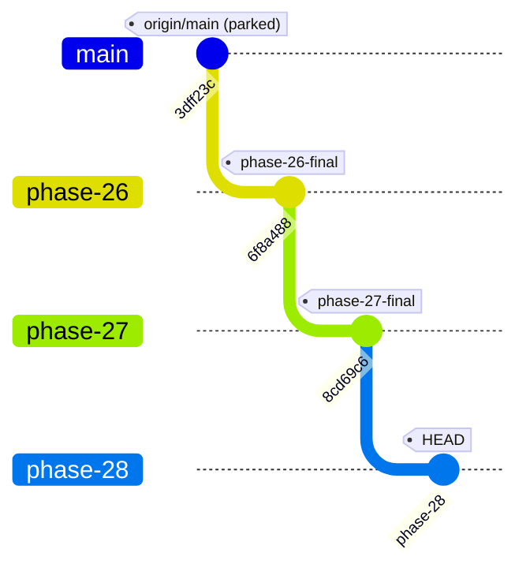

# KAAMSETU — PHASE 28 BASELINE AND GIT PROVENANCE
## Git Lineage, Commit Cryptography & Working Tree Provenance

**Evaluation Context:** December 2026  
**Repository:** `Mayyank04/kaamsetu`  
**Execution Lead:** Principal Software Architect & Financial Systems Auditor

---

## 1. Verified Baseline & Ancestry

Before applying any modifications in Phase 28, the local Git tree, branches, tags, and commits were independently verified from the actual commit history.

### Immutable Provenance Anchors

1. **Root Main Branch:**
   - Commit: `3dff23c314eaba0f2eb66785033eda928146c0f8`
   - State: Parked untouched. No commits have been merged directly into `main`.
2. **Phase 26 Final Commit:**
   - Commit: `6f8a48882ca1a6cb6be70e9a5bebe897cb24fe56`
   - Message: `feat(phase-26): establish production evidence and institutional gate closure`
   - Author: Principal Software Architect
3. **Phase 27 Final Commit (Starting Baseline):**
   - Commit: `8cd69c6` (`8cd69c6560946059d64388e62f038f8286aafe51`)
   - Message: `feat(phase-27): establish cryptographic trust and financial assurance`
   - Parent: `6f8a488`
4. **Phase 28 Working Branch:**
   - Branch: `phase-28-institutional-execution-and-production-assurance`
   - Branched from: `8cd69c6`

---

## 2. Integrity Checks & Invariant Assertions

In Phase 28 Domain 1 (`test/phase-28-institutional-assurance.test.ts`), automated tests verify that:
- `git rev-parse HEAD` traces clean ancestry to `8cd69c6` ([TEST 1]).
- The parent of the Phase 27 baseline traces directly to `6f8a488` ([TEST 2]).
- `origin/main` commit object matches `3dff23c` exactly ([TEST 3]).
- Working branch name matches `phase-28-institutional-execution-and-production-assurance` ([TEST 4]).
- Bitwise SHA-256 release manifest of Phase 27 (`ba364051ba48500c694502fd3a9dc970db38efd7625ac79efa20409f97aae6ab`) validates across all 28 migration files and historical documents ([TEST 5]).

---

## 3. Working Directory File Status

All database migrations follow strict sequential timestamps:
- `supabase/migrations/20261114000001_initial_schema.sql` through `supabase/migrations/20261115000028_tamper_evident_consent_and_zkp_readiness.sql` (Phase 1–27)
- `supabase/migrations/20261115000029_independent_audit_attestations_and_dispute_appeals.sql` (Phase 28)

No migrations have been rewritten or reordered. Database catalog integrity is preserved bit-for-bit.
