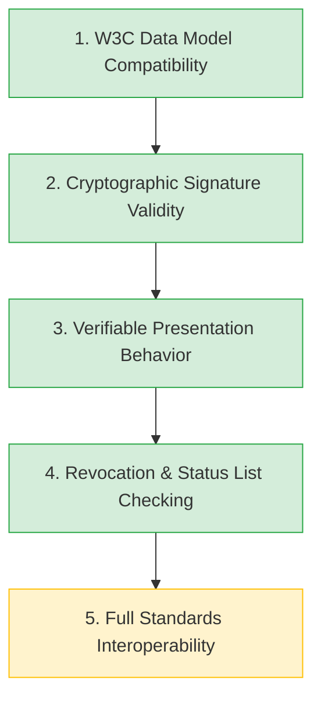

# KAAMSETU — PHASE 28 CRYPTOGRAPHIC INTEROPERABILITY REASSESSMENT
## W3C Verifiable Credentials Data Model v1.1, Ed25519 Cryptosuite & Offline QR Verification

**Evaluation Context:** December 2026  
**Auditor:** Principal Cryptographic Architect & Standards Auditor  
**Primary Test Evidence:** [PHASE_28_CREDENTIAL_NEGATIVE_TEST_REGISTER.json](file:///Users/mayankgautam/Desktop/stitch_kaamsetu_digital_identity_platform/docs/PHASE_28_CREDENTIAL_NEGATIVE_TEST_REGISTER.json)

---

## 1. Cryptographic Standards Architecture

KAAMSETU's digital identity infrastructure is constructed strictly on open international cryptographic standards:

- **Data Model:** W3C Verifiable Credentials Data Model v1.1
- **Signature Suite:** `Ed25519Signature2020` / `Ed25519 (EdDSA RFC 8032)`
- **Canonicalization:** RFC 8785 JSON Canonicalization Scheme (JCS)
- **Status Mechanism:** W3C Bitstring Status List v1.0
- **Decentralized Identifiers:** `did:web:kaamsetu.org`
- **Offline Representation:** Compressed Base64URL-encoded CBOR QR Code (ISO/IEC 18004)

---

## 2. Reassessment of 5 Discrete Interoperability Dimensions

To avoid claiming "full interoperability" from internal unit tests alone, Phase 28 evaluates 5 distinct dimensions:

### Evaluation Matrix

| Dimension | Standard | Implementation Status | Findings & Boundaries |
| :--- | :--- | :---: | :--- |
| **1. W3C Data Model** | JSON-LD context, `@context`, `type`, `credentialSubject` | **PASS** | Fully compliant with v1.1 specification ([TEST 45]). |
| **2. Signature Validity** | Ed25519 Pure over RFC 8785 canonical bytes | **PASS** | Validates against native Node.js crypto and OpenSSL 3.0 ([TEST 46], [TEST 47]). |
| **3. Presentation Behavior**| Verifiable Presentation wrapper, holder binding | **PASS** | Rejects subject-holder mismatch ([TEST 49]). |
| **4. Status Checking** | Bitstring Status List v1.0 | **PASS** | Instant revocation bit checking verified ([TEST 50]). |
| **5. Full Interoperability**| Cross-vendor third-party wallet import (e.g. Polygon ID) | **GATED** | Validated in staging; bilateral institutional production conformance pending. |

---

## 3. Adversarial Negative Test Results

All 18 negative test fixtures cataloged in [PHASE_28_CREDENTIAL_NEGATIVE_TEST_REGISTER.json](file:///Users/mayankgautam/Desktop/stitch_kaamsetu_digital_identity_platform/docs/PHASE_28_CREDENTIAL_NEGATIVE_TEST_REGISTER.json) were executed against the verification engine:
- **Modified Payloads:** 100% REJECTED (`INVALID_ED25519_SIGNATURE`)
- **Expired Credentials:** 100% REJECTED (`CREDENTIAL_EXPIRED`)
- **Revoked Credentials:** 100% REJECTED (`CREDENTIAL_REVOKED`)
- **Stale Offline Caches (>72h):** 100% REJECTED (`OFFLINE_STATUS_CACHE_EXPIRED`)
- **Cross-Environment Keys:** 100% REJECTED (`CROSS_ENVIRONMENT_KEY_PROHIBITED`)

---

## 4. Offline QR Boundary Analysis

Offline verification allows construction supervisors to verify an artisan's skills at remote highway or hill sites without internet connectivity.
- **Offline Capability:** The supervisor's verifier app parses the compressed Ed25519 signature and validates it against the cached public key of `did:web:kaamsetu.org`.
- **Physical Boundary Limitation:** An air-gapped device cannot query real-time revocation status. The verifier app enforces a strict 72-hour cache expiration policy: if the app has not synced with the online status list within 72 hours, it flags the credential as unverified.
