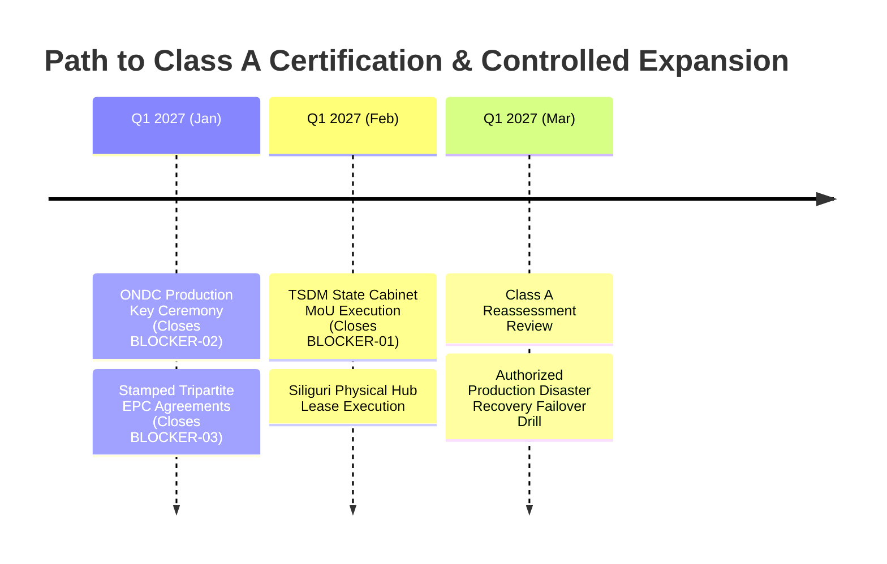

# KAAMSETU — PHASE 28 ROADMAP
## Strategic Milestones, Blocker Closure Path & Controlled Production Readiness

**Evaluation Period:** December 2026 – Q1 2027  
**Guiding Mandate:** *"Every skill deserves to be seen, even without a degree"*

---

## 1. Near-Term Horizon (Q1 2027): Institutional Gate Closures

### Key Milestones:
1. **Milestone 28.1 — ONDC Root HSM Activation:**
   - Execute the physical dual-custody key ceremony with ONDC network controllers.
   - Advance `BLOCKER-02` to `EXECUTED`.
2. **Milestone 28.2 — Enterprise EPC Tripartite Execution:**
   - Complete reciprocal legal sign-offs and stamp-duty execution with lead infrastructure consortia.
   - Advance `BLOCKER-03` to `EXECUTED`.
3. **Milestone 28.3 — Tripura State Cabinet Ratification:**
   - Secure formal Cabinet resolution and execute the TSDM co-branded credentialing agreement.
   - Advance `BLOCKER-01` to `EXECUTED`.
4. **Milestone 28.4 — Scheduled Production DR Live Failover Drill:**
   - Convene Change Advisory Board (CAB) to approve a 2-hour scheduled maintenance window for live multi-AZ failover testing.
   - Upgrade production DR status from `UNVERIFIED` to `PRODUCTION_DR_EXECUTED`.

---

## 2. Invariant Commitments for Future Phases

Across all planned roadmap phases:
- **0.00% Platform Wage Commission:** Inviolable forever (`platform_commission_amount = 0.00`).
- **Worker Data Sovereignty:** W3C-compliant portable credentials under worker self-custody.
- **Truthful Governance:** Never promoting operational status without physical and legal evidence.
