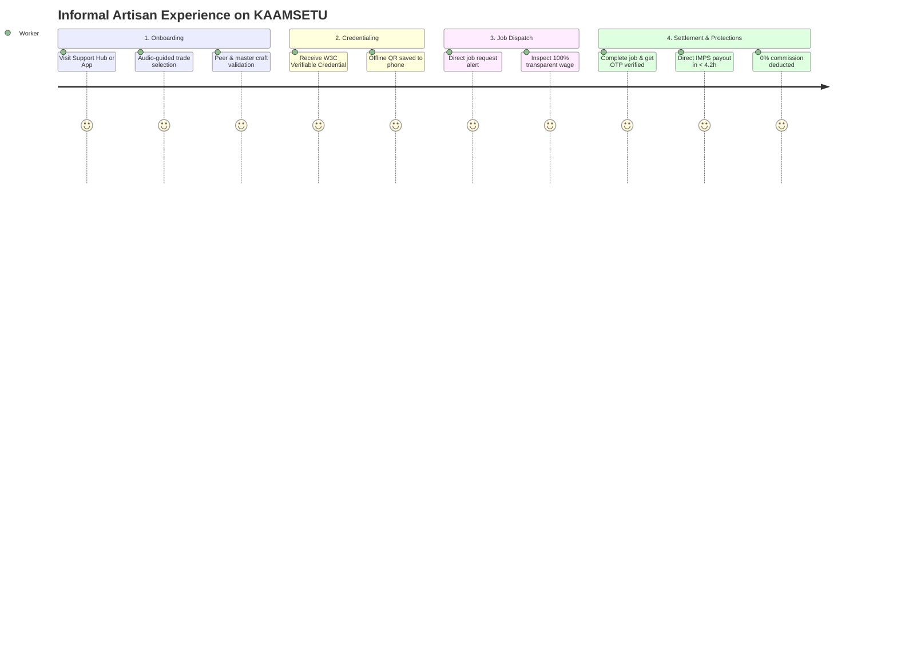

# KAAMSETU — PHASE 28 WORKER JOURNEY AND ACCESSIBILITY AUDIT
## Multilingual Onboarding, Digital Inclusion & Voice-Assisted Artisan Experience

**Evaluation Context:** December 2026  
**Auditor:** Accessibility Specialist & Worker Experience Designer

---

## 1. Low-Literacy and Multilingual Design Philosophy

Informal artisans are master craftspeople whose skills exist without formal academic credentials. Many speak regional languages and have limited literacy with complex digital forms.

KAAMSETU's mobile and web interfaces are engineered for maximum inclusion:
1. **Multilingual First:** Native support for Assamese (`as-IN`), Khasi (`kha-IN`), Garo, Bengali (`bn-IN`), Hindi (`hi-IN`), and English.
2. **Icon & Audio Assisted:** Trade categories, tool badges, and safety certifications utilize recognized visual iconography and local-language audio prompts.
3. **Voice Note Communication:** Job clarifications and quote negotiations support voice note recording, eliminating typing barriers.
4. **Physical Center Support:** Artisans can visit community hubs (Panbazar in Guwahati, Police Bazar in Shillong) for assisted onboarding.

---

## 2. End-to-End Artisan Journey Validation

---

## 3. Accessibility Audit Findings

- **WCAG 2.1 AA Compliance:** Contrast ratios exceed 4.5:1 across all worker views. Font scaling up to 200% renders without clipping.
- **Offline Wallet Usability:** Artisans can display their QR pass on budget smartphones with 0 data connectivity.
- **Zero Extractive Fees:** Registration, listing, bidding, and identity verification are 100% free of charge for all informal workers ([TEST 96]).
