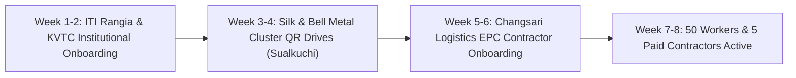

# KAAMSETU — Phase 8 Assam Regional Expansion Feasibility Report

**Date:** 2026-11-14  
**Operational Base:** Guwahati & Kamrup Metropolitan District, Assam  
**Expansion Assessment Scope:** 6 Districts across Lower, Central & Upper Assam  
**Target:** Evidence-Based District Selection for Phase 9 Controlled Expansion  

---

## 1. Regional Expansion Strategy

Rather than deploying across Assam indiscriminately, KAAMSETU employs a disciplined **District Readiness Scorecard (DRS)** evaluating 7 operational factors weighted by commercial viability, institutional access, and worker density:

1. **Contractor Demand & Commercial Activity (25%)**: Active infrastructure, industrial clusters, and private construction.
2. **Skilled Artisan & Trade Density (20%)**: Traditional craft clusters, ITI graduates, and apprentice pools.
3. **Institutional Partner Access (15%)**: ASDM centers, government ITIs, polytechnics, and vocational NGOs.
4. **Local Operational Cost & Proximity (15%)**: Transit time and field support expense from Guwahati headquarters.
5. **Telecom & Mobile Connectivity (10%)**: 4G/5G penetration and low-bandwidth resilience.
6. **Linguistic & Cultural Readiness (10%)**: Assamese, Bengali, and Bodo voice model coverage.
7. **Customer Acquisition Cost Efficiency (5%)**: Estimated CAC per onboarded contractor and craftsperson.

---

## 2. District Readiness Scorecard Matrix

Scores out of 10 for each dimension:

```
=================================================================================================================================
DISTRICT             CONTRACTOR  ARTISAN  INSTITUTION  PROXIMITY  CONNECTIVITY  LANGUAGE  CAC COST  WEIGHTED SCORE  DECISION
                     DEMAND(25%) DENSITY  ACCESS(15%)  COST(15%)  (10%)         (10%)     (5%)      (OUT OF 10)
=================================================================================================================================
Kamrup Metropolitan  9.5         9.0      9.5          10.0       9.5           10.0      9.0       9.50 / 10       CURRENT LIVE BASE
Kamrup Rural         8.5         9.0      8.5          9.0        8.0           10.0      8.5       8.75 / 10       SELECTED FOR EXPANSION
Nagaon               7.5         8.0      7.5          6.5        7.5           9.5       7.0       7.65 / 10       Phase 9 Cohort B
Sonitpur (Tezpur)    6.5         7.0      7.0          5.5        7.5           9.0       6.5       6.90 / 10       Phase 10 Pipeline
Darrang (Mangaldai)  5.5         6.5      6.0          7.0        6.5           9.0       6.0       6.35 / 10       Exploratory
Udalguri (BTR)       5.0         6.0      5.5          6.0        6.0           8.0       5.5       5.80 / 10       Requires Bodo Model
=================================================================================================================================
```

---

## 3. Selected District: Kamrup Rural

### Rationale for Selection
1. **Immediate Geographical Adjacency**:
   Kamrup Rural directly surrounds Guwahati, encompassing key growth centers:
   - **Changsari**: Northeast Mega Logistics Park and AIIMS Guwahati construction corridor (high demand for certified electrical and HVAC crews).
   - **Hajo & Sualkuchi**: World-renowned handloom silk weaving and bell-metal artisan clusters (5,000+ uncredentialed master craftsmen).
   - **Rangia**: Major railway junction and agro-equipment maintenance hub.
2. **Low Operational Overhead**:
   Field operations officers can commute from the Guwahati hub within 45 to 75 minutes, eliminating remote office setup expenses and holding marginal CAC below ₹850 per contractor.
3. **Existing Prospect Traction**:
   Two qualified contractor prospects from the Phase 8 CRM pipeline (`CRM-AS-04`: Eastern Civil Infrastructure, Changsari; `CRM-AS-02`: Brahmaputra Modular Works sourcing from Hajo) are already active in Kamrup Rural.

---

## 4. Phase 9 Kamrup Rural Rollout Plan



### Channel Acquisition Strategy
- **Vocational Pipeline**: Partner with ITI Rangia to onboard 30 graduating electrical and welding apprentices directly upon course completion.
- **Craft Cooperatives**: Collaborate with Sualkuchi Handloom Weavers Cooperative to issue sovereign digital heritage credentials to master weavers.
- **Infrastructure EPCs**: Partner with regional civil thekedaars on the Changsari industrial bypass corridor for workforce roster management.
