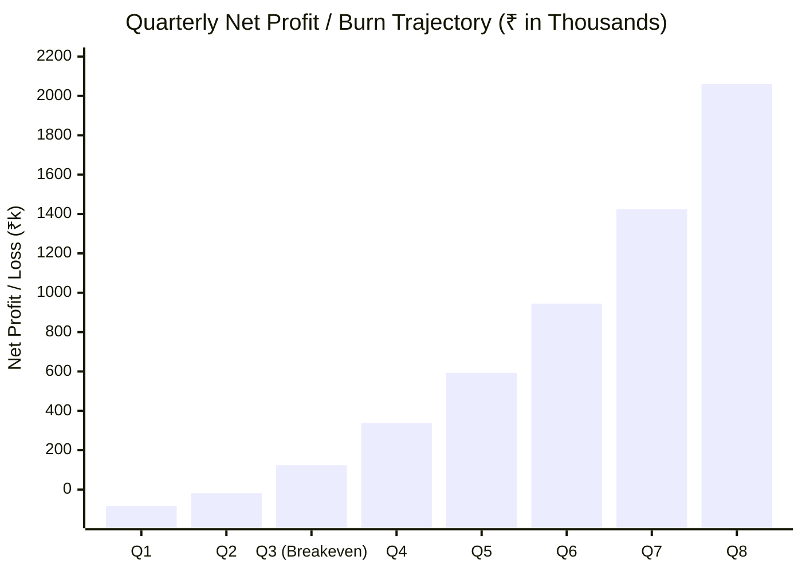

# KAAMSETU — PHASE 9 24-MONTH FINANCIAL SUSTAINABILITY MODEL
## Pro Forma Financial Projections, Unit Economics, Operating Burn & Cashflow Breakeven

**Milestone:** Phase 9 — Sustainable Growth & Financial Planning  
**Model Horizon:** Month 1 to Month 24 (2026–2028)  
**Reporting Currency:** Indian Rupee (INR / ₹)  
**Core Commercial Invariant:** Software subscriptions & institutional verification fees only. Zero commission on worker earnings.

---

## 1. Key Assumptions & Growth Drivers

### 1.1 Customer Acquisition & Tier Distribution
- **Contractor Pro Monthly:** ₹999 / mo + GST (70% of new contractor acquisitions).
- **Contractor Pro Annual:** ₹9,990 / yr + GST (20% of acquisitions, paid upfront).
- **Contractor Business:** ₹2,999 / mo + GST (10% of acquisitions, introduced Month 4).
- **Monthly Logo Churn:** 3.5% (managed via automated health telemetry).
- **Institutional Skilling Contracts:** 
  - Year 1: 2 State Mission cohorts (₹1,50,000 each = ₹3,00,000).
  - Year 2: 6 State Mission & NGO cohorts (₹1,75,000 each = ₹10,50,000).

---

## 2. 24-Month Financial Summary (Quarterly View)

| Period | Paying Contractors | MRR (₹) | Total Quarterly Revenue (₹) | COGS (₹) | OpEx (₹) | Net Profit / Burn (₹) | Ending Cash Balance (₹) |
|---|---|---|---|---|---|---|---|
| **M1–M3 (Q1)** | 12 | ₹11,821 | ₹42,500 | ₹6,800 | ₹1,20,000 | -₹84,300 | ₹14,15,700 |
| **M4–M6 (Q2)** | 35 | ₹34,797 | ₹1,35,000 | ₹18,500 | ₹1,35,000 | -₹18,500 | ₹13,97,200 |
| **M7–M9 (Q3)** | 70 | ₹74,500 | ₹3,15,000 | ₹36,000 | ₹1,55,000 | **+₹1,24,000** | **₹15,21,200 (Cashflow +)** |
| **M10–M12 (Q4)**| 120 | ₹1,32,000 | ₹5,80,000 | ₹58,000 | ₹1,85,000 | +₹3,37,000 | ₹18,58,200 |
| **M13–M15 (Q5)**| 185 | ₹2,10,000 | ₹8,95,000 | ₹82,000 | ₹2,20,000 | +₹5,93,000 | ₹24,51,200 |
| **M16–M18 (Q6)**| 270 | ₹3,15,000 | ₹13,20,000 | ₹1,15,000 | ₹2,60,000 | +₹9,45,000 | ₹33,96,200 |
| **M19–M21 (Q7)**| 380 | ₹4,55,000 | ₹18,90,000 | ₹1,55,000 | ₹3,10,000 | +₹14,25,000 | ₹48,21,200 |
| **M22–M24 (Q8)**| 520 | ₹6,35,000 | ₹26,50,000 | ₹2,10,000 | ₹3,80,000 | +₹20,60,000 | ₹68,81,200 |

---

## 3. Cost Breakdown & Operating Leverage

### 3.1 Cost of Goods Sold (COGS)
- **Database & Hosting (Supabase PostgreSQL):** ₹15,000 / mo scaling to ₹65,000 / mo at 500+ contractors.
- **AI Audio Transcription (Gemini):** ₹0.04 per second of audio (~₹2.40 per 60-second onboarding session).
- **Payment Gateway (Razorpay):** 2.0% transaction fee.
- **SMS & WhatsApp Alerts:** ₹0.25 per transactional SMS; ₹0.40 per WhatsApp utility message.

### 3.2 Operating Expenses (OpEx)
- **Core Engineering & Product (CTO + Senior Full-Stack):** Equity-incentivized lean structure.
- **Field Operations & Regional Lead (Guwahati):** Dedicated field community manager and customer success lead.
- **Compliance, Accounting & Audit:** GST filings, DPDP data protection reviews, and annual statutory audits.

---

## 4. Breakeven & Runway Analysis

- **Initial Capital / Seed Grant Buffer:** ₹15,00,000.
- **Cashflow Breakeven Point:** **Month 8 (Q3)** at **68 active paying contractors**.
- **Minimum Cash Balance:** ₹13,97,200 in Month 5 (Runway depletion is < 7% of seed capital before self-sufficiency).
- **Year 2 Projected ARR:** ₹76,20,000 (~$91,000 USD).
- **Capital Efficiency:** KAAMSETU achieves operating sustainability without requiring dilutive venture capital dependency, preserving its mission focus on worker welfare.
