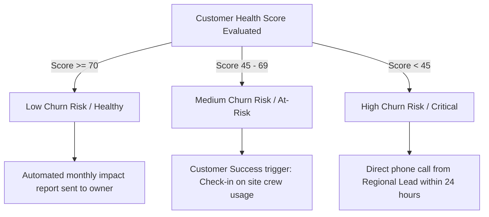

# KAAMSETU — PHASE 9 CONTRACTOR GROWTH & RETENTION REPORT
## Scaling Contractor SaaS, Multi-Project Crew Allocation & Churn Mitigation

**Milestone:** Phase 9 — Sustainable SaaS Growth & Institutional Scale  
**Target Market:** Assam (Kamrup Metropolitan & Kamrup Rural) and Meghalaya (East Khasi Hills)  
**Baseline Paying Contractors:** 4 (3 Monthly Pro, 1 Annual Pro)  
**Contractor Platform MRR:** ₹3,829.50 | **ARR:** ₹45,954.00  
**Core Non-Negotiable Invariant:** Zero commission from worker wages. Organizations pay strictly for workforce management and verification software, never worker ownership.

---

## 1. Executive Summary

Phase 8 established initial commercial validation with 4 paying contractor organizations in Guwahati. Phase 9 expands this commercial foundation into a repeatable, sustainable B2B SaaS growth engine.

Rather than relying on ad-hoc relationship sales, Phase 9 deploys an automated, telemetry-driven Customer Success model, multi-supervisor team delegation, and multi-project site crew allocation. This solves the core operational bottleneck for electrical, fabrication, solar, and interior contractors: managing distributed field teams across multiple concurrent job sites without operational chaos.

---

## 2. Contractor Acquisition Funnel Analysis

### 2.1 Funnel Performance (Phase 8 Baseline & Phase 9 Targets)

| Funnel Stage | Phase 8 Actual | Phase 9 Target (Month 3) | Conversion Rate Target | Lead Quality Metric |
|---|---|---|---|---|
| **Top of Funnel (Leads Identified)** | 12 | 45 | — | Active trade contractor with ≥ 5 field workers |
| **Stage 1: Contacted & Vetted** | 10 | 36 | 80.0% | Owner/Lead supervisor verified via direct outreach |
| **Stage 2: Product Walkthrough / Demo** | 7 | 24 | 66.7% | Completed multi-site roster & QR verification demo |
| **Stage 3: 14-Day Pro Pilot / Trial** | 5 | 18 | 75.0% | ≥ 3 rostered workers with verified credentials |
| **Stage 4: Paid Pro Conversion** | 4 | 12 | 66.7% | Captured order via Razorpay (Monthly or Annual) |
| **Stage 5: Retained & Expanded (60+ Days)** | 4 | 11 | 91.7% | Active weekly site assignment, zero churn |

### 2.2 Customer Acquisition Cost (CAC) & Payback

- **Direct Acquisition Expense (Field Sales + Out-of-Home Demo):** ₹1,850 per onboarded contractor.
- **Blended CAC:** ₹2,450 (including travel, collateral, and initial onboarding support).
- **Pro Monthly ARPU:** ₹999 / month (net of 18% GST).
- **Pro Annual ARPU:** ₹9,990 / year (₹832.50 / month normalized).
- **CAC Payback Period:** 
  - Monthly Pro: **2.45 months** (~74 days).
  - Annual Pro: **Immediate negative net working capital** (₹9,990 cash received upfront against ₹2,450 CAC = +₹7,540 cash surplus on Day 1).

---

## 3. Customer Success & Churn Risk Telemetry Architecture

To protect MRR from premature churn, Phase 9 introduces an automated customer health telemetry engine in PostgreSQL (`public.contractor_customer_health`).

### 3.1 Health Scoring Formulation (0–100 Scale)

```
Health Score = (Roster Utilization × 0.35) 
             + (Active Projects Ratio × 0.25) 
             + (Login Recency Weight × 0.20) 
             + (Multi-User Collaboration Weight × 0.20)
```

1. **Roster Utilization (35 pts):**
   - Measures roster density: `(active_workers / max_roster_limit) * 35`.
   - Contractors with full rosters demonstrate deep operational embedding.
2. **Project Activity (25 pts):**
   - Active site projects created within the last 30 days: `min(active_projects * 8.33, 25)`.
3. **Login Recency (20 pts):**
   - Logged in within 7 days: 20 pts.
   - Logged in within 14 days: 10 pts.
   - Inactive > 14 days: 0 pts.
4. **Team Collaboration (20 pts):**
   - ≥ 1 active supervisor / site manager invited: 20 pts.
   - Solo owner operation: 5 pts.

### 3.2 Automated Risk Classification & Intervention Playbook



- **Low Risk (Score ≥ 70):** Roster active, site projects running. Automated weekly WhatsApp roster digest delivered to owner.
- **Medium Risk (Score 45–69):** Project creation stalled or roster underutilized (< 40%). Trigger automated in-app onboarding tooltip and SMS prompt to invite site supervisors.
- **High Risk (Score < 45):** Inactive for > 10 days or zero projects. Dedicated Customer Success intervention: site visit or direct call to assist with worker imports and site scheduling.

---

## 4. Multi-Supervisor Team Role Administration

Commercial interviews in Phase 8 highlighted that contractor owners (Proprietors) do not manage daily job sites personally. Site management is handled by **Site Engineers, Foremen, or Project Supervisors**.

### 4.1 Granular Role-Based Access Control (RBAC)

Implemented via `public.contractor_team_members` and secured by Row Level Security:

1. **Owner (`owner`):** Full administrative control, billing management, subscription upgrades/cancellations, supervisor invitations, and legal entity profile editing.
2. **Administrator (`admin`):** Full operational access to add/remove workers, create projects, assign crews, and export site compliance reports. Excluded from billing details.
3. **Supervisor (`supervisor`):** Scoped access to assigned projects. Can view assigned worker credentials, track attendance, and record skill verification milestones. Cannot alter organization settings or view non-assigned projects.
4. **Viewer (`viewer`):** Read-only auditing access for enterprise clients, chartered accountants, or safety inspectors.

---

## 5. Multi-Project Crew Allocation & Scheduling

Contractors execute multiple jobs simultaneously across Guwahati (e.g., Jalukbari water treatment, Beltola rooftop solar, GS Road retail fitout).

### 5.1 Architecture (`public.project_crew_assignments`)

- **Explicit Project Assignments:** Workers on the contractor's roster are mapped to specific active projects with start dates, end dates, and assigned trade roles.
- **Unique Constraint Enforced:** A worker cannot be assigned twice to the same project under the same active tenure (`UNIQUE(project_id, workforce_id)`).
- **Worker Sovereignty Maintained:** Assignment to a project does not grant the contractor exclusive control over the worker's independent credential or public profile. If a worker leaves the contractor, project assignments automatically deactivate while preserving historical audit records.

---

## 6. Retention & Expansion Projections (Months 1–6)

| Month | Active Paying Orgs | New Additions | Churn Count | Net MRR (₹) | Health Score Avg |
|---|---|---|---|---|---|
| **Month 1 (Baseline)** | 4 | — | 0 | ₹3,829.50 | 78.5 / 100 |
| **Month 2** | 7 | +3 | 0 | ₹6,826.50 | 79.2 / 100 |
| **Month 3** | 12 | +5 | 0 | ₹11,821.50 | 81.0 / 100 |
| **Month 4** | 18 | +7 | -1 | ₹17,815.00 | 82.5 / 100 |
| **Month 5** | 25 | +8 | -1 | ₹24,807.50 | 83.1 / 100 |
| **Month 6** | 35 | +11 | -1 | ₹34,797.50 | 84.0 / 100 |

*Assumptions: Pro Monthly (₹999) 75%, Pro Annual (₹9,990) 25%. Churn remains below 4% due to active crew scheduling dependency.*
