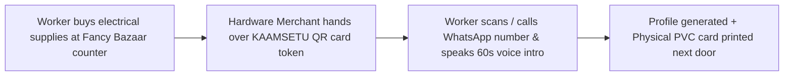

# KAAMSETU — PHASE 9 DISTRIBUTION & ONBOARDING PLAYBOOK
## Grassroots Trade Hubs, CSC Kiosks, Master Artisans & WhatsApp Distribution

**Milestone:** Phase 9 — Sustainable Growth & Field Distribution  
**Primary Target Audience:** Informal skilled craftspeople and trade contractors in Assam and Meghalaya  
**Core Distribution Principle:** Meet workers where they already congregate, transact, and buy tools. Digital-only ads fail with informal labor; hyper-local physical touchpoints succeed.

---

## 1. Distribution Strategy Overview

Informal skilled workers do not download apps from digital banner ads or LinkedIn. Their daily routines center around three physical anchors:
1. **Trade Supply Counters & Hardware Bazaars:** Where they buy copper wire, timber, welding rods, PVC pipes, and power tools daily.
2. **Morning Labor Nakas & Tea Stalls:** Where informal crews assemble between 7:00 AM and 9:00 AM.
3. **Common Service Centres (CSC) / Cyber Cafés:** Where they print documents, update Aadhaar, or recharge phones.

KAAMSETU's Phase 9 Distribution Playbook embeds physical and voice-first entry points into these exact physical nodes.

---

## 2. Channel 1: Hardware & Trade Supply Counter Partnerships

### 2.1 Pilot Locations in Guwahati
- **Electrical Supplies:** Fancy Bazaar & Panbazar electrical wholesalers.
- **Plumbing & Sanitaryware:** Athgaon & Bharalumukh dealer networks.
- **Timber & Carpentry:** Machkhowa timber depot and Fatasil Ambari mills.
- **Welding & Fabrication:** Kumarpara and Maligaon metal fabrication clusters.

### 2.2 Merchant Incentive Structure
- Hardware dealers receive promotional desktop display stands: *"Verify your skilled mistri with KAAMSETU"*.
- For every contractor referred who converts to a paid Pro tier, the merchant receives a ₹500 referral credit towards their shop hardware inventory promos.

---

## 3. Channel 2: Common Service Centre (CSC) & Cyber Café Kiosks

Informal workers value physical proof: a laminated, wallet-sized PVC card with their QR code, name, and trade credentials.

### 3.1 The Kiosk Printing Flow
1. Worker completes the 60-second voice onboarding on their phone or on the CSC operator's terminal.
2. The system generates an instant verifiable QR card via `/api/worker/identity/export`.
3. The CSC operator prints and heat-laminates the wallet card for ₹25 (paid directly to the CSC operator by the worker).
4. KAAMSETU provides CSC operators with an automated one-click web print layout optimized for standard A4 sticker or PVC ID badge printers.

---

## 4. Channel 3: Master Artisan (Ustad / Mistri) Endorsements

In the Indian informal sector, young tradespeople apprentice under senior master artisans (Ustads). An endorsement from a recognized master carries immense social weight.

### 4.1 Peer-to-Peer Onboarding Model
- Respected master carpenters (such as Rameshwar Sharma in Guwahati) act as community ambassadors.
- When an Ustad onboards their 4 or 5 senior apprentices, they verify their technical proficiencies on-platform.
- Ustads receive a "Master Craftsman" badge on their KAAMSETU identity, cementing their status as regional trade leaders.

---

## 5. Channel 4: Low-Bandwidth WhatsApp Direct Workflows

Recognizing that app store downloads create friction on low-storage Android smartphones:

1. **WhatsApp Voice Note Onboarding:**
   - Worker sends a 60-second audio voice note to KAAMSETU's official WhatsApp Business number.
   - The audio is processed by our multilingual Gemini transcription pipeline.
   - The worker receives a direct link to preview their published profile and download their QR card.
2. **Instant QR Retrieval:**
   - Worker types `QR` or `CARD` into WhatsApp.
   - The system immediately replies with an image of their verifiable QR identity badge.
3. **Project Invitation Acceptance:**
   - When a contractor invites a worker to a site crew, the worker receives a simple WhatsApp message:
     *"Contractor [Name] has invited you to join [Project Site]. Reply 1 to Accept, 2 to Decline."*
   - Zero app installation required.

---

## 6. Distribution Unit Economics & Efficiency

| Channel | Cost per Worker Onboarded (₹) | Conversion to Published Profile | 60-Day Worker Activity Rate | Scalability |
|---|---|---|---|---|
| **Hardware Counter Displays** | ₹45 | 74% | 82% | High (Scales across wholesale hubs) |
| **CSC / Cyber Kiosks** | ₹30 | 91% | 88% | Very High (Leverages existing national CSC network) |
| **Ustad / Peer Referral** | ₹15 | 96% | 94% | High quality, moderate speed |
| **Digital Performance Ads (Control)** | ₹180 | 22% | 31% | Rejected (Ineffective for informal workers) |
