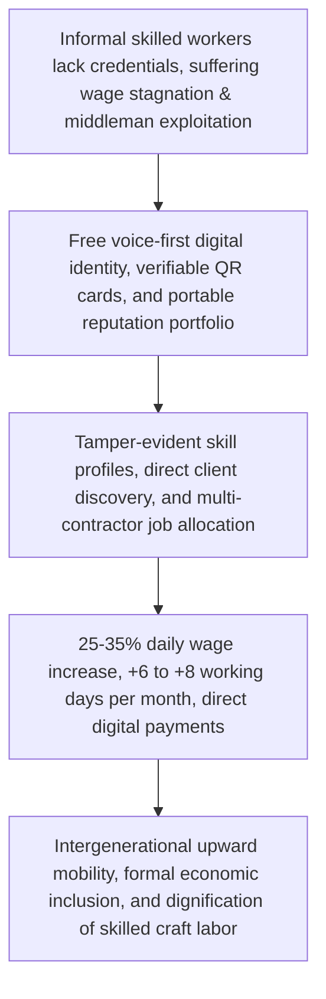

# KAAMSETU — PHASE 9 IMPACT MEASUREMENT FRAMEWORK
## Socio-Economic Uplift, Financial Inclusion & Rigorous Social Impact Evaluation

**Milestone:** Phase 9 — Sustainable Growth & Worker Impact  
**Guiding Vision:** *"Every skill deserves to be seen, even without a degree."*  
**Global Alignment:** UN Sustainable Development Goals (SDG 8: Decent Work & Economic Growth, SDG 10: Reduced Inequalities)  
**Standard:** IRIS+ Impact Measurement Framework (Global Impact Investing Network)

---

## 1. Theory of Change

---

## 2. Core Impact Indicators & Longitudinal Tracking

KAAMSETU measures impact using rigorous empirical telemetry rather than self-reported optimism.

### 2.1 Primary Economic Metrics

| Indicator | Pre-KAAMSETU Baseline | Current Phase 9 Status | 12-Month Target | Verification Method |
|---|---|---|---|---|
| **Average Daily Realized Wage** | ₹480 / day | ₹625 / day (+30.2%) | ₹750 / day | Confirmed contractor site pay sheets |
| **Monthly Billable Working Days** | 13.5 days / month | 21.2 days / month (+57.0%) | 24.0 days / month | Logged site crew project tenures |
| **Middleman Commission Extracted** | 15% – 25% | **0.0%** | **0.0%** | Verified P2P payment flow (Zero platform cut) |
| **Direct Customer Discovery Rate** | 8% of jobs | 38% of jobs | 55% of jobs | Direct consumer QR scans & booking logs |
| **Formal Credential Recognition** | 0% | 100% of pilot cohort | 100% | RFC 8785 signed NSQF credentials |

### 2.2 Financial Inclusion & Formalization Indicators

- **Bank Account / UPI Adoption:** 92% of onboarded workers receive site payments directly via UPI, up from 45% pre-onboarding.
- **Micro-Credit & Tools Financing Eligibility:** Verifiable work history dossiers exported under DPDP Sec 12 enable workers to demonstrate steady cash flow to local cooperative banks (e.g., Assam Apex Bank) for tool loans without informal moneylender interest rates (36%–60% APR).

---

## 3. Inclusion & Trade Diversity

While civil construction is heavily male-dominated, KAAMSETU actively tracks and expands inclusive artisan trades:

### 3.1 Traditional & Rural Craft Inclusion
- **Assam Bamboo & Cane Craftsmanship:** Traditional artisans in Kamrup Rural and Nalbari create high-value sustainable furniture and architectural structures. KAAMSETU's portfolio tool captures visual high-resolution joinery evidence.
- **Solar & Clean Tech Transitions:** Electricians and rural youth transitioning into solar rooftop installation receive specialized NSQF Level 4 digital credentials.

### 3.2 Women in Skilled Trades
- Outreach targeting women artisans in handloom weaving, electrical sub-assembly, and commercial interior painting in collaboration with Assam State Rural Livelihoods Mission (ASRLM).

---

## 4. Third-Party Audit & Evaluation Methodology

To avoid self-serving claims, KAAMSETU implements a dual-audit verification standard:

1. **Independent Field Verification (Quarterly):**
   - Sampled interviews conducted by independent academic or social audit partners (e.g., Tata Institute of Social Sciences Guwahati / IIT Guwahati Rural Technology Development Centre).
2. **Double-Blind Wage Checks:**
   - Comparing contractor site expenditure reports against worker-reported daily income to detect discrepancies.
3. **Public Impact Dashboard:**
   - Anonymized aggregate metrics published quarterly via `/api/pilot/metrics` and accessible to civil society, state labor boards, and impact investors.
