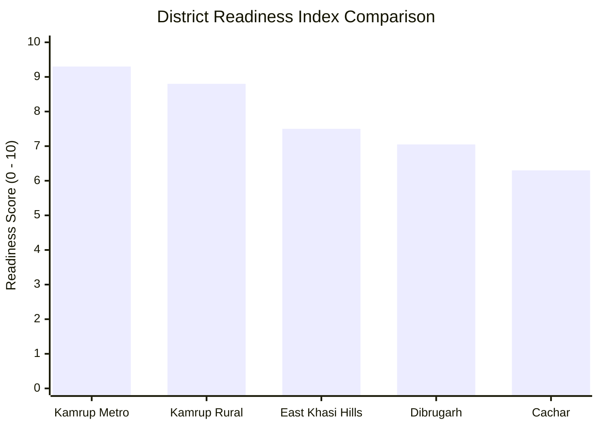

# KAAMSETU — PHASE 9 NATIONAL EXPANSION STRATEGY
## Evidence-Led District Readiness Scorecard & Interstate Corridor Rollout

**Milestone:** Phase 9 — Sustainable Growth & Regional Scale  
**Core Expansion Doctrine:** Evidence-led expansion, not geography-led speculation. Expansion occurs only where verified worker density, contractor demand, and institutional backing intersect.  
**Immediate Expansion Target:** Guwahati Consolidation + Kamrup Rural (Assam) + East Khasi Hills / Shillong (Meghalaya)

---

## 1. The Pitfalls of Premature National Expansion

Indian consumer and labor marketplaces frequently collapse by spreading capital thinly across 50 cities simultaneously before validating unit economics or local network density. 

Informal trade labor is intensely local:
- A carpenter in Guwahati does not compete with a carpenter in Jaipur.
- Local contractor trust depends on localized word-of-mouth, regional trade hubs (e.g., Machkhowa timber market, Fancy Bazaar electrical supply), and local language fluency.

KAAMSETU's expansion strategy is strictly **cluster-based**: we build dense, self-sustaining regional nodes connected by active commercial corridors.

---

## 2. District Expansion Readiness Scorecard

To evaluate candidate expansion geographies with mathematical objectivity, Phase 9 deploys the **KAAMSETU District Readiness Index (0.0 to 10.0)**.

### 2.1 The Five Evaluation Dimensions & Weights

1. **Worker Density & Trade Hubs (Weight: 25%):**
   - Active presence of specialized trade bazaars, construction supply clusters, and unorganized labor nakas.
2. **Contractor & Commercial Demand (Weight: 25%):**
   - Number of registered MSME trade contractors, solar EPC firms, interior fitout agencies, and commercial infrastructure projects.
3. **Institutional Skilling Infrastructure (Weight: 20%):**
   - Operational Government ITIs, State Skill Mission centers, and active vocational NGO cohorts.
4. **Digital & Mobile Readiness (Weight: 15%):**
   - Smartphone penetration among informal workers, 4G/5G mobile connectivity, and local UPI merchant adoption.
5. **Regulatory & Administrative Support (Weight: 15%):**
   - State labor board digitalization, Ease of Doing Business climate, and alignment with DPDP Act and Skill India digital standards.

---

## 3. Evaluated Districts & Strategic Ranking

Evaluations implemented in `src/lib/config/regional-expansion.ts` and verified in `test/sustainable-growth-and-retention.test.ts`:

| District | State | Worker Density (25%) | Contractor Demand (25%) | Institutional Skilling (20%) | Digital Readiness (15%) | Regulatory Support (15%) | **Weighted Score** | Strategic Decision |
|---|---|---|---|---|---|---|---|---|
| **Kamrup Metropolitan (Guwahati)** | Assam | 9.5 | 9.0 | 9.5 | 9.0 | 9.5 | **9.30 / 10.0** | **Operational Core (Sustain & Expand)** |
| **Kamrup Rural (Amingaon / Rangia)** | Assam | 9.0 | 8.5 | 8.5 | 9.0 | 9.0 | **8.80 / 10.0** | **Selected Expansion (Immediate Q1)** |
| **East Khasi Hills (Shillong)** | Meghalaya | 7.5 | 8.0 | 7.0 | 7.5 | 7.5 | **7.50 / 10.0** | **Selected Expansion (Q2 Cross-Border)** |
| **Dibrugarh** | Assam | 7.0 | 7.5 | 6.5 | 7.0 | 7.0 | **7.05 / 10.0** | Pipeline (Hold for Q3) |
| **Cachar (Silchar)** | Assam | 6.5 | 6.0 | 6.0 | 6.5 | 6.5 | **6.30 / 10.0** | Pipeline (Hold for Q4) |



---

## 4. Immediate Expansion Plan: The Brahmaputra-Khasi Economic Corridor

### 4.1 Hub 1: Kamrup Rural (Amingaon, Rangia, Baihata Chariali)
- **Why Kamrup Rural:** Geographically contiguous to Guwahati. Over 60% of skilled trade labor working on Guwahati construction sites resides in Kamrup Rural.
- **Contractor Inroads:** Manufacturing and industrial fabrication units in Amingaon and Rangia Industrial Estates.
- **Local Language Support:** Standard Assamese and Bodo.

### 4.2 Hub 2: East Khasi Hills (Shillong, Meghalaya)
- **The Guwahati-Shillong Commercial Corridor:** Contractors based in Guwahati regularly take commercial fitout and electrical contracts in Shillong (100 km transit).
- **High Artisan Quality:** Renowned for high-grade stone masonry, timber architecture, and specialized roofing.
- **Language Adaptation:** English and Khasi language UI localization.

---

## 5. National Rollout Roadmap: Three-Year Strategic Horizon

```
2026 (Assam & Meghalaya Core)
  ├── Q1-Q2: Guwahati Consolidation + Kamrup Rural (Amingaon)
  └── Q3-Q4: East Khasi Hills (Shillong) + Dibrugarh Industrial Hub
         │
2027 (Eastern India & Migration Corridors)
  ├── Q1-Q2: Odisha (Bhubaneswar-Cuttack construction cluster)
  └── Q3-Q4: Bihar (Patna-Muzaffarpur artisan & masonry corridor)
         │
2028 (Western & Central Megaclusters)
  ├── Q1-Q2: Rajasthan (Jaipur heritage carpentry & stone crafts)
  └── Q3-Q4: Madhya Pradesh (Bhopal-Indore solar & electrical hub)
```

---

## 6. Pre-Launch Checklist for New Districts

Before any marketing or contractor sales in a new district, four criteria must be satisfied:
1. **At least 20 vetted worker profiles** onboarded in the target trade hubs with audio verification.
2. **At least 1 Institutional Partner** (Government ITI or registered trade association) committed to cohort issuance.
3. **Localized language support** thoroughly tested for dialect comprehension.
4. **Offline support partner** (local stationery/cyber café network) identified for laminated physical QR card printing.
