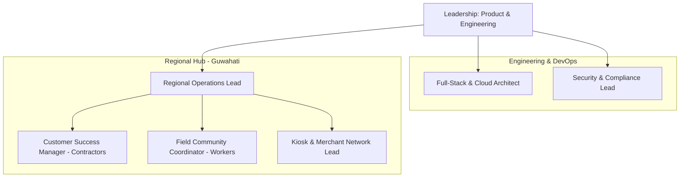

# KAAMSETU — PHASE 9 OPERATING MODEL & TEAM TOPOLOGY
## Field Operations, Customer Success SLAs, DevOps Cadence & Incident Response

**Milestone:** Phase 9 — Sustainable Growth & Operating Maturity  
**Operating Scope:** Guwahati Regional Hub + Expanding Northeast Corridors  
**Team Philosophy:** Highly automated core platform paired with empathetic, hyper-local field customer success.

---

## 1. Operating Model & Team Topology

KAAMSETU operates on a hub-and-spoke organizational structure designed for extreme capital efficiency and deep community trust:



### 1.1 Role Responsibilities

1. **Regional Operations Lead (Guwahati):**
   - Owns regional expansion targets across Kamrup Metro, Kamrup Rural, and East Khasi Hills.
   - Manages institutional relationships with ASDM, Directorate of Technical Education, and trade associations.
2. **Customer Success Manager (Contractors):**
   - Monitors `public.contractor_customer_health` telemetry daily.
   - Executes proactive interventions for contractors with health scores < 60.
   - Onboards contractor site supervisors onto multi-project scheduling tools.
3. **Field Community Coordinator (Workers):**
   - Conducts weekly morning outreach at labor nakas (Beltola, Jalukbari, Maligaon).
   - Coordinates with Master Artisans (Ustads) for peer onboarding.
   - Assists workers with profile corrections and laminated physical QR cards.
4. **Platform & DevOps Architect:**
   - Maintains 99.9% uptime across Next.js app, Supabase PostgreSQL, and storage nodes.
   - Executes weekly automated DR restore drills and cryptographic key rotation routines.

---

## 2. Customer Success & Contractor Support SLAs

To maintain high retention and low churn (< 3.5% monthly), KAAMSETU establishes strict Service Level Agreements (SLAs):

| Support Tier | Channel | First Response SLA | Resolution SLA | Coverage Hours |
|---|---|---|---|---|
| **Free / Starter** | In-app FAQ & Bot | < 4 hours | < 24 hours | 9:00 AM – 6:00 PM IST |
| **Pro Contractor** | WhatsApp Business + Phone | < 15 minutes | < 2 hours | 7:00 AM – 8:00 PM IST |
| **Business / EPC** | Dedicated Account Lead | < 5 minutes | < 1 hour | 24 / 7 Site Emergency |
| **Institutional Partner**| Email & Direct Desk | < 30 minutes | < 4 hours | 9:00 AM – 6:00 PM IST |

---

## 3. DevOps & Platform Maintenance Cadence

### 3.1 Daily Operations
- Automated check of rate limiter health and dead-letter queues.
- Automated daily backup execution via `pg_dump` to encrypted offsite bucket.
- Telemetry evaluation: Customer Health Scores recalculated at 00:00 UTC.

### 3.2 Weekly Operations
- Disaster recovery restore drill in isolated test schema.
- Payment gateway reconciliation: matching Razorpay captured orders with `subscription_orders`.
- Review of flagged abuse reports (`/api/reports/abuse`).

### 3.3 Monthly Operations
- GSTR-1 and GSTR-3B tax invoice filing and GST reconciliation.
- Evaluation of District Readiness Index for expansion pipeline.
- Worker outcome tracking update for institutional cohorts.

---

## 4. Incident Response & Escalation Protocol

```
Severity 1 (Critical Outage / Security Breach)
  ├── Immediate SMS/PagerDuty alert to CTO & Security Lead (< 5 mins)
  ├── Fail-closed safety mechanisms engage automatically
  ├── Public status banner activated
  └── Target Resolution: < 30 minutes

Severity 2 (Degraded Performance / Payment Gateway Failure)
  ├── Alert to On-call DevOps & Customer Success Manager (< 15 mins)
  ├── Fallback to asynchronous offline payment recording
  └── Target Resolution: < 2 hours

Severity 3 (Minor UI Glitch / Non-Blocking Bug)
  ├── Logged to sprint backlog
  └── Target Resolution: Next scheduled deploy (< 48 hours)
```
