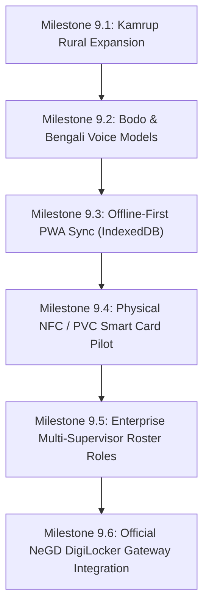

# KAAMSETU — Phase 9 Product & Operational Expansion Roadmap

**Target Timeline:** Q1 2027 (Jan - Mar 2027)  
**Baseline:** Phase 8 Production Release (`d26dc73` / `phase-8-production-launch`)  
**Core Promise:** "Every skill deserves to be seen, even without a degree."  

---

## 1. Phase 9 Strategic Objectives

Following the commercial validation and production readiness achieved in Phase 8, Phase 9 focuses on three scaling pillars:
1. **Regional Footprint Expansion**: Expand from Kamrup Metropolitan into Kamrup Rural (Changsari, Hajo, Sualkuchi, Rangia).
2. **Linguistic Inclusivity**: Deploy Bodo and Sylheti/Bengali voice-first onboarding models.
3. **Physical-Digital Bridge**: Deliver tap-and-verify physical NFC/PVC smart cards for informal workers on high-dust construction sites.

---

## 2. Phase 9 Milestones & Engineering Deliverables

### Milestone 9.1: Kamrup Rural Expansion
- Establish field partnerships in Rangia and Changsari.
- Onboard 150 craftspeople across electrical, welding, carpentry, and masonry trades.
- Enroll 10 regional EPC contractors onto Contractor Pro subscriptions.
- Target MRR expansion: **₹15,000 / month** in incremental SaaS revenue.

### Milestone 9.2: Regional Language Voice AI Models
- Train Gemini prompt adaptors for **Bodo (बर’) dialect** spoken in Bodoland Territorial Region (BTR) and Udalguri.
- Enhance code-switched Assamese-English (*Assamish*) recognition for technical trade terms (e.g. *mitre cut*, *conduit fitting*, *inverter capacity*).
- Benchmark: Maintain strict $\ge 90\%$ skill extraction accuracy and 0% qualification invention across all dialect inputs.

### Milestone 9.3: Offline-First PWA Synchronization
- Implement local client-side queue using browser **IndexedDB** for workers capturing on-site job evidence in 2G or zero-signal basements.
- Background sync triggers cryptographic hash generation and auto-uploads work evidence once 4G connectivity restores.

### Milestone 9.4: Physical NFC / PVC Smart Card Pilot
- Partner with local Guwahati printing cooperatives to produce durable, waterproof PVC skill cards embedded with NTAG213 NFC chips.
- Site supervisors can tap their standard Android NFC phone against a worker's card to load the verified tamper-evident profile in $< 1\text{ second}$ without manual camera alignment.

### Milestone 9.5: Enterprise Multi-Supervisor Management
- Enhance Contractor Business tier (₹2,999/mo) with role-based sub-accounts for site thekedaars and project engineers.
- Enables site supervisors to verify work completions and record daily attendance across distributed building sites while centralizing billing with the company owner.

### Milestone 9.6: NeGD DigiLocker Official Integration
- Transition DigiLocker verification from the current fail-closed status to production upon finalization of the formal government agreement with the National e-Governance Division (NeGD).
