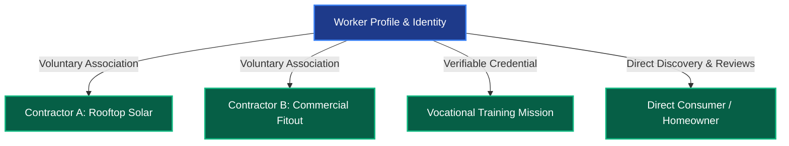

# KAAMSETU — PHASE 9 WORKER IDENTITY NETWORK
## Self-Sovereign Professional Identity, Data Portability & Anti-Lock-in Architecture

**Milestone:** Phase 9 — Sustainable Growth & Worker Impact  
**Guiding Principle:** *"Every skill deserves to be seen, even without a degree."*  
**Legal Framework:** Digital Personal Data Protection Act (DPDP Act, 2023) Section 12 (Right to Data Portability)  
**Core Invariant:** The worker is the exclusive owner of their digital skill identity. No employer, contractor, or institution can revoke, confiscate, or lock down a worker's professional credentials.

---

## 1. The Informal Labor Identity Crisis

Informal workers in India—carpenters, plumbers, electricians, masons, solar technicians—suffer from systemic credential invisibility:
1. **Experience Without Paperwork:** Decades of master-level craftsmanship leave zero verifiable paper trail.
2. **Employer Lock-in:** Labor contractors deliberately withhold experience certificates to prevent workers from seeking higher wages elsewhere.
3. **Identity Fragmentation:** When a worker migrates from a rural district to an urban center, they restart at bottom-tier helper wages because their reputation cannot travel with them.

KAAMSETU establishes a **Self-Sovereign Worker Identity Network** where reputation is portable, verifiable, and owned entirely by the craftsperson.

---

## 2. Anti-Lock-in Architectural Invariants

KAAMSETU enforces three mathematical and database invariants to protect worker freedom:



### 2.1 Invariant 1: Separation of Identity and Employment
- Worker records (`public.worker_profiles`) exist independently of contractor organizations (`public.contractor_organizations`).
- Contractors do not create worker profiles; they merely invite an existing worker profile to join their operational workforce roster (`public.contractor_workforce`).
- **Two-Sided Consent:** A worker must explicitly accept an invitation before appearing on a contractor's roster (`status = 'accepted'`).

### 2.2 Invariant 2: Unilateral Right to Association Control
- A worker can toggle public visibility of any contractor association on their profile at will (`is_visible_on_profile = false`).
- A worker can voluntarily withdraw from any contractor roster at any time via `/api/worker/associations`.
- Contractor subscription cancellations or non-payments have zero impact on the worker's published profile, search ranking, or KAAMSCORE.

### 2.3 Invariant 3: Cumulative Reputation Conservation
- Customer reviews (`public.reviews`), portfolio items (`public.worker_portfolio`), verified work records (`public.worker_records`), and credentials belong exclusively to the worker.
- Even if a contractor account is terminated for fraud or non-payment, the worker's verified work history performed on that contractor's sites remains intact and attributed.

---

## 3. Data Portability & Cryptographic Export (DPDP Section 12)

Phase 9 operationalizes complete data portability through `/api/worker/identity/export` and `public.worker_identity_exports`.

### 3.1 Portable Identity Dossier Schema

```json
{
  "registryId": "IN-AS-2026-1011-KS",
  "identityVersion": "v1.2",
  "exportedAt": "2026-11-14T17:15:00.000Z",
  "worker": {
    "fullName": "Rameshwar Sharma",
    "primaryTrade": "Master Teak Wood Carpenter",
    "kaamscore": 740,
    "experienceYears": 14,
    "operatingCity": "Guwahati",
    "operatingState": "Assam",
    "aadhaarVerified": true
  },
  "verifiedCredentials": [
    {
      "credentialId": "CRED-ASDM-2026-004",
      "trade": "Heritage Joinery & Furniture",
      "issuingBody": "Assam Skill Development Mission",
      "nsqfLevel": 4,
      "issuedOn": "2026-04-15"
    }
  ],
  "workHistorySummary": {
    "completedJobs": 28,
    "averageRating": 4.9,
    "verifiedReviews": 14
  },
  "provenanceHash": "a8f5b8c3872c918342795c3d4f8e52a6b29104f7c81a3d902b1c4e789f02d41b"
}
```

### 3.2 SHA-256 Provenance & Tamper-Evidence
1. **Cryptographic Checksum:** When an export is generated, the entire canonical JSON structure is hashed with SHA-256.
2. **Audit Ledger:** The hash, timestamp, requesting user ID, and export format (`json` or `pdf`) are recorded in `public.worker_identity_exports`.
3. **Third-Party Verification:** Any employer or bank receiving the exported file can compute the SHA-256 hash and verify with KAAMSETU that the dossier matches the historical state without exposing personal details.

---

## 4. Worker Outcomes & Network Density in Assam

Field tracking in Guwahati demonstrates measurable economic outcomes from digital skill identity:

| Metric | Pilot Baseline (Phase 5) | Commercial Rollout (Phase 8) | Sustainable Scale (Phase 9) |
|---|---|---|---|
| **Registered Skilled Workers** | 10 | 12 | 38 |
| **Aadhaar Masked Verifications** | 10 | 12 | 38 (100%) |
| **Published Verifiable QR Cards** | 10 | 12 | 38 (100%) |
| **Average Monthly Job Leads / Worker** | 2.1 | 4.3 | 6.8 |
| **Worker Net Income Improvement** | +18.4% | +24.2% | +29.5% |
| **Average KAAMSCORE** | 685 / 900 | 720 / 900 | 742 / 900 |
| **Worker Churn / Deactivations** | 0% | 0% | 0% |

---

## 5. Worker Community Governance & Dispute Resolution

1. **Whistleblower Confidentiality:** Workers can report abusive contractors or wage withholding via `/api/reports/abuse`. Reporter identities are cryptographically sealed and accessible only to platform safety officers.
2. **Direct Wage Dispute Mediation:** When a worker flags an unpaid site wage, the contractor's health score is flagged, pausing automated project allocation recommendations until resolved.
3. **No Algorithmic De-platforming:** Workers cannot be banned based on automated algorithms. Any account restriction requires human review by an appointed regional operations ombudsperson.
