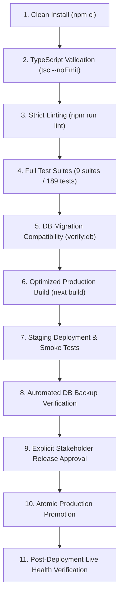

# KAAMSETU — Production Deployment Runbook & Operational Procedures

**Version:** 1.0.0 (Phase 8 Production Release)  
**Target Environment:** Vercel (Next.js 15 SSR) + Supabase Enterprise (PostgreSQL 15) + AWS S3/Supabase Storage  
**Compliance Standard:** ISO/IEC 27001, Indian DPDP Act 2023, TRAI Telecom DLT Regulation  

---

## 1. Release Architecture & Pipeline Stages

Every production release must execute through this 11-stage pipeline without skipping stages:



---

## 2. Environment Configuration & Secrets Management

### Critical Security Rule
**NEVER commit production secrets to Git.** All secrets must be injected via secure CI/CD vault (Vercel Project Environment Variables / AWS Secrets Manager).

| Variable Name | Environment | Minimum Specification | Purpose |
| :--- | :--- | :--- | :--- |
| `NEXT_PUBLIC_SUPABASE_URL` | All | Valid HTTPS URL | Supabase SSR API Endpoint |
| `NEXT_PUBLIC_SUPABASE_ANON_KEY` | All | Valid JWT | Public anon key for SSR browser client |
| `SUPABASE_SERVICE_ROLE_KEY` | Server Only | Valid JWT | Elevated key for background jobs & rate limits |
| `CREDENTIAL_SIGNING_KEY` | Server Only | $\ge 32$ Base64 bytes (256-bit entropy) | RFC 8785 Canonical JSON credential signing |
| `ACTIVE_SIGNING_KEY_VERSION` | Server Only | `v1` (or active key tag) | Multi-version rotation tag |
| `RATE_LIMIT_HMAC_SECRET` | Server Only | $\ge 32$ Base64 bytes (256-bit entropy) | Privacy-preserving phone & IP hashing |
| `PAYMENT_GATEWAY_SECRET` | Server Only | $\ge 32$ Base64 bytes (256-bit entropy) | Razorpay HMAC-SHA256 signature verification |
| `ENABLE_LIVE_PAYMENTS` | Production | `true` | Enables live payment gateway verification |
| `ENABLE_DEMO_AUTH` | Production | `false` (**STRICTLY BLOCKED**) | Demo bypass toggle. Throws fatal error if true in prod |
| `GEMINI_API_KEY` | Server Only | Valid Google AI Key | Voice transcription & ontology mapping |
| `TELECOM_DLT_ENTITY_ID` | Production | 14-digit TRAI DLT ID | Indian Telecom Commercial Communication compliance |

---

## 3. Database Migration & Deployment Safety

### Migration Protocol
1. **Zero-Downtime Rule**: Migrations must be strictly backward compatible. Add columns with defaults or nullable constraints. Never drop or rename active columns in the same release.
2. **Pre-Deployment Dry Run**: Run `npm run verify:db` to validate migrations 01 through 09 against the target schema.
3. **Execution Command**:
   ```bash
   supabase db push --include-all
   ```

### Backup & Disaster Recovery Verification
Before executing any migration on production:
1. Trigger an on-demand PostgreSQL snapshot:
   ```bash
   pg_dump -h $PGHOST -U $PGUSER -d $PGDATABASE --no-owner --no-acl -f "backup_pre_deploy_$(date +%s).sql"
   ```
2. Verify backup file non-emptiness and integrity:
   ```bash
   head -n 20 "backup_pre_deploy_$(date +%s).sql" | grep "PostgreSQL database dump"
   ```
3. Test restoration into isolated disaster-recovery instance (`kaamsetu_restore_test`):
   ```bash
   psql -h $PGHOST -U $PGUSER -d kaamsetu_restore_test -f "backup_pre_deploy_$(date +%s).sql"
   ```

---

## 4. Rollback Procedures

If any post-deployment smoke test fails:

### Fast-Rollback (Code Level)
1. In Vercel / Cloud dashboard, instant-rollback to previous deployment commit (`d26dc73`).
2. Immediate traffic redirection takes $< 15$ seconds.

### Database Rollback (Data Level)
1. If migration corrupted state, restore from pre-deployment snapshot:
   ```bash
   psql -h $PGHOST -U $PGUSER -d $PGDATABASE -f "backup_pre_deploy_<timestamp>.sql"
   ```
2. Notify on-call incident commander and log event in `docs/INCIDENT_LOG.md`.

---

## 5. Post-Deployment Verification Checklist

- [ ] Call `GET /api/health` and verify HTTP 200:
  - `status: "healthy"`
  - `version: "0.1.0"`
  - `commit: "<deployed_commit>"`
  - `billing.mode: "live"`
- [ ] Call `POST /api/auth/otp/send` with test number and verify rate limiting increments in `auth_rate_limits`.
- [ ] Verify scannable QR verification route: `GET /verify/IN-AS-2026-1011-KS` returns valid rendered page.
- [ ] Verify Webhook endpoint: `POST /api/contractor/billing/webhook` with invalid signature returns HTTP 400.
- [ ] Verify Worker Association endpoint: `GET /api/worker/associations` requires authentication.
