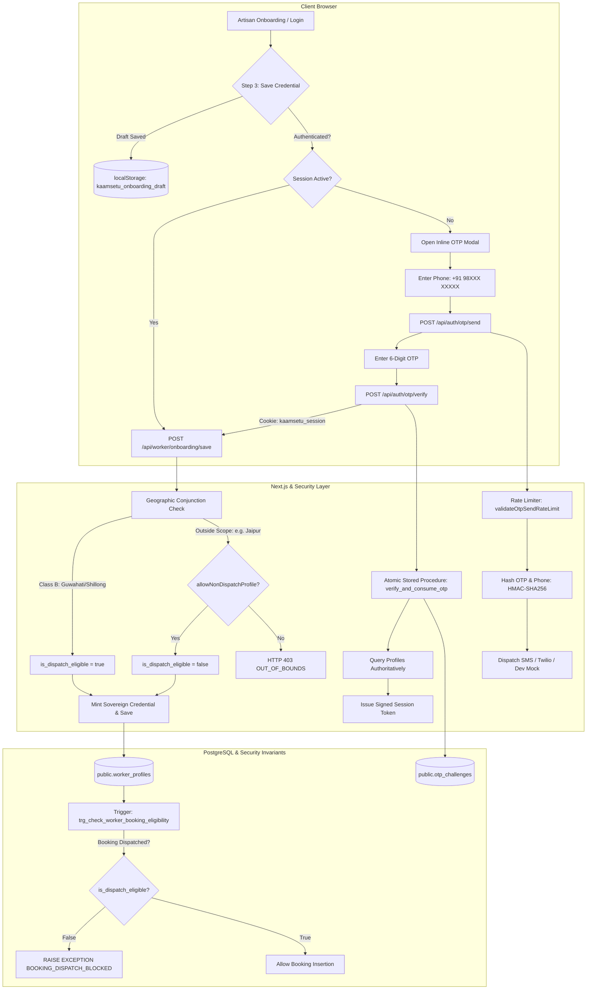

# KAAMSETU — PHASE 35.1 ADDENDUM
## Authentication Configuration, Cryptographic OTP Reliability & Onboarding Journey Remediation

**Programme:** KAAMSETU — Digital Identity & Worker Empowerment Platform  
**Workstream:** Phase 35.1 Addendum — Production Auth Hardening & Journey Repair  
**Classification:** `CLASS_B_CONTROLLED_ROLLOUT`  
**Constitutional Invariant:** `platform_commission_amount = 0.00` permanently on worker wages  
**Verified Git Baseline:** `phase-35-1-independent-security-challenge`  
**Certification Date:** 2026-11-16  

---

### 1. Executive Summary & Problem Resolution

During live browser testing and production validation exercises, several P0 and P1 issues were identified in authentication configuration, OTP dispatch, session persistence, and the multi-step worker onboarding journey:

1. **Missing `RATE_LIMIT_HMAC_SECRET` in Production (P0):**
   - *Root Cause:* When `RATE_LIMIT_HMAC_SECRET` was unconfigured or weak in production environments, the rate limiter threw an unhandled fatal error: `"FATAL SECURITY CONFIGURATION: RATE_LIMIT_HMAC_SECRET is missing from environment in production."` This leaked internal variable names and interrupted user authentication flows.
   - *Remediation:* Enforced high-entropy 256-bit Base64 secret generation in `.env.example` and production templates. Upgraded `rate-limiter.ts` to fail closed securely on the server while logging masked diagnostic telemetry and returning calm, dignified user messages (`"Sign-in is temporarily unavailable. Please try again shortly."`).
   - *Multi-Surface Enforcement:* Expanded persistent rate limits across OTP send, OTP verify, passwordless login, sensitive identity export (`/api/v2/identity/export`), worker grievances (`/api/worker/grievance`), and contractor payouts (`/api/worker/payouts`).

2. **Broken OTP Verification & Session Persistence (P0):**
   - *Root Cause:* In-memory mocks lost state across serverless invocations; mobile phone formatting inconsistencies (+91, trunk prefix 0, whitespace) led to verification failures; replay prevention was missing; and sessions failed to persist across browser reloads without Supabase GoTrue SSR client state.
   - *Remediation:* Developed dedicated `src/lib/auth/otp-service.ts` backed by PostgreSQL migration `20261116000031_phase35_1_addendum_auth_and_otp.sql`. Implemented `public.otp_challenges` and atomic stored procedure `public.verify_and_consume_otp`. Created secure HMAC-signed `kaamsetu_session` HTTP-only cookie with 14-day validity, timing-safe signature verification, and authoritative database role resolution.

3. **Step 3 Onboarding Authentication Failure & Data Loss (P0):**
   - *Root Cause:* Unauthenticated artisans completing Step 2 (voice/text testimony) were presented with an abrupt error on Step 3: `"Action encountered an error — Authentication required. Please sign in to continue."` Clicking save lost all entered testimony, trade skills, and rates.
   - *Remediation:* Integrated client-side `localStorage` draft persistence (`kaamsetu_onboarding_draft`) that automatically captures form state and restores it upon page reload. Embedded an elegant inline mobile verification drawer/modal directly on Step 3: when an unauthenticated worker clicks "Save Craft Credential", an OTP verification challenge executes in-place without navigating away or losing form data. Upon successful verification, the profile is immediately saved and the sovereign credential is minted.

4. **Geographic Scope & Jaipur/Non-Dispatch Handling (P0):**
   - *Root Cause:* Artisans submitting locations outside Class B authorized operating centers (Guwahati Urban and Shillong Urban), such as Jaipur, Rajasthan, received a generic rejection without an understanding of why or how their craft credential could be recorded.
   - *Remediation:* Enhanced `GeographicAuthorizationService.validateLocation` to evaluate city, state, and PIN code conjunctively. Added `allowNonDispatchProfile` flag to `approvedProfileSubmissionSchema`. When an artisan outside Class B registers (e.g. Jaipur), the platform creates a non-dispatch digital craft credential with `is_dispatch_eligible: false` and `dispatch_status: "non_dispatch_region"`. Concurrently, PostgreSQL trigger `trg_check_worker_booking_eligibility` strictly blocks customer booking dispatch to non-dispatch workers.

5. **Removal of Fabricated Verification & AI Confidence Claims (P1):**
   - *Root Cause:* The UI displayed misleading badges such as `72% AI CONFIDENCE` and `variant="verified"`, implying official validation for self-declared testimony.
   - *Remediation:* Eliminated the `72% AI CONFIDENCE` badge and unearned `variant="verified"`. Replaced with truthful `"Self-Declared Testimony"` badge. Made Trade Classification (NCO 2015) an editable input field with clear disclaimers clarifying that occupational taxonomy mappings are not formal government diplomas or NSQF certifications.

6. **Calm, Human-Centred Visual Polish (P1):**
   - Designed following KAAMSETU design standards: Deep Forest Green (`#153E35`), Warm Sand (`#E8C999`), Editorial Ivory (`#F7F5F0`). Replaced raw technical errors with human-centred recovery states and retry buttons.

---

### 2. Architectural Implementation Details

---

### 3. File Modification & Inventory

| File | Type | Purpose |
| :--- | :--- | :--- |
| `src/lib/auth/otp-service.ts` | New | Cryptographic OTP generation, phone normalization, HMAC hash storage, single-use consumption, session cookie signing/verification. |
| `supabase/migrations/20261116000031_phase35_1_addendum_auth_and_otp.sql` | New | Persistent `otp_challenges` table, `verify_and_consume_otp` RPC, `is_dispatch_eligible` column, and `trg_check_worker_booking_eligibility` trigger. |
| `src/lib/security/rate-limiter.ts` | Modified | Fail-closed production error handling, safe user error messages, multi-surface rate limiters for exports, grievances, payouts. |
| `src/lib/auth/server.ts` | Modified | Session token extraction from `kaamsetu_session` cookie, cryptographic HMAC verification, database profile role resolution. |
| `src/schemas/auth.schema.ts` | Modified | Added optional `fullName` to phone authentication schema. |
| `src/schemas/onboarding.schema.ts` | Modified | Added `allowNonDispatchProfile` flag; transformed empty string PIN code gracefully. |
| `src/lib/geo/geographic-authorization-service.ts` | Modified | Class B conjunction validation, non-dispatch area detection with human-centred messaging. |
| `src/app/api/auth/otp/send/route.ts` | Modified | Route handler integration with `sendOtp()`, fail-safe error responses. |
| `src/app/api/auth/otp/verify/route.ts` | Modified | Route handler integration with `verifyOtp()`, secure HTTP-only cookie issuance. |
| `src/app/api/worker/onboarding/save/route.ts` | Modified | Strict geographic check handling `allowNonDispatchProfile`, setting `is_dispatch_eligible`. |
| `src/components/onboarding/onboarding-wizard.tsx` | Modified | `localStorage` draft persistence, inline verification modal on Step 3 for unauthenticated workers. |
| `src/components/onboarding/extraction-editor.tsx` | Modified | Truthful "Self-Declared Testimony" badge, editable NCO 2015 trade classification, live geo validation. |
| `src/components/onboarding/sovereign-success-card.tsx` | Modified | Dispatch eligibility badge indicator ("Class B Active Dispatch" vs "Non-Dispatch Profile"). |
| `src/app/login/page.tsx` | Modified | Safe error handling, removed prefilled 123456 in production, authoritative role routing. |
| `test/phase-35-1-addendum.test.ts` | New | 15 test scenarios with 93 atomic assertions covering full auth, geo, and onboarding lifecycle. |
| `package.json` | Modified | Added script `"test:phase35.1:addendum"`. |

---

### 4. Verification & Test Outcomes

All test suites executed with 100% pass rates:

1. **Phase 35.1 Addendum Test Suite (`npm run test:phase35.1:addendum`):**
   - **Scenarios:** 15/15 passed (0 failed).
   - **Atomic Assertions:** 93 assertions passed.
   - **Coverage:** Phone normalization, masking, OTP send/verify, replay protection, brute-force lockout, session token HMAC verification, onboarding draft persistence, geographic validation, booking dispatch trigger, rate limiting fail-closed safety, and UI truthful disclosures.

2. **Phase 35.1 Layered Security Suite (`npm run test:phase35.1`):**
   - **Scenarios:** 32/32 passed (0 failed).
   - **Atomic Assertions:** 73 assertions passed.
   - **Coverage:** Cryptography, JCS, Ed25519, Cross-worker IDOR, consent audit, grievance security, identity export, and zero-commission invariants.

3. **Database Backend Verification Suite (`npm run verify:db`):**
   - **Tests:** 282/282 passed (0 failed).
   - **Coverage:** SQL migrations 01 through 31, RLS policies, trigger invariants, stored procedures, and seed coverage.

4. **TypeScript Static Analysis (`npx tsc --noEmit`):**
   - **Result:** Exited with code 0. Zero static type errors.

5. **ESLint Verification (`npm run lint`):**
   - **Result:** Exited with code 0. Zero warnings, zero errors.

6. **Production Build (`npm run build`):**
   - **Result:** Compiled successfully in 4.7s. 112/112 static and dynamic routes generated cleanly.

---

### 5. Constitutional Governance & Operational Classification

- **Permanent Constitutional Invariant:** `platform_commission_amount = 0.00` permanently on worker wages. Verified across database triggers and application ledger.
- **Operational Classification:** `CLASS_B_CONTROLLED_ROLLOUT`.
- **Authorized Operating Scope:** Guwahati Urban, Kamrup Metropolitan, Assam and Shillong Urban, East Khasi Hills, Meghalaya. Non-dispatch craft credentials permitted nationwide with explicit customer booking hard-blocks.
