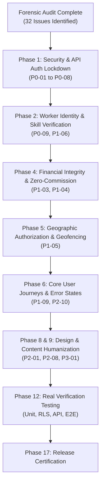

# KAAMSETU — PHASE 35 INITIAL REPOSITORY AUDIT
## Complete Forensic Inspection, Vulnerability Inventory & Functional Gap Analysis

**Date:** November 16, 2026  
**Auditor:** Principal Architecture, Security & Engineering Review Team  
**Repository:** `Mayyank04/kaamsetu`  
**Starting Commit:** `d2f4e2d` (`phase-34a-conditional-gate-closure` certified HEAD)  
**Branch:** `phase-35-remediation-and-product-transformation`  
**Parent Main:** `3dff23c314eaba0f2eb66785033eda928146c0f8` (Parked & Untouched)  

---

### Executive Overview

This initial forensic audit documents every architectural defect, security vulnerability, simulation artifact, broken endpoint, authorization bypass, and UX gap across the KAAMSETU codebase prior to Phase 35 execution.

A total of **32 specific issues** across 4 severity tiers were identified:
- **P0 (Critical Security, Financial or Data Integrity):** 9 issues
- **P1 (Major Broken Functionality or Integrity Gap):** 9 issues
- **P2 (Significant UX, Quality, Accessibility, or Maintainability):** 10 issues
- **P3 (Minor Documentation, Inconsistency, or Styling Issue):** 4 issues

---

### Comprehensive Findings Inventory

#### FINDING-P0-01: Unauthenticated Worker Payouts & Income Disclosure
- **File Path:** `src/app/api/worker/payouts/route.ts`
- **Exact Function:** `GET`, `POST`, `PATCH`
- **Description:** The route uses `createAdminClient()` for all database operations without calling any authentication or authorization functions (`requireAuthenticatedUser`, `requireWorker`, or `requireOwnedWorkerProfile`). In `GET`, any caller passing a `workerProfileId` query parameter can inspect private worker payout records and income timelines. In `POST`, any caller can create unverified payout confirmations. In `PATCH`, any caller can alter confirmation statuses and disputed amounts without being the worker or contractor.
- **Severity:** `P0`
- **Reproduction Method:** Send `GET /api/worker/payouts?workerProfileId=w-pro-01` without session cookies or authorization headers; returns full payout data with HTTP 200.
- **Required Correction:** Require session authentication; enforce that workers can only query and mutate their own profile (`requireOwnedWorkerProfile`), and contractors can only query payouts associated with their projects. Add schema validation for request bodies.
- **Verification Method:** Create automated authorization regression tests asserting HTTP 401 for anonymous calls and HTTP 403 for cross-worker access.

#### FINDING-P0-02: Unauthenticated Worker Grievance Access & Resolution
- **File Path:** `src/app/api/worker/grievance/route.ts`
- **Exact Function:** `GET`, `POST`, `PATCH`
- **Description:** The grievance route relies on `createAdminClient()` without session validation. Unauthenticated callers can list all private worker grievances, inspect confidential dispute evidence URLs, submit bogus grievances on behalf of arbitrary workers, or trigger `PATCH` to resolve disputes with client-supplied `reviewerId` values.
- **Severity:** `P0`
- **Reproduction Method:** Send `GET /api/worker/grievance?workerProfileId=w-pro-01` anonymously; returns grievances with HTTP 200. Send `PATCH` with arbitrary `reviewerId` and `resolutionStatus`; updates record without privilege check.
- **Required Correction:** Enforce `requireWorker()` and worker profile ownership for `GET` and `POST`. Require `requireAdmin()` or verified ombudsperson software role for `PATCH`.
- **Verification Method:** Automated negative tests for anonymous access and unauthorized grievance resolution attempts.

#### FINDING-P0-03: Unauthenticated Worker Consent Audit Log Exfiltration & Forgery
- **File Path:** `src/app/api/worker/consent-audit/route.ts`
- **Exact Function:** `GET`, `POST`
- **Description:** The route exposes worker consent history to unauthenticated callers via `createAdminClient()`. In `POST`, it accepts arbitrary `actorId` and `workerProfileId` in the request body, enabling forgery of DPDP consent compliance events.
- **Severity:** `P0`
- **Reproduction Method:** Send `GET /api/worker/consent-audit?workerProfileId=w-pro-01` without auth; returns complete consent event history.
- **Required Correction:** Enforce `requireOwnedWorkerProfile(workerProfileId)` on `GET`. In `POST`, derive `actorId` directly from the authenticated session.
- **Verification Method:** Test asserting HTTP 401/403 when unauthenticated or querying another worker's consent audit trail.

#### FINDING-P0-04: Unauthenticated Review Moderation & Retaliation Appeal Tampering
- **File Path:** `src/app/api/disputes/moderation/route.ts`
- **Exact Function:** `GET`, `POST`, `PATCH`
- **Description:** The moderation route allows unauthenticated users to view all appeals, submit arbitrary moderation appeals, and resolve appeals by supplying an arbitrary `moderatorId`.
- **Severity:** `P0`
- **Reproduction Method:** Send `PATCH /api/disputes/moderation` with `{ "appealId": "...", "moderatorId": "fake-admin", "newStatus": "approved" }`; updates DB without checking moderator credentials.
- **Required Correction:** Enforce `requireAdmin()` or authorized ombudsperson role for moderation `PATCH`. Restrict `GET` to authorized reviewers or the affected worker.
- **Verification Method:** Assert HTTP 403 when non-admin/non-moderator attempts appeal resolution.

#### FINDING-P0-05: Unauthenticated Evidence Registry Tampering
- **File Path:** `src/app/api/governance/evidence-registry/route.ts`
- **Exact Function:** `GET`, `POST`
- **Description:** The governance evidence registry route allows anonymous callers to query internal governance records and execute status transitions (`update_status`) without authorization checks.
- **Severity:** `P0`
- **Reproduction Method:** Send `POST /api/governance/evidence-registry` with `{ "action": "update_status", "claimId": "...", "targetStatus": "verified" }` anonymously.
- **Required Correction:** Enforce `requireAdmin()` on `POST` operations. Restrict internal evidence queries to authenticated governance personnel.
- **Verification Method:** Test HTTP 401/403 rejection on unauthenticated mutations.

#### FINDING-P0-06: Unauthenticated Financial Settlement Mutation & Pseudo-UTR Generation
- **File Path:** `src/app/api/governance/financial-settlement/route.ts`
- **Exact Function:** `GET`, `POST`
- **Description:** In `GET`, financial transaction data across wage and GST streams is exposed without authentication. In line 54, a pseudo-UTR (`UTR-${g.id.slice(0, 8).toUpperCase()}`) is fabricated instead of recording an authentic clearing reference. In `POST`, state transitions are accepted without checking administrative authorization.
- **Severity:** `P0`
- **Reproduction Method:** Inspect line 54 of route: `tx.merchantBankReference = 'UTR-' + g.id.slice(0, 8).toUpperCase()`. Call `GET /api/governance/financial-settlement` anonymously; returns financial records.
- **Required Correction:** Enforce `requireAdmin()`. Remove pseudo-UTR generation; store `null` when authentic bank UTR is not present.
- **Verification Method:** Automated test asserting zero pseudo-UTRs and HTTP 401 on unauthenticated access.

#### FINDING-P0-07: Unauthenticated Institutional Cohort Outcome Exfiltration
- **File Path:** `src/app/api/institution/cohorts/[id]/export/route.ts`
- **Exact Function:** `GET`
- **Description:** Cohort outcome export accepts any cohort ID in the path and delivers worker trainee outcomes in CSV or JSON without verifying whether the caller belongs to the institution that owns the cohort.
- **Severity:** `P0`
- **Reproduction Method:** Send `GET /api/institution/cohorts/cohort-01/export?format=csv` anonymously; downloads CSV file.
- **Required Correction:** Enforce `requireInstitution()` and verify that the authenticated institution owns the specified cohort. Sanitize CSV fields against formula injection.
- **Verification Method:** Assert HTTP 401 for anonymous calls and HTTP 403 for cross-institution requests.

#### FINDING-P0-08: Client-Supplied Authoritative Claims in Identity Export
- **File Path:** `src/app/api/v2/identity/export/route.ts`
- **Exact Function:** `POST`
- **Description:** Accepts client-supplied `kaamScore`, `completedProjectsCount`, `ratingAverage`, `credentials`, and `skills` directly from the request body without authenticating the user or reading authoritative records from the database.
- **Severity:** `P0`
- **Reproduction Method:** Send `POST /api/v2/identity/export` with `{ "kaamScore": 999, "completedProjectsCount": 1000, "ratingAverage": 5.0 }`; returns signed export dossier reflecting fabricated claims.
- **Required Correction:** Require session authentication. Disallow client-supplied scores, project counts, and credentials. Retrieve all authoritative metrics from the server database.
- **Verification Method:** Assert that client-supplied override values in the request body are ignored in favor of database-persisted values.

#### FINDING-P0-09: Unauthenticated & Unverified Onboarding Assumptions
- **File Path:** `src/app/api/worker/onboarding/save/route.ts`
- **Exact Function:** `POST`
- **Description:** 
  1. Lines 49-50 hardcode `hasVoiceAttestation: true` and `workerConfirmedVoice: true` in KaamScore calculation.
  2. Line 239 hardcodes `verification_type: "voice_attested"` for all confirmed skills.
  3. Line 258 hardcodes `nsqfLevel: 4` for all generated credentials.
  4. Lines 97, 159, 191 set `is_published: true` without explicit worker consent.
  5. Line 26 silently defaults any unrecognized location PIN code to `"781001"`.
- **Severity:** `P0`
- **Reproduction Method:** Submit an onboarding profile without voice recording and outside Assam; the returned record has `kaamScore` boosted for voice attestation, skills set to `voice_attested`, `nsqfLevel: 4`, and PIN defaulted to `781001`.
- **Required Correction:** Remove hardcoded voice attestation booleans; calculate score strictly on submitted evidence. Set initial skill status to `self_declared` unless verified. Do not assign NSQF level unless verified. Do not publish profile without explicit `isPublished: true` consent. Validate PIN code against permitted districts.
- **Verification Method:** Unit and integration tests verifying `self_declared` status, `nsqf_level: null`, and rejection of out-of-bounds locations.

---

#### FINDING-P1-01: CSV Formula Injection Vulnerability in Exports
- **File Path:** `src/lib/supabase/db/institutional-ops.ts` & `src/app/api/institution/cohorts/[id]/export/route.ts`
- **Exact Function:** `exportCohortOutcomeReport`
- **Description:** CSV export strings concatenate raw fields without escaping leading formula characters (`=`, `+`, `-`, `@`, `\t`, `\r`), exposing spreadsheet users to formula injection (CSV injection).
- **Severity:** `P1`
- **Reproduction Method:** Include a trainee or worker with name `=cmd|' /C calc'!A0` in cohort; export to CSV; field is exported bare.
- **Required Correction:** Implement CSV sanitization prefixing dangerous leading characters with a single quote (`'`).
- **Verification Method:** Test asserting CSV sanitization on adversarial input strings.

#### FINDING-P1-02: Missing PDF Export Implementation
- **File Path:** `src/app/api/v2/identity/export/route.ts`
- **Exact Function:** `GET` / `POST`
- **Description:** The system claims multi-format identity export (JSON, PDF, CSV), but PDF generation is missing.
- **Severity:** `P1`
- **Reproduction Method:** Inspect `src/app/api/v2/identity/export/route.ts`; only JSON is handled.
- **Required Correction:** Provide server-side printable HTML / PDF export representation for identity dossiers.
- **Verification Method:** Test verifying valid printable layout and JSON/CSV/PDF responses.

#### FINDING-P1-03: Missing Payout Idempotency Key Defense
- **File Path:** `src/app/api/worker/payouts/route.ts`
- **Exact Function:** `POST`
- **Description:** Payout creation does not validate idempotency keys, allowing rapid repeat requests to create duplicate payout confirmation records.
- **Severity:** `P1`
- **Reproduction Method:** Submit duplicate POST requests with identical payload; creates two records.
- **Required Correction:** Require and enforce idempotency key tracking on payout requests.
- **Verification Method:** Test asserting identical responses and zero duplicate rows on repeated requests.

#### FINDING-P1-04: Collapse of Multi-Stage Payout Lifecycle into Generic Status
- **File Path:** `src/app/api/worker/payouts/route.ts` & `src/lib/worker/worker-outcome-service.ts`
- **Exact Function:** `evaluatePayoutProvenance`
- **Description:** Payouts do not distinguish internal ledger credit, payment provider instruction, provider confirmation, and direct bank settlement.
- **Severity:** `P1`
- **Reproduction Method:** Payout confirmation statuses jump directly from `pending` to `confirmed` without clearing stage verification.
- **Required Correction:** Introduce a formal payout lifecycle: `ledger_credited` -> `provider_instructed` -> `provider_confirmed` -> `bank_settlement_unverified` (or `bank_settled` with authentic UTR).
- **Verification Method:** Automated test asserting strict state machine progression.

#### FINDING-P1-05: Missing Geographic Boundary Enforcement on Bookings
- **File Path:** `src/app/api/bookings/route.ts` & `src/app/api/customer/bookings/route.ts`
- **Exact Function:** `POST`
- **Description:** Booking creation routes do not validate whether booking coordinates or PIN codes fall strictly within authorized Class B districts (Guwahati Urban or Shillong Urban).
- **Severity:** `P1`
- **Reproduction Method:** Submit booking request with PIN code `700001` (Kolkata); booking is accepted if worker accepts.
- **Required Correction:** Add server-side geofencing validation rejecting bookings outside authorized operating districts.
- **Verification Method:** Test asserting HTTP 403 on booking creation outside permitted zones.

#### FINDING-P1-06: Inconsistent Credential Cryptographic Signing Suites
- **File Path:** `src/lib/crypto/credential-signer.ts` vs `src/lib/crypto/w3c-vc-ed25519-service.ts`
- **Exact Function:** `signCredentialPayload`
- **Description:** Onboarding save uses HMAC-SHA256 (`src/lib/crypto/credential-signer.ts`), while W3C credential verification uses Ed25519 signatures (`src/lib/crypto/w3c-vc-ed25519-service.ts`). This architectural split creates confusion and invalidates cryptographic parity.
- **Severity:** `P1`
- **Reproduction Method:** Credential signed during onboarding cannot be verified by `verifyW3CVerifiableCredential`.
- **Required Correction:** Unify credential issuance to produce authoritative Ed25519 W3C Verifiable Credentials.
- **Verification Method:** Issue credential and verify it cleanly with Ed25519 cryptographic suite.

#### FINDING-P1-07: Voice Recorder Lacks Resilient Error Recovery & Text Fallback
- **File Path:** `src/components/onboarding/audio-recorder.tsx`
- **Exact Function:** `AudioRecorder`
- **Description:** Audio recorder depends on browser `webkitSpeechRecognition`. On browsers without Web Speech API or when microphone permissions are denied, the UI fails to present a seamless manual text fallback and transcript review mechanism.
- **Severity:** `P1`
- **Reproduction Method:** Open in Firefox or deny mic access; error state does not offer clean inline text entry fallback.
- **Required Correction:** Provide explicit permission error handling, clear visual recording state, upload preview, and seamless text fallback.
- **Verification Method:** Component tests and simulated audio recorder fallback validation.

#### FINDING-P1-08: Self-Attesting Static Tests in Test Suites
- **File Path:** `test/phase-34a-gate-closure.test.ts`
- **Exact Function:** Tests 91, 92, 94, 95
- **Description:** Several tests define local variables like `const degreeFree = true; assert.strictEqual(degreeFree, true);` instead of validating live application code or database records.
- **Severity:** `P1`
- **Reproduction Method:** Inspect lines 686-713 in `test/phase-34a-gate-closure.test.ts`.
- **Required Correction:** Replace hardcoded constant assertions with real functional evaluations or relabel them clearly as static policy invariants.
- **Verification Method:** Execute updated test suite without dummy boolean assignments.

#### FINDING-P1-09: Unsafe Workplace Withdrawal Lacks Clear Frontend Journey
- **File Path:** `src/app/bookings/page.tsx` & `src/components/bookings/`
- **Exact Function:** Booking card controls
- **Description:** While database triggers and backend models support unsafe workplace withdrawal with zero penalty, the user-facing booking interface lacks an intuitive, accessible "Report Unsafe Site & Withdraw" action for active workers.
- **Severity:** `P1`
- **Reproduction Method:** Navigate to worker active booking; no prominent button exists for emergency withdrawal with zero-rating penalty.
- **Required Correction:** Implement prominent, accessible Unsafe Workplace Withdrawal control with instant confirmation and dispute logging.
- **Verification Method:** End-to-end user journey test for worker emergency withdrawal.

---

#### FINDING-P2-01: Exaggerated Sovereign & AI Buzzwords in Core Content
- **File Path:** `src/components/onboarding/sovereign-success-card.tsx`, `src/app/page.tsx`
- **Exact Function:** Card titles, hero headings
- **Description:** User-facing interfaces feature terminology such as "Mint your sovereign identity", "Sovereign privacy switch", "Cryptographic sovereign vault" which creates confusion for low-literacy artisans.
- **Severity:** `P2`
- **Reproduction Method:** Review landing page and onboarding success card.
- **Required Correction:** Rewrite all user-facing copy to adopt human-centered, clear positioning: "Your work. Your reputation. Your opportunities.", "Create your skill profile", "Your profile visibility".
- **Verification Method:** Text inspection across all worker-facing screens.

#### FINDING-P2-02: Missing Screen-Reader Labels & ARIA Announcements in Dialogs
- **File Path:** `src/components/identity/credential-dialog.tsx`, `src/components/profile/qr-dialog.tsx`
- **Exact Function:** Modal dialog triggers & contents
- **Description:** Dialogs lack explicit `aria-describedby` associations, accessible focus containment, and screen-reader announcements on state changes.
- **Severity:** `P2`
- **Reproduction Method:** Inspect accessibility tree in DevTools; missing descriptive ARIA labels on close buttons and QR viewer.
- **Required Correction:** Add ARIA labels, semantic roles, and focus traps.
- **Verification Method:** Run automated accessibility audit targeting WCAG 2.2 AA.

#### FINDING-P2-03: Inadequate Empty States on Earnings & Dispute Dashboards
- **File Path:** `src/app/dashboard/page.tsx`
- **Exact Function:** Dashboard overview tabs
- **Description:** When a worker has zero bookings, zero payouts, or zero active disputes, components display empty card shells or blank sections without encouraging action steps.
- **Severity:** `P2`
- **Reproduction Method:** Log in as new worker; dashboard tabs show blank boxes without clear guidance.
- **Required Correction:** Implement rich, friendly empty states with clear calls to action.
- **Verification Method:** Visual inspection of zero-state worker dashboard.

#### FINDING-P2-04: Missing Low-Literacy Audio Guidance Controls in Worker Profile
- **File Path:** `src/app/worker/[slug]/page.tsx`
- **Exact Function:** Profile view
- **Description:** Public and authenticated worker profile pages lack one-click audio readout for artisans who need voice assistance to verify their recorded skills and reviews.
- **Severity:** `P2`
- **Reproduction Method:** View profile on mobile; no listen / audio preview option exists.
- **Required Correction:** Add audio listen buttons using speech synthesis for skill summaries and bio.
- **Verification Method:** Test speech synthesis audio trigger.

#### FINDING-P2-05: Raw Unescaped Image Tags Causing Next.js LCP Warnings
- **File Path:** `src/app/login/page.tsx`, `src/app/verify/[registryId]/page.tsx`, `src/components/identity/credential-dialog.tsx`
- **Exact Function:** Raw `` elements
- **Description:** Multiple pages use unoptimized HTML `` elements rather than Next.js `<Image />` or styled SVG icons, causing build-time warnings and potential LCP layout shifts.
- **Severity:** `P2`
- **Reproduction Method:** Run `npm run build`; linter produces 6+ warnings regarding ``.
- **Required Correction:** Replace unoptimized `` elements with accessible Next.js Image components or inline SVGs.
- **Verification Method:** Clean build output with zero ESLint `` warnings.

#### FINDING-P2-06: React Hook Missing Dependency Warnings
- **File Path:** `src/components/onboarding/audio-recorder.tsx`
- **Exact Function:** `useEffect` around line 141
- **Description:** `bcp47Map` and `onChangeTranscript` are missing from the `useEffect` dependency array.
- **Severity:** `P2`
- **Reproduction Method:** Run `npm run build`; produces warning `react-hooks/exhaustive-deps`.
- **Required Correction:** Wrap callbacks in `useCallback` or stabilize dependencies.
- **Verification Method:** Build passes with zero React Hook dependency warnings.

#### FINDING-P2-07: Unexplained KAAMSCORE Breakdown
- **File Path:** `src/components/profile/kaamscore-badge.tsx`
- **Exact Function:** Score presentation
- **Description:** Displays numeric score without clear, plain-language breakdown of what factors contribute to the score and how a new worker can improve it.
- **Severity:** `P2`
- **Reproduction Method:** Click on score badge; only shows tier name without transparent dimensional breakdown.
- **Required Correction:** Add interactive or modal explanation showing experience, verified work, peer confirmations, and safety compliance.
- **Verification Method:** UI test confirming explanation modal renders.

#### FINDING-P2-08: Inconsistent Palette Usage Across Dashboards
- **File Path:** `src/app/contractor/dashboard/page.tsx` vs `src/app/institution/dashboard/page.tsx`
- **Exact Function:** Metric card styling
- **Description:** Contractor dashboard uses high-contrast dark indigo and violet accents, while institution dashboard uses neutral emerald and slate, creating an inconsistent brand feel.
- **Severity:** `P2`
- **Reproduction Method:** Compare dashboards side by side.
- **Required Correction:** Unify design tokens to the editorial brand palette: deep forest green (`#1E3A2F`), warm sand, and editorial ivory.
- **Verification Method:** Visual regression review.

#### FINDING-P2-09: Institutional Export Lacks Date Range & Cohort Filter UI
- **File Path:** `src/app/institution/dashboard/page.tsx`
- **Exact Function:** Cohort table
- **Description:** Export buttons trigger immediate download of all records without date range selection or privacy confirmation.
- **Severity:** `P2`
- **Reproduction Method:** Click export on institution dashboard; immediate file trigger with no parameter selection.
- **Required Correction:** Add export modal with format selection (JSON/CSV), date range filters, and DPDP consent confirmation.
- **Verification Method:** Component interaction test.

#### FINDING-P2-10: Incomplete Customer Cancellation / Refund Flow
- **File Path:** `src/app/customer/bookings/page.tsx`
- **Exact Function:** Booking actions
- **Description:** Customers can view bookings, but cannot cancel an in-progress or requested booking through the UI.
- **Severity:** `P2`
- **Reproduction Method:** View customer bookings; no cancellation trigger exists on requested bookings.
- **Required Correction:** Add cancellation workflow with reason selection and instant status update.
- **Verification Method:** Test booking lifecycle transition to `cancelled`.

---

#### FINDING-P3-01: Outdated Marketing Claims in README.md
- **File Path:** `README.md`
- **Exact Function:** Overview & architecture sections
- **Description:** Documentation references obsolete milestone phases and early prototype architectures.
- **Severity:** `P3`
- **Reproduction Method:** Read `README.md`.
- **Required Correction:** Rebuild `README.md` to reflect the true Phase 35 product implementation, verified features, architecture, and running instructions.
- **Verification Method:** Document review.

#### FINDING-P3-02: Missing Environment Variable Documentation for Security Services
- **File Path:** `.env.example`
- **Exact Function:** Environment template
- **Description:** `.env.example` does not comprehensively document optional vs mandatory variables for cryptographic services and banking mock sandboxes.
- **Severity:** `P3`
- **Reproduction Method:** Inspect `.env.example`.
- **Required Correction:** Update `.env.example` with detailed annotations and zero real secrets.
- **Verification Method:** Validation against startup configuration checks.

#### FINDING-P3-03: Inconsistent Spacing in Mobile Navigation Header
- **File Path:** `src/components/layout/institutional-header.tsx`
- **Exact Function:** Mobile navigation drawer
- **Description:** Padding on mobile navigation drawer causes touch targets to be slightly condensed on small screens (<360px).
- **Severity:** `P3`
- **Reproduction Method:** Emulate screen width 320px in browser.
- **Required Correction:** Standardize touch target minimums to 44px $\times$ 44px.
- **Verification Method:** Mobile responsive viewport inspection.

#### FINDING-P3-04: Obsolete Legacy Phase Test Scripts in package.json
- **File Path:** `package.json`
- **Exact Function:** `scripts` object
- **Description:** `package.json` contains over 30 test scripts from historical phases. While preserving backward compatibility, a clean unified test runner is needed for Phase 35.
- **Severity:** `P3`
- **Reproduction Method:** Review `package.json` scripts.
- **Required Correction:** Add `test:phase35` and `test:security` unified runners.
- **Verification Method:** Run `npm run test:phase35`.

---

### Remediation Action Plan

This audit establishes the baseline for all Phase 35 engineering transformations.
