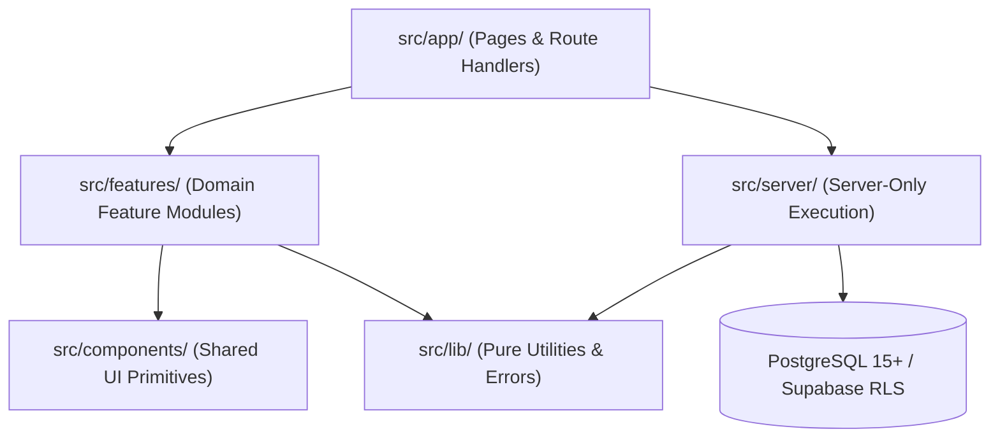

# KAAMSETU — PHASE 37 TARGET ARCHITECTURE
## Scalable Modular Monolith Specification & Migration Architecture

**Programme:** KAAMSETU Digital Identity & Worker Empowerment Platform  
**Workstream:** Phase 37 — Architecture Modernization & Technical Debt Elimination  
**Document Reference:** `docs/phase-37/TARGET_ARCHITECTURE.md`  
**Date:** 16 November 2026  

---

## 1. Architectural Vision

KAAMSETU operates as a **Domain-Driven Modular Monolith** implemented on Next.js 15+ and PostgreSQL 15+. 

Instead of an arbitrary distribution of files across horizontal buckets or an overly complex distributed microservices architecture, the codebase is structured around business domains that reflect actual user and stakeholder interactions:
- **Artisans & Informal Workers:** Vernacular onboarding, sovereign skill credentials, work history, booking requests.
- **Commercial Contractors:** Organization profiles, crew rosters, project crew assignments, subscription billing.
- **Vocational Institutions:** Trainee cohorts, credential issuance, granular consent telemetry.
- **Customers & Clients:** Artisan discovery, direct bookings, OTP-verified reviews, direct settlement.
- **Governance & Trust:** Audit hash chaining, W3C verifiable credentials, Ed25519 signatures, zero-commission verification.

---

## 2. Directory Layout & Module Boundaries



### 2.1 The `src/server/` Layer (Server-Only Execution)
Dedicated strictly to backend operations. Client components (`"use client"`) are forbidden from importing from `src/server/`:
- `src/server/configuration/`: Server-only environment validation, startup invariant enforcement (`environment.ts`).
- `src/server/auth/`: Server-side session validation, cookie parsing, RBAC guards (`session.ts`, `guards.ts`).
- `src/server/database/`: Typed repositories wrapping Supabase/PostgreSQL queries with strict RLS enforcement (`repositories/`).
- `src/server/services/`: Pure business logic services coordinating domain rules, state machines, and cryptographic operations (`services/`).
- `src/server/security/`: Privacy-preserving rate limiting, HMAC validation, key rotation (`rate-limiter.ts`, `key-rotation.ts`).
- `src/server/logging/`: Privacy-preserving logger with request correlation IDs and sensitive data redaction (`logger.ts`).

### 2.2 The `src/features/` Layer (Domain Feature Modules)
Organized by business domain, co-locating components, hooks, actions, and presentation logic:
- `src/features/authentication/`: Phone OTP verification, persona switcher, session state.
- `src/features/onboarding/`: 4-step voice onboarding, audio recorder, Gemini skill extraction editor, draft state.
- `src/features/worker-identity/`: Sovereign skill card, public profile showcase, work history, service catalogue.
- `src/features/contractors/`: Enterprise crew roster, project allocations, subscription plans, GST invoicing.
- `src/features/institutions/`: Cohort dossiers, trainee progress monitoring, credential issuance.
- `src/features/bookings/`: Direct artisan booking dialog, status progression, counterparty OTP review.
- `src/features/credentials/`: Ed25519 signature generator, W3C JSON-LD serialization, offline QR verifier.

### 2.3 The `src/lib/` Layer (Pure Utilities & Shared Cross-Cutting Libraries)
Isomorphic, framework-agnostic code safely callable from both client and server:
- `src/lib/errors/`: Centralized typed error hierarchy (`app-error.ts`, `api-response.ts`, `error-handler.ts`).
- `src/lib/utilities/`: Phone normalization, currency formatting, cryptographic hashes, string helpers.
- `src/lib/constants/`: Trade taxonomies, Class B rollout boundaries, invariant constants.

---

## 3. Standardized Error & Response Contracts

### 3.1 Typed Error Hierarchy
All operational failures throw typed descendants of `AppError`:
```typescript
export class AppError extends Error {
  constructor(
    message: string,
    public readonly statusCode = 500,
    public readonly code = "INTERNAL_SERVER_ERROR",
    public readonly details?: unknown,
    public readonly isOperational = true
  ) {
    super(message);
    this.name = this.constructor.name;
    Error.captureStackTrace(this, this.constructor);
  }
}
```

Specialized errors:
- `ValidationError` (400)
- `AuthenticationError` (401)
- `AuthorizationError` (403)
- `NotFoundError` (404)
- `ConflictError` (409)
- `RateLimitError` (429)
- `ExternalServiceError` (502)
- `DatabaseError` (500)
- `ConfigurationError` (500)

### 3.2 Unified API Response Envelope (`ApiResponse<T>`)
Every API endpoint returns a standardized JSON envelope:
```typescript
export type ApiResponse<T> =
  | {
      success: true;
      data: T;
      meta?: {
        page?: number;
        pageSize?: number;
        total?: number;
        requestId?: string;
        timestamp: string;
      };
    }
  | {
      success: false;
      error: {
        code: string;
        message: string;
        requestId?: string;
        details?: unknown;
        timestamp: string;
      };
    };
```

---

## 4. Controlled Refactoring Plan

Refactoring will execute sequentially across 6 implementation stages:
1. **Error Handling & Environment Configuration:** Establish `src/lib/errors/`, `src/lib/utilities/phone.ts`, and `src/server/configuration/environment.ts`.
2. **Core Domain Services & Repositories:** Extract `WorkerIdentityService`, `OnboardingService`, `BookingService`, `ContractorService`, `InstitutionService` into `src/server/services/`.
3. **API Standardization:** Refactor high-traffic endpoints (`/api/auth/*`, `/api/worker/onboarding/*`, `/api/bookings/*`, `/api/contractor/*`) to consume the standardized service layer and error envelopes.
4. **UI Feature Extraction:** Co-locate complex components into `src/features/` while maintaining existing component re-export bridges for full backward compatibility.
5. **Dead Code Elimination & Cleanup:** Document and clean up unused legacy imports.
6. **Automated Verification:** Comprehensive tests in `test/phase-37-architecture-modernization.test.ts` ensuring 100% invariant preservation.
