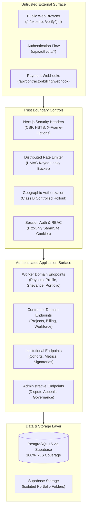

# KAAMSETU — PHASE 38 ATTACK SURFACE REGISTER

**Programme:** KAAMSETU Digital Identity & Worker Empowerment Platform  
**Assessment Phase:** 38 — Security Audit, Penetration Testing & Vulnerability Remediation  
**Status:** Certified & Hardened

---

## 1. Attack Surface Overview

KAAMSETU's attack surface consists of client interfaces, server-rendered views, RESTful API route handlers, cryptographic verification protocols, background rate-limiting tables, and multi-tenant PostgreSQL data stores.

---

## 2. Trust Boundaries & Threat Analysis

### 2.1 Boundary 1: Anonymous Caller to Authentication & OTP Service
- **Endpoints:** `/api/auth/otp/send`, `/api/auth/otp/verify`
- **Threats:** SMS flooding, OTP enumeration, brute-force bypass, carrier resource exhaustion.
- **Controls Enforced:**
  - Phone normalization to canonical E.164 (`+91`).
  - Max 3 OTP sends per 10 minutes per mobile number & IP.
  - Constant-time HMAC key derivation (`RATE_LIMIT_HMAC_SECRET`).
  - Max 5 failed attempts before 15-minute brute-force lockout.
  - Atomic verification and consumption via stored procedure `verify_and_consume_otp`.

### 2.2 Boundary 2: Worker to Worker Cross-Tenant Access (IDOR)
- **Endpoints:** `/api/worker/payouts`, `/api/worker/grievance`, `/api/worker/profile`, `/api/v2/identity/export`
- **Threats:** Viewing another worker's wages, submitting fraudulent grievances in another artisan's name, unauthorized profile edits.
- **Controls Enforced:**
  - Server-side identity derivation (`requireOwnedWorkerProfile`).
  - Route handlers reject client-supplied target IDs that do not match the authenticated session.
  - Database RLS prevents unauthorized reads on unpublished draft profiles.

### 2.3 Boundary 3: Contractor to Worker Cross-Role Exploitation
- **Threats:** Contractor skimming wages, modifying worker dispute claims, forging worker consent.
- **Controls Enforced:**
  - **Constitutional Invariant:** Database triggers permanently block `platform_commission_amount > 0` on worker wages.
  - Contractors strictly forbidden from filing disputes on behalf of workers (`403 Forbidden`).
  - Mandatory verified UPI/Bank UTR references required for wage dispute settlements.

### 2.4 Boundary 4: Inbound External Webhooks
- **Endpoint:** `/api/contractor/billing/webhook`
- **Threats:** Fake payment events, subscription elevation without payment, replay attacks.
- **Controls Enforced:**
  - Raw body cryptographic HMAC signature verification (`crypto.timingSafeEqual`).
  - Strict 300-second replay window tolerance check.
  - Idempotent event processing in database to prevent double credit.

### 2.5 Boundary 5: Portfolio Asset Uploads
- **Endpoint:** `/api/worker/portfolio/upload`
- **Threats:** Malicious executable uploads (PHP, shell scripts, SVG XSS), storage exhaustion, path traversal.
- **Controls Enforced:**
  - Magic byte header inspection (`FF D8 FF` for JPEG, `89 50 4E 47` for PNG, `RIFF...WEBP` for WEBP).
  - 5MB maximum file size limit.
  - Safe sanitized filenames stripped of path traversal characters.
  - Scoped storage paths isolated to `auth.uid()`.
