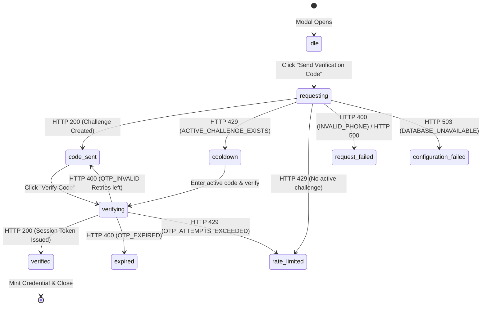

# KAAMSETU — PHASE 39.3 AUTHENTICATION ERROR CATALOG & CONTRACT
## Typed Error Codes, HTTP Status Mappings & User-Facing Actionable Guidance

**Date:** 17 November 2026  
**Document:** `docs/phase-39-3/AUTH_ERROR_CONTRACT.md`  
**Contract Location:** `src/lib/auth/auth-error-codes.ts`  

---

## 1. The Standard 10 Authentication Error Catalog

KAAMSETU enforces a strict, typed error contract for all authentication, OTP challenges, and session operations. Every failure response returns a structured payload with a machine-readable `code` and an empathetic, actionable `userMessage`.

| Code | HTTP Status | Meaning | Actionable User Guidance |
|------|-------------|---------|--------------------------|
| `INVALID_PHONE` | 400 Bad Request | Phone number fails Indian mobile criteria (not 10 digits starting with 6, 7, 8, or 9) | "Enter a valid 10-digit Indian mobile number beginning with 6, 7, 8 or 9." |
| `RATE_LIMITED` | 429 Too Many Requests | User has exceeded maximum send frequency (60s cooldown or hourly limit) | "You can request another code in {seconds} seconds." |
| `ACTIVE_CHALLENGE_EXISTS` | 429 Too Many Requests | Challenge already exists and is active; client should enter code or wait | "You have an active verification code. You can enter it now or wait {seconds}s to resend." |
| `OTP_EXPIRED` | 400 Bad Request | Verification challenge exceeded its 5-minute validity window | "Verification code has expired. Please request a new code." |
| `OTP_INVALID` | 400 Bad Request | Code mismatch, malformed code, or already consumed | "Invalid verification code. Please check the code and try again." |
| `OTP_ATTEMPTS_EXCEEDED` | 429 Too Many Requests | More than 5 consecutive incorrect attempts; challenge invalidated | "Maximum verification attempts exceeded. Please request a new code." |
| `AUTH_CONFIGURATION_ERROR` | 500 Internal Error | Cryptographic signing secret missing or malformed | "Verification service is momentarily unavailable. Please retry shortly." |
| `DATABASE_UNAVAILABLE` | 503 Service Unavailable | Remote PostgreSQL / PostgREST schema cache unreachable | "Verification is temporarily unavailable. Your profile draft has been saved. Please try again later." |
| `OTP_CHALLENGE_CREATION_FAILED`| 500 Internal Error | Challenge persistence failure | "Unable to send verification code. Please try again shortly." |
| `INTERNAL_SERVER_ERROR` | 500 Internal Error | Unhandled server exception | "We're temporarily unable to process this request. Please try again shortly." |

---

## 2. Modal State Machine Alignment

The client-side authentication modal transitions through 10 deterministic states:

---

## 3. Preserving User Drafts on Any Error State

Regardless of whether an error is `INVALID_PHONE` (400), `RATE_LIMITED` (429), or `DATABASE_UNAVAILABLE` (503):
- The complete worker onboarding profile draft in `localStorage` is preserved untouched.
- Closing and reopening the modal does not discard entered data.
- The user can fix input errors or wait out cooldowns without losing their craft declaration.
