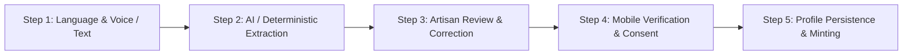

# KAAMSETU — PHASE 39.5 ONBOARDING PERSISTENCE AUDIT

**Route:** `/onboarding` (`src/components/onboarding/onboarding-wizard.tsx`)  
**Backend:** `/api/worker/onboarding/save`, `/api/worker/onboarding/extract`  
**Status:** VERIFIED LOCALLY

---

## 1. Onboarding Pipeline

## 2. Invariants & Governance

1. **Manual Entry Independent:**
   If voice recording or Gemini API extraction is unavailable, manual text entry is fully functional without error.
2. **Draft Survival:**
   `localStorage` draft key `kaamsetu_worker_onboarding_draft` preserves worker progress across reloads and authentication modal flows.
3. **Server Session Derivation:**
   Profile ownership is derived authoritatively from `kaamsetu_session` cookie; client-supplied user IDs are rejected.
4. **Controlled Rollout Boundaries:**
   Location validation enforces approved Class B boundaries:
   - Guwahati Urban (`781001–781039`)
   - Shillong Urban (`793001–793022`)
   Locations outside these boundaries are tagged with Controlled Rollout guidance.
5. **Worker Confirmation Required:**
   No self-declared claim is published without explicit worker confirmation.
