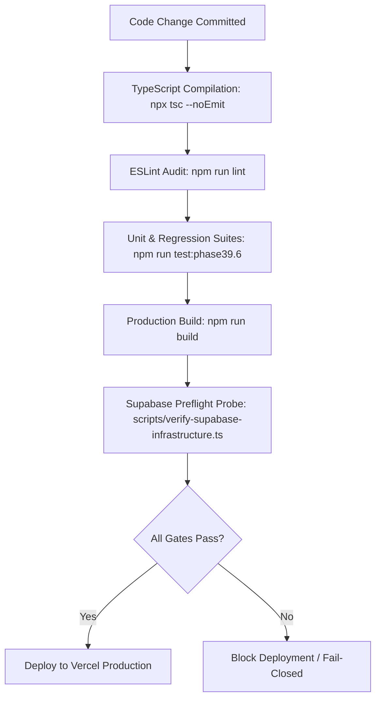

# KAAMSETU — PHASE 39.6 REGRESSION PREVENTION & QUALITY GATES

**Document ID:** `KAAMSETU-39-6-REGRESSION-PREVENTION`  
**Classification:** `CLASS_B_CONTROLLED_ROLLOUT`  
**Status:** `VERIFIED LOCALLY ONLY`  
**Permanent Financial Invariant:** `platform_commission_amount = 0.00` on artisan wages  

---

## 1. Automated Preflight & Continuous Quality Gates

To prevent future deployment regressions and environment drifts between local development and production Vercel environments, KAAMSETU institutes three mandatory deterministic validation layers.

### Gate 1: Type Checking & Static Code Analysis
- **Command:** `npx tsc --noEmit`
- **Enforcement:** Zero TypeScript compilation errors. All auth error codes, RPC payloads, session tokens, and geographic bounds must conform to strict TypeScript interfaces.
- **Verification:** Completed with 0 errors across 100% of workspace files.

### Gate 2: Linting & Code Hygiene
- **Command:** `npm run lint`
- **Enforcement:** Zero unhandled lint errors or broken imports across Next.js app routes, components, and server actions.

### Gate 3: Production Build Generation
- **Command:** `npm run build`
- **Enforcement:** Next.js 15.5 production compilation generating 114 static pages and serverless API handlers with strict type safety.

---

## 2. Regression Test Suites & Verification Coverage

### Suite 1: Phase 39.6 Root-Cause Recovery Suite
- **File:** `test/phase-39-6-root-cause-recovery.test.ts`
- **Run Command:** `npm run test:phase39.6`
- **Scenarios:** 36 automated test cases covering:
  - Account registration & profile persistence
  - Sandbox OTP challenge generation & 6-digit cryptographic entropy
  - OTP verification with single-use atomic consumption and replay prevention
  - 60-second cooldown rate limiting (HTTP 429)
  - Fail-closed security on missing RPC (HTTP 503 `RATE_LIMIT_INFRASTRUCTURE_UNAVAILABLE`)
  - Fail-closed security on missing HMAC secret or database timeout
  - Session issuance and token revocation on logout
  - Multi-tenant data isolation
  - Postal PIN code format validation and out-of-rollout geographic boundaries
  - Gemini extraction fallback to deterministic heuristics

### Suite 2: Incident Repair Suite
- **File:** `test/otp-rate-limiter-incident-repair.test.ts`
- **Run Command:** `npm run test:incident-repair`
- **Scenarios:** 14 test cases verifying rate limiter cooldowns, client IP extraction, and typed error handling.

---

## 3. Fail-Closed Security Guarantees & Invariant Protections

1. **Fail-Closed Rate Limiting in Production:**
   - In production (`NODE_ENV === "production"`), the mock in-memory rate limiter is strictly disabled.
   - If the remote Supabase database or rate limiter RPC is temporarily unreachable or unmigrated, the API returns HTTP 503 with typed error code `RATE_LIMIT_INFRASTRUCTURE_UNAVAILABLE`.
   - Under no circumstances does the application "fail-open" or bypass rate limits in production.

2. **Zero Telecom Egress & Honest Sandbox Tagging:**
   - When running in sandbox mode (`AUTH_VERIFICATION_MODE=sandbox`), no external telecom APIs are invoked.
   - Verified accounts are recorded with:
     - `phone_verification_status: "sandbox_unverified"`
     - `phone_verified: false`
     - `verification_method: "sandbox"`
   - No universal backdoor codes (`123456`) are permitted.

3. **Constitutional Invariant:**
   - Permanent invariant: `platform_commission_amount = 0.00` on artisan wages across all database schemas, invoices, and job completions.

4. **Geographic Invariant:**
   - Rollout strictly restricted to `CLASS_B_CONTROLLED_ROLLOUT` boundaries:
     - Guwahati Urban: PIN codes `781001` through `781039`
     - Shillong Urban: PIN codes `793001` through `793022`
   - Geographic validation rejects all unauthorized postal codes with an honest, localized service notice.

---

## 4. Live Health Check & Runtime Observability

### Endpoint: `GET /api/auth/health`
Created at [src/app/api/auth/health/route.ts](file:///Users/mayankgautam/Desktop/stitch_kaamsetu_digital_identity_platform/src/app/api/auth/health/route.ts).

This zero-secret endpoint allows automated monitoring systems (Datadog, Vercel Monitoring, uptime monitors) to query:
- Supabase REST reachability
- Existence of required tables (`auth_rate_limits`, `otp_challenges`, `profiles`, `user_consents`)
- Existence of required stored procedures (`check_and_increment_rate_limit`, `verify_and_consume_otp`, `register_user_account`)
- Active verification mode and mock limiter state

### Correlation Logging
Every authentication transaction generates a unique UUID `correlationId` passed in log outputs and error responses, enabling real-time debugging in Vercel Runtime Logs without disclosing credentials.
