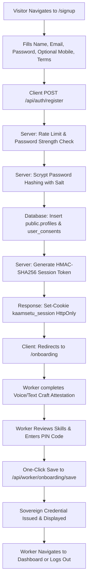

# KAAMSETU — PHASE 39.7: ACCOUNT CREATION ARCHITECTURE

**Document ID:** `KAAMSETU-39-7-ACCOUNT-ARCHITECTURE`  
**Classification:** `CLASS_B_CONTROLLED_ROLLOUT`  
**Status:** `VERIFIED LOCALLY`  
**Permanent Financial Invariant:** `platform_commission_amount = 0.00` on artisan wages  

---

## 1. End-to-End Account & Lifecycle Flow



---

## 2. API Endpoint Specifications

### 2.1 Direct Registration: `POST /api/auth/register`

- **Ingress Route:** `/api/auth/register`
- **Method:** `POST`
- **Rate Limit:** 10 registrations per IP per hour.
- **Request Headers:** `Content-Type: application/json`

#### Request Payload:
```json
{
  "fullName": "Ramesh Sharma",
  "email": "ramesh.sharma@example.com",
  "password": "StrongPassword123!",
  "confirmPassword": "StrongPassword123!",
  "phone": "9876543210",
  "role": "worker",
  "termsAccepted": true,
  "privacyAccepted": true,
  "termsVersion": "2026.1",
  "privacyVersion": "2026.1"
}
```

#### Success Response (`201 Created`):
```json
{
  "success": true,
  "message": "Account created successfully.",
  "user": {
    "id": "e8d6480b-6a95-46eb-8e50-98fc1a896d8e",
    "email": "ramesh.sharma@example.com",
    "fullName": "Ramesh Sharma",
    "role": "worker",
    "phone": "9876543210",
    "phoneVerified": false,
    "phoneVerificationStatus": "not_verified"
  },
  "redirectUrl": "/onboarding"
}
```
**Set-Cookie Header:**
```
kaamsetu_session=<base64url_json>.<hmac_signature>; Path=/; Max-Age=1209600; HttpOnly; SameSite=Lax; Secure
```

---

### 2.2 Direct Login: `POST /api/auth/login`

- **Ingress Route:** `/api/auth/login`
- **Method:** `POST`
- **Rate Limit:** 5 attempts per identifier/IP per 15-minute window; 15-minute block upon exhaustion.

#### Request Payload:
```json
{
  "identifier": "ramesh.sharma@example.com",
  "password": "StrongPassword123!"
}
```

#### Success Response (`200 OK`):
```json
{
  "success": true,
  "message": "Signed in successfully.",
  "user": {
    "id": "e8d6480b-6a95-46eb-8e50-98fc1a896d8e",
    "email": "ramesh.sharma@example.com",
    "fullName": "Ramesh Sharma",
    "role": "worker",
    "phone": "9876543210",
    "phoneVerified": false,
    "phoneVerificationStatus": "not_verified"
  },
  "redirectUrl": "/onboarding"
}
```

---

## 3. Account Schema Invariants & Column Constraints

All newly registered user profiles conform strictly to these authoritative default states:

| Attribute | Type | Default Value | Guarantee |
|---|---|---|---|
| `account_status` | `TEXT` | `'active'` | Account is immediately usable without telecom lockouts. |
| `phone_verified` | `BOOLEAN` | `false` | Never falsely asserts real-world phone ownership. |
| `phone_verification_status` | `TEXT` | `'not_verified'` | Truthful state visible across administrative and audit logs. |
| `verification_method` | `TEXT` | `'none'` | Explicit indicator that no telecom or sandbox SMS occurred. |
| `email` | `TEXT` | User-provided | Case-insensitively unique (`idx_profiles_email_lower`). |
| `password_hash` | `TEXT` | `scrypt` derived | Memory-hard 512-bit key; plaintext never stored. |
| `password_salt` | `TEXT` | 16-byte random | Unique cryptographic salt per registered identity. |
