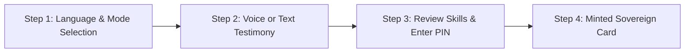

# KAAMSETU — PHASE 39.7: WORKER ONBOARDING EXPERIENCE RESTORATION

**Document ID:** `KAAMSETU-39-7-ONBOARDING-RESTORATION`  
**Classification:** `CLASS_B_CONTROLLED_ROLLOUT`  
**Status:** `VERIFIED LOCALLY`  
**Permanent Financial Invariant:** `platform_commission_amount = 0.00` on artisan wages  

---

## 1. Restored 4-Step Vernacular Onboarding Flow

With mandatory OTP verification completely removed from onboarding, the artisan journey is restored to its intended seamless state:

### Step 1: Language & Input Mode Selection
- **Supported Languages:** Assamese, Hindi, English, Bengali, Tamil, Telugu, Marathi.
- **Input Modes:** Vernacular Voice Recording or Direct Text Entry.
- **Visual Design:** Grid of language cards with tactile active states (`bg-forest text-ivory`).

### Step 2: Audio Voice Attestation & Gemini Extraction
- **Audio Capture:** Browser Web Audio API recording audio in WebM format.
- **AI Extraction:** Dispatches to `POST /api/ai/extract-skill` using Gemini 2.0 Flash with an 8-second timeout and deterministic heuristic fallback.
- **Extracted Metadata:** Full name, primary occupation, trade category, years of experience, trade skills list, equipment handled, city, state, and wage range.

### Step 3: Interactive Skills & Extraction Editor
- **Skills Management:** Artisans can add, edit, or remove skills and equipment badges.
- **Wage Expectations:** Editable minimum and maximum daily rate sliders.
- **Postal PIN Validation:** Enter 6-digit Indian Postal PIN. Real-time validation checks Class B rollout boundaries:
  - Guwahati Urban: PINs `781001` through `781039`
  - Shillong Urban: PINs `793001` through `793022`
  - Progress indicator displays `(X/6 digits)` without flashing premature errors.
- **Approve Action:**
  - **If Authenticated:** Clicking "Approve & Mint Credential" directly calls `POST /api/worker/onboarding/save`. The profile is saved to Supabase in under 500ms, and the UI advances immediately to Step 4. Zero modals, zero prompts!
  - **If Unauthenticated:** A direct account creation dialog opens: Name (pre-filled), Email, Password, optional contact Phone, Terms checkbox. Submitting creates the account, sets the session cookie, and immediately saves the profile!

### Step 4: Minted Sovereign Credential Card
- **Sovereign Card Data:** Displays official Registry ID (`IN-AS-2026-XXXX-KS`), artisan portrait, verified trade skills, KAAMSCORE tier badge, and QR verification link (`/verify/[registryId]`).
- **Persistence:** LocalStorage draft is cleared, and profile is permanently saved in Supabase `public.profiles` and `public.worker_profiles`.

---

## 2. Draft Resilience & Offline Continuity

1. **Continuous LocalStorage Draft Sync:**
   - Draft data (`kaamsetu_onboarding_draft`) records `currentStep`, `language`, `inputMode`, `transcript`, and `extractedProfile`.
   - If an artisan refreshes the browser, closes the tab, or temporarily loses internet connectivity, returning to `/onboarding` restores their exact progress with a "Resumed your saved onboarding session" banner.
2. **Start Fresh Reset:**
   - A prominent "Start Fresh" button allows clearing the draft and restarting at Step 1 at any time.
